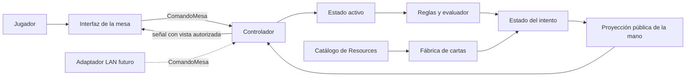
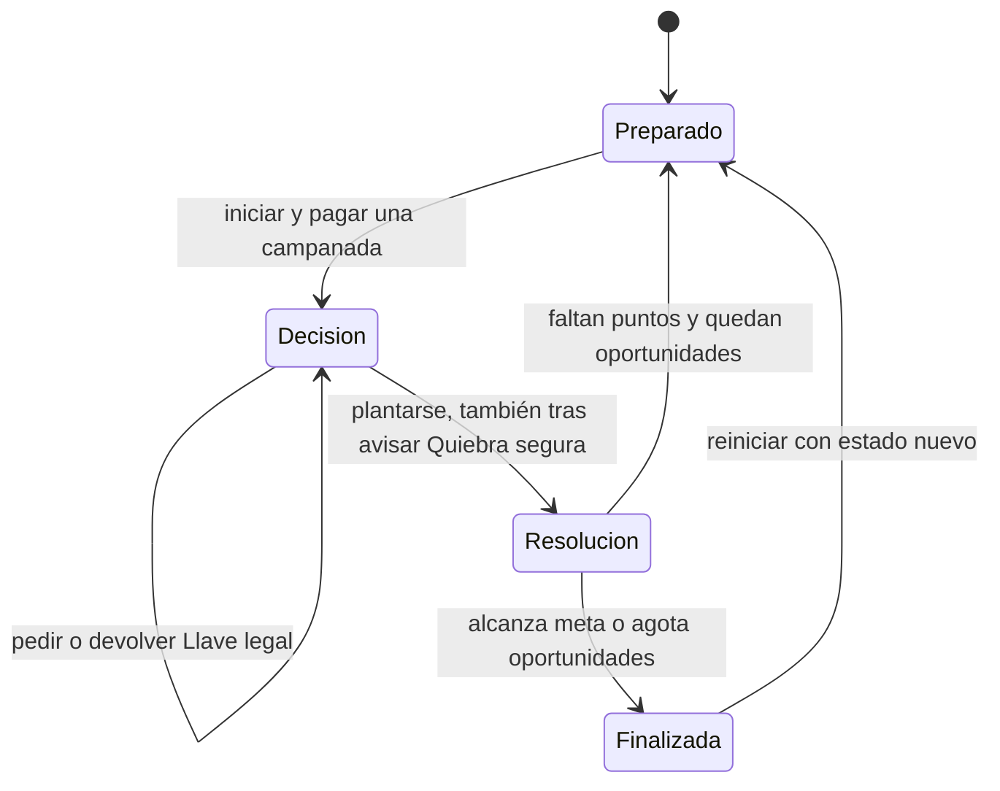

# Arquitectura y patrones de La Última Mesa

Estas decisiones guían la implementación en **Godot 4.7.2 con GDScript**, conforme al diseño v2.4 y los tres PDF del curso. La campaña aplica State, Command, Strategy, Observer y una fábrica simple. Los módulos del dominio no dependen de los controles de interfaz. [Verificación de I3](ITERACION_03.md#verificación).

## Material del curso y aplicación

Las páginas indicadas corresponden a la posición dentro del PDF, empezando en 1. Se conservaron copias idénticas de los tres archivos en Referencias/Clase para que el equipo pueda consultarlos desde el repositorio.

| Documento | Páginas relevantes | Aplicación al proyecto |
| --- | --- | --- |
| [Ingeniería de software en videojuegos](<../Referencias/Clase/Desarrollo_de_VideoJuegos-Ing_Software.pdf>) | 10 y 22: modelo iterativo incremental; 12–19: disciplinas, configuración y gestión; 40–41: verificación y QA | Ciclos cortos con análisis, diseño, implementación y pruebas; versión común y registro de cambios; evaluar funcionalidad, compatibilidad, jugabilidad, usabilidad y balance por separado |
| [Creación de videojuegos con un Game Engine](<../Referencias/Clase/3.Desarrollo_de_VideoJuegos Creacion.pdf>) | 4–10: programa principal y motor lógico; 12–22: datos; 25–29: módulos | Separar coordinación, reglas, datos e interfaz; distinguir catálogo, estado temporal y ajustes persistentes |
| [Patrones y motores de juegos](<../Referencias/Clase/Desarrollo_de_VideoJuegos Patrones -Motores de juegos.pdf>) | 3–6: patrones; 10–13: componentes y elección del motor | Aplicar patrones a problemas concretos y justificar cada dependencia del motor |

El primer documento contiene muchas diapositivas como imágenes; se revisaron visualmente el conjunto y las páginas citadas. Los ejemplos de plataformas, Unity y otros motores del material se adaptan al juego de cartas y a Godot. Sus ejercicios no añaden vidas, enemigos de plataformas ni APIs de Unity al alcance de La Última Mesa.

## Módulos y límites

| Módulo de clase | Implementación prevista | Responsabilidad y límite |
| --- | --- | --- |
| Programa principal | Escena principal y controlador de mesa | Inicia, coordina estados y conecta sistemas; Godot ejecuta el Game Loop |
| Motor lógico | Evaluador, comandos, estados y reglas de crupier | Valida acciones y calcula costes, patrones, puntuación y cierre |
| Datos estáticos | Resources de cartas, objetos y condiciones de mesa | Definiciones compartidas que se tratan como inmutables durante el juego |
| Datos temporales | `EstadoPartida` y `CampanaCasino` | La partida guarda mano, mazo, descarte, cartas retenidas y cierre de manos. La campaña guarda fichas, sellos, baraja e inventario |
| Datos persistentes | `AjustesJuego` con `ConfigFile` en `user://ajustes.cfg` | Guarda movimiento reducido y niveles de volumen. La campaña se reinicia al cerrar |
| Interfaz | Control, Containers, Theme y escenas de cartas | Presenta una vista autorizada y emite solicitudes; no modifica reglas |
| Red, en el siguiente incremento | Adaptador de comandos y vistas | Anfitrión valida; cada cliente recibe la información que le corresponda |

El módulo de datos no exige una base de datos, cuentas o servicios en nube para este alcance. La lógica por turnos recibe acciones; los frames actualizan la representación y, después, el movimiento de exploración. Una animación no concede puntos ni gasta campanadas por sí misma.

La vista que recibe la UI excluye el orden futuro del mazo y los valores de Máscaras todavía ocultos. El estado interno conserva esos datos para resolver; la UI no los recibe para después esconderlos.

## Patrones de clase y decisiones

| Patrón | Problema del juego y aplicación | Momento y evidencia |
| --- | --- | --- |
| **State** | Las acciones legales cambian según la fase. Un contexto delega a estados concretos preparado, decisión, resolución y final | Iteración 1. Diagrama de transiciones, clases y pruebas de aceptación/rechazo por fase |
| **Observer** | El controlador publica la vista por señal y los componentes notifican selecciones y cierres | Una acción aceptada publica una vista. El uso de una Lente también publica una sola vista y bloquea acciones reentrantes durante la señal |
| **Command** | La misma intención puede venir de un botón, teclado o prueba. Cada comando concreto encapsula una operación y la ejecuta sobre el estado activo | Iteración 1. Comandos aceptados y rechazados reproducibles. El adaptador LAN queda para un incremento posterior |
| **Factory** | Crear cartas de manera consistente a partir del catálogo y asignar identidades de instancia | Iteración 1 con una fábrica simple. Se documenta como simplificación, no como una jerarquía completa de Factory Method |
| **Strategy** | Los crupieres comparten el ciclo de cartas y cambian reglas de entrada, comisión o cierre | Iteración 3. `FabricaCrupieres` elige la regla. Las estrategias reciben `EstadoPartida` o `CampanaCasino` según la operación. Las pruebas de campaña e invariantes comprueban umbrales, comisión y retención |
| **Prototype** | Preparar variantes del intento sin alterar las definiciones originales al ajustar cartas | Al implementar modificaciones de baraja. Copia controlada de datos y prueba de independencia entre catálogo e intentos |
| **Composición** | La misma mesa puede abrirse de forma independiente o dentro del casino | Cada punto de entrada crea un nodo `AudioCasino` e inyecta la instancia en la mesa. `ControlesSonido` comparte la vista de volumen y la señal `pisada` desacopla el movimiento del efecto |

### Distribución en I3

- `dominio/campana/` controla progresión e inventario. `objetos_mesa.gd` aplica los efectos de la Lente y los amuletos por encuentro. `dominio/recompensas/` genera las ofertas y `FabricaCartas` crea la instancia elegida.
- `controlador_mesa.gd` coordina comandos, costes y transiciones. Reutiliza las mismas guardas para habilitar una acción y para ejecutarla. `vista_mano.gd` decide qué valores proyectar y conserva una copia de la mano al cierre, antes de que la Coleccionista pueda retener una carta.
- `sala_explorable.gd` monta fondo, figuras, colisiones y puntos de interacción. `casino.gd` autoriza el acceso y coordina exploración, diálogo y encuentros.
- `casino/interfaz/` reutiliza el libro para el inventario y los diálogos. Desde I4 las compras pasan por la vitrina ([distribución en I4](#distribución-en-i4)), que solicita la compra a la campaña y las cartas de recompensa emiten el índice elegido. El indicador de objetivo administra su propio texto y animación.
- `audio/` mezcla los cuatro buses y presenta el control de niveles. Los eventos de la mesa se reproducen después de que el comando o la resolución hayan sido aceptados.
- `mesa/interfaz/` contiene la mano visual, la franja de patrones, el panel de Llaves, la secuencia de revelación y el diálogo modal. La mano conserva la identidad de cada carta y se ocupa del desplazamiento. El diálogo aísla el foco y lo devuelve al control anterior. `mesa_ui.gd` conecta estos componentes y traduce las acciones del jugador a comandos.

### Distribución en I4

Cada pantalla nueva de I4 es un componente con una sola responsabilidad. Los coordinadores (`casino.gd` y `mesa_ui.gd`) los crean, les pasan datos y escuchan sus señales; no dibujan su contenido.

| Componente | Responsabilidad | Patrón |
| --- | --- | --- |
| `casino/interfaz/vitrina/` | `VitrinaGabinete` coordina `FichaProducto`, `DetalleProducto` y `SelectorCartas`. La campaña valida y aplica la compra; la vitrina emite `compra_realizada` y `cerrada` | Observer y composición |
| `casino/interfaz/hud/` | `HudCampana` reúne `SellosCampana` y `SaldoFichas`; solo lee la campaña. El mismo recuadro sirve en exploración, mesa y vitrina | Composición |
| `casino/exploracion/plano_galeria.gd` | Plano del corredor como datos: lado (mesas al norte, vestíbulo y tienda al sur), posición sobre el arte, regreso, requisito, puerta siguiente y estado. Cambiar el fondo solo exige ajustar estas cifras. La galería dibuja el estado sobre el fondo y `SalaExplorable` crea las interacciones | Datos separados de la presentación |
| `casino/dialogos/` | `Conversacion` guarda una conversación como datos (`datos/dialogos/*.tres`); `DialogoNovela` la presenta y emite `solicitud` y `cerrado`. Las condiciones las evalúa `CampanaCasino.cumple` y las solicitudes las aplica `CampanaCasino.atender` | Datos separados de la presentación y Observer |
| `casino/interfaz/menus/` | `MenuCasino` muestra inicio, pausa, opciones, cómo jugar, inventario y confirmación, y emite lo elegido; el casino decide qué congelar. `PanelOpciones` guarda volumen y movimiento reducido en `AjustesJuego` | Observer y composición |
| `casino/interfaz/cifras_mesa.gd` | Umbral, meta y campanadas de una `ReglaMesa` junto a Tomar asiento | Composición |
| `mesa/interfaz/dial_campanadas.gd` | Cifra real, giro del aro solo ante un gasto de la misma partida y aviso propio de las devoluciones | Componente con estado visual propio |
| `mesa/interfaz/composicion_mesa.gd` | Medidas de la mesa en un solo lugar | Datos de distribución |

La tabla distingue aplicación inmediata de incorporación posterior. Un patrón se acepta si se puede señalar el problema, el código que lo resuelve y la prueba que evita una regresión.

### State y flujo de la mesa

Las guardas validan coste, disponibilidad de cartas y uso de Llave. Antes de confirmar una Quiebra demostrable se respeta la devolución legal de la Llave recién recibida. Resolución revela, calcula una sola vez y comprueba primero la meta. Cada estado puede rechazar un comando sin modificar recursos. El estado preparado tras reiniciar es el de un encuentro nuevo.

### Command y cierre irreversible

Command encapsula la solicitud, pero no obliga a ofrecer deshacer. Las reglas vigentes cierran la mano de forma irreversible y el jugador no puede retroceder tras conocer una Máscara. Registrar comandos para repetir pruebas tampoco significa habilitar una revancha de acciones dentro de la mano.

El anfitrión de LAN validará además remitente, turno y datos. Un identificador o valor enviado por el cliente será una solicitud para comprobar, no una puntuación autorizada.

### Resources, Prototype y separación de datos

Resources son contenedores de datos y pueden compartirse entre cargas. Se mantendrán como catálogo. Las fichas, puntos, posiciones en la baraja y marcas de revelación pertenecen a cada intento.

En la primera iteración, la fábrica crea estados propios a partir de definiciones. La incorporación posterior de Prototype debe precisar qué datos se copian y cuáles se comparten; usar una copia superficial sin comprobar referencias anidadas no acredita independencia. El test consiste en modificar una carta del intento A y verificar que el catálogo y el intento B no cambian.

### Autoload y Singleton

Godot advierte que Autoload **no impide crear otra instancia**. Facilita un servicio global, pero no garantiza por sí solo el Singleton estricto. Para los ajustes se eligió una clase con métodos estáticos y un archivo `ConfigFile`, sin Autoload: el vestíbulo y la mesa suelta leen la preferencia al abrir una mesa y las pruebas redirigen la ruta a un archivo propio. Las reglas, la mano y los puntos no se convertirán en variables globales necesarias para ejecutar un test.

## Revisión de arquitectura por tarea

- [x] La regla puede comprobarse sin abrir la escena visual.
- [x] La UI recibe una vista y emite una intención; no consulta ni modifica el mazo privado.
- [x] Una solicitud ilegal deja el estado igual.
- [x] Las transiciones de State tienen una causa y una guarda verificables.
- [x] Las señales comunican resultados y no provocan cobros o puntuaciones duplicados.
- [x] Un intento nuevo tiene estado propio y conserva el catálogo.
- [x] Los patrones implementados coinciden con su nombre; las simplificaciones se reconocen.
- [x] La versión del motor y de los addons coincide con la guía de entorno.

La primera iteración se acepta con State, Observer, Command y la fábrica simple. La iteración 3 incorpora Strategy para las reglas de los crupieres, con su fábrica. Prototype queda en el plan de evolución; incorporarlo exige una necesidad y sus pruebas, no solo una mención en un diagrama.

## Fuentes técnicas

- [Godot, organización de escenas](https://docs.godotengine.org/en/stable/tutorials/best_practices/scene_organization.html): responsabilidades y comunicación entre escenas.
- [Godot, Resources](https://docs.godotengine.org/en/stable/classes/class_resource.html): datos compartidos y caché.
- [Godot, Autoload](https://docs.godotengine.org/en/stable/tutorials/scripting/singletons_autoload.html): alcance y límite respecto de Singleton.
- [Godot, multijugador de alto nivel](https://docs.godotengine.org/en/stable/tutorials/networking/high_level_multiplayer.html): autoridad, remitentes y mensajes dirigidos.

Las correspondencias de módulos y patrones son decisiones de este proyecto. Las fuentes oficiales de Godot se consultaron mediante Context7 y documentación oficial; el material de clase define los conceptos académicos de referencia.
