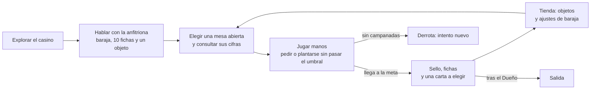

# La Última Mesa · Objetos, personajes y mecánicas

**Estado:** redactado por Kenned el 24 de noviembre de 2026 a partir del código de la rama `kenned/i5-arranque-campana` y de sus datos (`datos/tienda/catalogo_tienda.tres`, `datos/mesas/mesas_campana.tres`, `datos/cartas/baraja_inicial.tres`). Cada elemento indica si está **implementado** o **previsto**; los previstos salen del [guion versión 4](GUION_PROLOGO_Y_DIALOGOS.md) y del [documento de diseño v2.4](../../../1P/Diseno_Videojuego/Documento_Diseno_La_Ultima_Mesa_v2_4.docx).

**Para qué sirve:** tener en un solo sitio qué objetos, personajes y mecánicas interactúan en el juego y qué función cumplen en la jugabilidad. La navegación entre pantallas está en [NAVEGACION_PANTALLAS.md](NAVEGACION_PANTALLAS.md).

## Índice

1. [El bucle de juego](#1-el-bucle-de-juego)
2. [Personajes](#2-personajes)
3. [Objetos](#3-objetos)
4. [Cartas](#4-cartas)
5. [Mecánicas de la mesa](#5-mecánicas-de-la-mesa)
6. [Mecánicas de campaña y exploración](#6-mecánicas-de-campaña-y-exploración)
7. [Las cuatro mesas](#7-las-cuatro-mesas)
8. [Interacciones entre elementos](#8-interacciones-entre-elementos)
9. [Elementos previstos](#9-elementos-previstos)

---

## 1. El bucle de juego

En una frase: **el jugador prepara su baraja y sus objetos explorando el casino, y en cada mesa arriesga cartas contra un umbral para sumar puntos antes de que se acaben las campanadas.**

---

## 2. Personajes

| Personaje | Estado | Dónde está | Función en la jugabilidad |
| --- | --- | --- | --- |
| **El visitante** (Klein Moretti en el guion) | Implementado | Lo controla el jugador | Se mueve por las salas (WASD o flechas), interactúa con **E**, compra en la vitrina y se sienta en las mesas. No tiene salud ni combate: pierde si agota las campanadas de una mesa. |
| **La anfitriona** | Implementada | Vestíbulo y tienda | Entrega la invitación: 24 cartas, 10 fichas y un objeto gratis a elegir. Da la pista del siguiente paso según los sellos. En la tienda atiende la vitrina. |
| **El Custodio** | Implementado | Mesa I | Primer crupier. Mesa de aprendizaje con las reglas básicas y umbral bajo. Guarda el primer sello. |
| **El Recaudador** | Implementado | Mesa II | Entrega 15 fichas al sentarse y cobra una por cada carta pedida tras el reparto. Pone precio a arriesgar. Guarda el segundo sello. |
| **La Coleccionista** | Implementada | Mesa III | Retiene la carta más alta de cada mano cerrada, incluso con Quiebra, hasta que el jugador se levanta. Cambia la baraja disponible durante el encuentro. Guarda el tercer sello. |
| **El Dueño de la Casa** | Implementado | Mesa IV | Jefe final. Su umbral empieza en 25 y baja uno por cada mano cerrada sin Quiebra, hasta 17. Obliga a cambiar de estrategia a mitad del encuentro. Vencerlo abre la salida. |
| **Otros visitantes** (Amparo, Tobías, Benavides) | Previstos | Zonas comunes | Cuentan cómo perdieron y dejan una pista de juego (Velas y Quiebra, plantarse a tiempo, guardar fichas para el Recaudador). Dos participan en decisiones morales. |
| **Ignacio Ferrer** y **el farolero** | Previstos | Prólogo y eventos | Solo narrativos: no interactúan con las reglas. |

---

## 3. Objetos

### Objetos y servicios de la tienda

La vitrina del Gabinete abre tras el primer sello. Los precios están en `datos/tienda/catalogo_tienda.tres`. No se puede comprar durante una mesa ni con una recompensa pendiente, y el saldo nunca queda negativo.

| Objeto | Tipo | Precio | Efecto | Límite | Función en la jugabilidad |
| --- | --- | ---: | --- | --- | --- |
| **Lente de humo** | Consumible | 6 | Revela todas las Máscaras ocultas de la mano | Hasta 2 en el inventario; se gasta al usarla | Convierte una decisión a ciegas en una informada: saber si conviene pedir otra carta |
| **Corona del riesgo** | Amuleto | 15 | +2 al multiplicador al plantarse con una Máscara aún oculta en una mano válida | Uno | Premia el riesgo: plantarse sin conocer el valor de la Máscara |
| **Sello del prudente** | Amuleto | 12 | Recupera una campanada al cerrar una mano 3 o más por debajo del umbral | Una vez por mesa | Premia plantarse pronto: compensa una mano baja con otra oportunidad |
| **Moneda mellada** | Amuleto | 10 | +2 fichas por cada Punto exacto | Tres veces por mesa | Economía: buscar el umbral exacto para ahorrar para la tienda |
| **Retirar una carta** | Servicio | 4 | Quita una carta de la baraja | Deben quedar al menos 12 | Construir la baraja: sacar cartas que estorban |
| **Ajustar valor +1** | Servicio | 5 | Sube en uno el valor impreso de una carta | Una vez por carta; valor entre 1 y 10 | Afinar la baraja hacia los umbrales y los patrones |
| **Ajustar valor −1** | Servicio | 5 | Baja en uno el valor impreso de una carta | Igual que el anterior | Igual que el anterior |

### Objeto inicial

Al aceptar la invitación, la anfitriona ofrece **uno gratis** entre Lente de humo, Sello del prudente y Moneda mellada. Se elige con ratón o teclado, se entrega una sola vez por intento y, si se cierra el diálogo antes de elegir, la oferta se puede retomar. Función: que la primera mesa ya tenga una decisión de estilo de juego, aunque la tienda esté cerrada.

### Fichas y sellos

| Elemento | Cómo se obtiene | Para qué sirve |
| --- | --- | --- |
| **Fichas** | 10 al empezar; 10 + 5 por cada Punto exacto al vencer una mesa; 15 del Recaudador al sentarse; la Moneda mellada | Comprar en la tienda y pagar las cartas pedidas en la mesa del Recaudador. Se ven arriba a la derecha |
| **Sellos** | Uno por cada una de las tres primeras mesas | Abren las puertas del pasillo siguiente y, con los tres, la mesa del Dueño. Se ven en un tríptico junto al saldo |

---

## 4. Cartas

### Los cuatro palos

| Palo | Regla | Función en la jugabilidad |
| --- | --- | --- |
| **Velas** | Cada Vela conservada en una mano válida suma +1 al multiplicador | Recompensa conservar Velas; tienta a pedir más |
| **Llaves** | Una Llave elegible se puede devolver al fondo del mazo para recibir otra carta gratis, una vez por mano; el reemplazo va al final de la mano | Una segunda oportunidad: corregir una mano que se acerca demasiado al umbral |
| **Relojes** | Valen uno menos que lo impreso (mínimo 1) | Permiten pedir con menos riesgo, pero suman menos |
| **Máscaras** | Su valor se oculta hasta plantarse; mientras tanto la mano muestra un intervalo de 1 a 10 por Máscara | Incertidumbre: decidir sin saber el total exacto |

### Baraja inicial

24 cartas, seis por palo (`datos/cartas/baraja_inicial.tres`):

| Palo | Valores |
| --- | --- |
| Velas | 1, 2, 4, 6, 8, 10 |
| Llaves | 1, 2, 3, 4, 5, 9 |
| Relojes | 1, 2, 4, 6, 7, 9 |
| Máscaras | 1, 3, 5, 7, 8, 10 |

### Cartas de recompensa

Tras vencer cada una de las tres primeras mesas, el jugador elige una de tres cartas con combinaciones distintas de palo y valor, u omite la oferta. La carta elegida entra en el mazo desde la mesa siguiente. La baraja crece como máximo de 24 a 27. **Variante en prueba:** la tercera opción es una **Vela de Racha ×2**, que cuenta como dos cartas para Racha y conserva su valor para el umbral.

---

## 5. Mecánicas de la mesa

| Mecánica | Cómo funciona | Función en la jugabilidad |
| --- | --- | --- |
| **Campanadas** | Cada mano nueva gasta una. Pedir y plantarse no las gastan. Se renuevan en cada mesa | Recurso que limita el encuentro: cuántas oportunidades quedan |
| **Umbral** | Límite de la suma de la mano. Pasarlo es Quiebra | Riesgo central de cada decisión |
| **Meta** | Puntos que hay que acumular para vencer la mesa | Objetivo del encuentro |
| **Iniciar mano** | Gasta una campanada y reparte dos cartas | Empieza la apuesta |
| **Pedir** | Añade una carta al final de la mano. No se puede si el mínimo posible ya supera el umbral | Subir la suma y buscar patrones a cambio de riesgo |
| **Plantarse** | Cierra la mano, revela las Máscaras y calcula los puntos | Asegurar lo conseguido |
| **Quiebra** | La suma supera el umbral: la mano aporta 0 puntos | Castigo por arriesgar de más |
| **Intervalo** | Con Máscaras ocultas, la mano muestra el mínimo y el máximo posibles | Decidir con información parcial, sin revelar el valor real |
| **Patrones** | Suman al multiplicador si la mano no quiebra: **Punto exacto** (suma igual al umbral, +3), **Al filo** (uno por debajo, +2), **Ascenso** (3 o más cartas de menor a mayor, +2), **Mano larga** (5 o más cartas, +2) y **Racha** (las 3 últimas del mismo palo, +2) | Dan objetivos más allá de «no pasarse»; la franja de patrones muestra cuáles están en progreso |
| **Puntuación** | Puntos = suma × (1 + bonos de patrones + Velas + amuletos) | Premia combinar suma alta con patrones |
| **Desglose** | Tras cada mano, muestra valores efectivos, patrones y multiplicador | Explica por qué se ganaron esos puntos |
| **Victoria y derrota** | Se vence al alcanzar la meta; se pierde al quedarse sin campanadas antes | Cierra el encuentro |

---

## 6. Mecánicas de campaña y exploración

| Mecánica | Cómo funciona | Función en la jugabilidad |
| --- | --- | --- |
| **Exploración** | Movimiento libre por salas y pasillos; los puntos de interacción se marcan con ◇ y se activan con **E** | Conecta la historia con la preparación; caminar no gasta recursos |
| **Puertas y sellos** | Cada sello abre la puerta del pasillo siguiente; la tienda abre con el primero y el Dueño con el tercero | Progresión física: el avance se ve en el mapa |
| **Objetivo** | Una línea arriba a la izquierda que cambia solo con el progreso | Orientación sin texto de más |
| **Pistas de la anfitriona** | Cambian con el número de sellos y anuncian la regla de la siguiente mesa | Preparar la estrategia antes de sentarse |
| **Presentación del crupier** | Muestra umbral, meta y campanadas antes de «Tomar asiento» | Decidir si se está listo o volver a la tienda |
| **Ver baraja** | Consulta la baraja por palo y valor desde el inventario, en exploración o a mitad de una mano | Planificar compras y decisiones sin revelar el orden del mazo ni las Máscaras de la mano |
| **Intento** | Perder una mesa termina el intento; el siguiente reinicia cartas, fichas, sellos y objetos. Los ajustes se conservan | Partidas cortas y rejugables |
| **Partida guardada** | Se guarda sola entre encuentros y se retoma con «Continuar» en el inicio. Cerrar a mitad de una mesa vuelve a como se estaba al sentarse; perder borra la partida | Poder dejar la campaña y volver sin perder el progreso, sin permitir esquivar una derrota |
| **Pausa y opciones** | Esc congela la sala y la mesa; volumen por canal y movimiento reducido | Accesibilidad y control del ritmo |

---

## 7. Las cuatro mesas

Cifras de `datos/mesas/mesas_campana.tres`.

| Mesa | Umbral | Meta | Campanadas | Regla propia | Qué enseña o exige |
| --- | ---: | ---: | ---: | --- | --- |
| **I · Custodio** | 17 | 200 | 10 | Ninguna | Las reglas básicas: pedir, plantarse, Quiebra y patrones |
| **II · Recaudador** | 21 | 400 | 12 | +15 fichas al sentarse; cada carta pedida tras el reparto cuesta una ficha | Administrar fichas y valorar cada petición |
| **III · Coleccionista** | 25 | 700 | 12 | Retiene la carta de mayor valor de cada mano cerrada (incluida una Quiebra) hasta el final del encuentro | Adaptarse a una baraja que pierde sus cartas altas |
| **IV · Dueño** | 25 → 17 | 750 | 17 | El umbral baja uno tras cada mano sin Quiebra, hasta 17 | Cambiar de estrategia a medida que el límite se estrecha |

---

## 8. Interacciones entre elementos

| Elemento | Interactúa con | Resultado |
| --- | --- | --- |
| Lente de humo | Máscaras de la mano | Las revela; el intervalo pasa a ser exacto |
| Corona del riesgo | Máscaras ocultas al plantarse | +2 al multiplicador si la mano es válida |
| Sello del prudente | Umbral y campanadas | Una campanada de vuelta tras una mano baja |
| Moneda mellada | Punto exacto y fichas | +2 fichas por exacto |
| Retirar y ajustar | Baraja y patrones | Cambian la probabilidad de cada valor y palo |
| Llaves | Mazo y Quiebra | Cambiar una carta antes de pasarse |
| Relojes | Umbral | Pedir con menos riesgo |
| Velas | Multiplicador | Más puntos por mano válida |
| Vela de Racha ×2 | Patrón Racha | Racha con solo dos cartas del palo si una es esta Vela |
| Recaudador | Fichas | Entrega 15 fichas al sentarse y cada petición tras el reparto cuesta una; quien gastó todo en la tienda aún puede pedir, pero poco |
| Coleccionista | Mazo durante el encuentro | Menos cartas altas en las manos siguientes |
| Dueño | Umbral | Las mismas cartas valen distinto a medida que baja el umbral |
| Sellos | Puertas | Abren la tienda y los pasillos siguientes |
| Anfitriona | Sellos | Pistas distintas en cada etapa |

---

## 9. Elementos previstos

| Elemento | Origen | Función prevista |
| --- | --- | --- |
| **Prólogo y eventos de novela visual** | Guion | Contar la historia entre mesas sin cambiar las reglas |
| **Decisiones morales** (`moral.sombra`) | Guion | Elegir entre opciones que dan ventaja a costa de otros personajes; abren la ruta de sombra y el final B |
| **Campanada extra** (aceptar el año de Benavides) | Guion, decisión M2 | +1 campanada en la mesa siguiente. Pendiente de balance |
| **Máscara de Ignacio** | Guion, decisión M3 | Una Máscara de 10 en la baraja. Pendiente de balance |
| **Fichas del Dueño** | Guion, decisión M4 | Elegir el final A: recuperar los años propios, llevárselos todos o no tocar nada |
| **Reacciones de los crupieres** | Guion | Frases breves durante la partida según lo que pase en la mesa, sin revelar información oculta |
| **Duelo 1 contra 1 por LAN** | Documento de diseño | Dos visitantes en equipos distintos; el anfitrión valida turnos y no envía cartas ocultas al rival |
