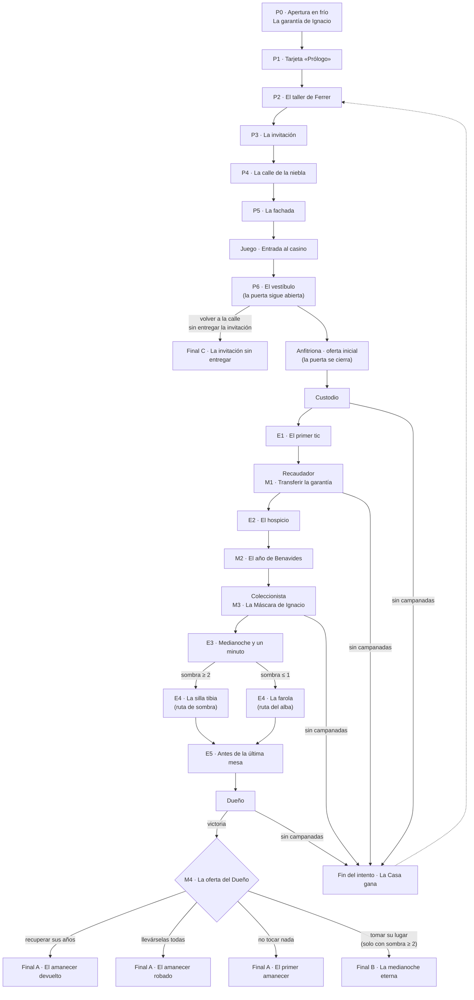

# La Última Mesa · Prólogo y diálogos en formato de novela visual

**Estado:** borrador para revisión de Julio, escrito por Kenned. **Versión 4.1**, del 25 de noviembre de 2026; los cambios entre versiones están en el [historial](#17-historial-de-versiones). No forma parte de ninguna iteración.

**Protagonista:** masculino. El nombre lo elegirá el jugador en una iteración futura; en el texto aparece como `{nombre}` (por defecto **Klein**) y `{apellido}` (por defecto **Moretti**). Los diálogos del protagonista en las opciones funcionan con cualquier nombre.

**Alcance:** este documento solo contiene guion: diálogos, rutas, decisiones e interacciones. Fondos, ilustraciones, hojas de expresiones y prompts están en [ILUSTRACIONES_PENDIENTES.md](ILUSTRACIONES_PENDIENTES.md); aquí solo se citan por su id.

**Fuentes:** el [documento de diseño v2.4](../../../1P/Diseno_Videojuego/Documento_Diseno_La_Ultima_Mesa_v2_4.docx) (historia, personajes, música prevista), la [dirección artística](DIRECCION_ARTISTICA.md) y las líneas que ya están en el juego: el reloj detenido, el péndulo de diez muescas, el libro mayor, el expositor, la verja del alba y el diálogo de la anfitriona en `datos/dialogos/anfitriona.tres`.

## Índice

1. [Resumen de la historia](#1-resumen-de-la-historia)
2. [Convenciones y tono](#2-convenciones-y-tono)
3. [Lore fundamental](#3-lore-fundamental)
4. [Personajes, trasfondos y expresiones](#4-personajes-trasfondos-y-expresiones)
5. [Estructura narrativa](#5-estructura-narrativa)
6. [Prólogo escena por escena](#6-prólogo-escena-por-escena)
7. [Vestíbulo y anfitriona](#7-vestíbulo-y-anfitriona)
8. [Los jefes](#8-los-jefes)
9. [Reacciones de los jefes durante la partida](#9-reacciones-de-los-jefes-durante-la-partida)
10. [Los otros visitantes](#10-los-otros-visitantes)
11. [Notas examinables](#11-notas-examinables)
12. [Eventos de novela visual](#12-eventos-de-novela-visual)
13. [Decisiones morales](#13-decisiones-morales)
14. [Finales](#14-finales)
15. [Implementación sugerida](#15-implementación-sugerida)
16. [Decisiones pendientes](#16-decisiones-pendientes)
17. [Historial de versiones](#17-historial-de-versiones)

---

## 1. Resumen de la historia

### Sinopsis

Corvera, un puerto de finales del siglo XIX. **Klein Moretti**, aprendiz de relojero, recibe la invitación que era de su maestro, **Ignacio Ferrer**, desaparecido hace un año. El nombre de Ignacio está tachado y el de Klein, escrito debajo con tinta todavía húmeda.

La invitación lo lleva a **la Casa**, un casino que vive en la hora entre la medianoche y el amanecer. Allí **cada campanada que suena en una mesa cuesta un año de vida**, y quien se queda sin campanadas se convierte en una **Máscara de porcelana** que pasa a la baraja. Para salir, Klein debe vencer a tres crupieres (**el Custodio**, **el Recaudador** y **la Coleccionista**), reunir sus sellos y ganar al **Dueño de la Casa**.

Por el camino descubre tres verdades:

1. Ignacio lo **ofreció como garantía** para jugar una mano más, y perdió igual.
2. La **anfitriona** es Leonor, la esposa moribunda del Dueño. Él apostó contra el amanecer para que ella no muriera.
3. **Ganar significa que amanezca**, y que Leonor por fin muera.

### Columna del juego

Todas las rutas pasan por las mismas cuatro mesas. Las decisiones cambian diálogos, eventos y finales, nunca el recorrido jugable. El documento de diseño v2.4 deja las ramificaciones narrativas para después; esta propuesta las adelanta sin bloquear el juego.

| Tramo | Contenido narrativo | Juego |
| --- | --- | --- |
| **Prólogo** (P0–P5) | La garantía de Ignacio, el taller, la invitación, la calle y la fachada | Novela visual pura, unos 9 minutos |
| **Llegada** (P6 y anfitriona) | El vestíbulo, la oferta del objeto inicial | Exploración. Volver a la calle sin entregar la invitación lleva al **final C** |
| **Mesa 1 · Custodio** | El campanero que enseña a contar | Partida; después, el evento **E1** |
| **Mesa 2 · Recaudador** | El libro mayor y la verdad de la garantía; decisión **M1** | Partida; después, **E2** y la decisión **M2** |
| **Mesa 3 · Coleccionista** | La Máscara de Ignacio en la vitrina; decisión **M3** | Partida; después, **E3** y el **E4** de la ruta que corresponda |
| **Mesa 4 · Dueño** | La última mesa; antes, **E5** | Partida; después, la decisión **M4** y el final |

### Finales

| Final | En una línea |
| --- | --- |
| **A · El primer amanecer** | Klein vence al Dueño y sale. Según lo que haga con las fichas del Dueño, sale joven esa misma noche, sale joven condenando a los demás o sale viejo décadas después. |
| **B · La medianoche eterna** | Con una ruta de sombra, Klein ocupa el lugar del Dueño. |
| **C · La invitación sin entregar** | Klein no entra. La Casa espera hasta su lecho de muerte. |
| **Fin del intento** | Klein pierde, se vuelve porcelana y la noche se repite con ecos. |

Detalle en [Finales](#14-finales).

---

## 2. Convenciones y tono

### Marcas del guion

La presentación imita a las novelas visuales del estilo de Fate. Las **cinemáticas** (prólogo, llegada, eventos y finales) ocupan toda la pantalla con su ilustración: la narración avanza un párrafo por clic en la franja inferior y los diálogos usan el cuadro con los personajes en escena. Las **conversaciones** con la anfitriona y los crupieres se abren sobre la sala, con el retrato junto al cuadro.

| Marca | Significado |
| --- | --- |
| `[NVL]` | Narración sin placa de nombre en la franja inferior, sobre la ilustración; cada párrafo sustituye al anterior al hacer clic. Se usa para el monólogo interior del protagonista. |
| `[ADV]` | Cuadro inferior con placa de nombre y retrato. Es el modo de la escena de diálogos de I4-06 (`DialogoNovela`). |
| `[FONDO: id]` | Fondo de la escena. Su descripción está en [ILUSTRACIONES_PENDIENTES.md](ILUSTRACIONES_PENDIENTES.md). |
| `[CG: id]` | Ilustración a pantalla completa de un momento clave. Se desbloquea en la galería. |
| `[ENTRA: personaje · lado · expresión]` | El personaje entra en escena (o se mueve) en una de tres posiciones: izquierda, centro o derecha. Se queda hasta que sale. La expresión es un id de su hoja de expresiones ([Personajes](#4-personajes-trasfondos-y-expresiones)). Mientras habla queda iluminado y los demás, atenuados; su cara aparece en el cuadro. |
| `[SALE: personaje]` | El personaje sale de escena. `[SALE: todos]` vacía el escenario (cambio de escena o tarjeta). |
| `[RETRATO: personaje · expresión · lado]` | Cambio de expresión de alguien que ya está en escena; en una conversación normal, el retrato del cuadro. |
| `[EFECTO: temblor · temblor_fuerte · destello]` | Efecto de cinemática en esa línea. Los fondos y CG pueden llevar movimiento lento (acercar o desplazar); al cambiar de fondo hay un fundido cruzado. Con movimiento reducido no se aplican. |
| `[MÚSICA: pieza]` / `[SONIDO: efecto]` | Pistas del documento de diseño o efectos del banco actual (`campana`, `naipe`, `paso`, `puerta`, `quiebra`, `sello`, `interfaz`). Los nuevos se marcan con *(nuevo)*. |
| `[ACCIÓN: …]` | Lo que ocurre en pantalla: movimientos, gestos, temblores, fundidos. |
| `[TRANSICIÓN: …]` | Paso entre escenas: fundido a negro, barrido de humo o corte. |
| `[OPCIÓN]` | Elección del jugador. Cada respuesta indica su efecto y la variable que guarda. |
| `{nombre}` | Nombre del protagonista. `{apellido}` es su apellido. |

El texto que se dice va entre comillas latinas («…»). Lo que piensa el protagonista en `[ADV]` va en cursiva y sin placa de nombre.

### Tono

- **Horror gótico contenido.** El miedo viene de lo que se insinúa: el frío en los dedos, una boca que se queda lisa, un nombre tachado. **Nunca hay sangre ni violencia explícita.** La transformación en Máscara se cuenta con porcelana, frío y silencio.
- **Humor escaso y seco.** La Casa es sombría, pero quienes viven en ella tienen siglos para afilar la lengua. Klein se defiende con ironía; la anfitriona responde con frases cortas que cortan; el Recaudador hace chistes de contable sin sonreír; la Coleccionista lanza pullas elegantes; el Custodio tiene la ternura seca de un maestro viejo. **Una broma por escena como mucho, nunca en una muerte o una transformación, y nunca absurda.** Las frases amables duelen más porque son raras.
- **El precio siempre se paga.** Ninguna victoria es limpia: cada campanada cuesta un año, cada sello deja algo atrás.
- **El protagonista no es un héroe.** Es un relojero asustado que cuenta para no pensar. Su ironía es una defensa que se rompe a medida que avanza.
- **La esperanza existe, pero es pequeña:** un tic del reloj, una Máscara que abre los ojos, los pájaros del final.

---

## 3. Lore fundamental

Este es el canon que deben respetar todos los textos. El jugador lo descubre por partes: la anfitriona, los jefes, los otros visitantes y las notas aportan cada uno una pieza. Nadie lo explica todo de una vez.

### La Casa

- **Qué es.** La Casa es un casino que existe en **la hora que no termina**: el instante entre la última campanada de la medianoche y el amanecer. Adentro pueden pasar siglos; por eso sus relojes están detenidos y nadie recuerda cuánto lleva jugando. La anfitriona dice que **afuera solo pasa un segundo. Miente:** los años que la Casa cobra también pasan afuera. Quien sale encuentra su mundo envejecido con él, **salvo que recupere sus años de las fichas del Dueño**: entonces vuelve a la misma noche en que entró. El jugador lo descubre en el final.
- **Su origen.** Hace mucho, un jugador apostó contra el amanecer y ganó la noche. Ese jugador es **el Dueño de la Casa**. Mientras alguien siga jugando en sus mesas, el sol no sale dentro de la Casa, y el Dueño no envejece.
- **Las fichas del Dueño.** Cada año cobrado en una mesa se convierte en una ficha de marfil con la cara diminuta de su dueño grabada. El Dueño las guarda sin usarlas. Quien lo vence puede tocarlas.
- **De qué vive.** La Casa se alimenta de **tiempo**. **Cada campanada que suena en una mesa es un año de vida** que el visitante entrega. Quien sale, sale más viejo. Quien agota sus campanadas sin alcanzar la meta ya no tiene años que apostar, y la Casa se queda con lo que queda de él: la cara.

### La invitación, la ficha y la garantía

- La invitación llega a quien alguna vez dijo, en voz alta o por dentro, **«daría lo que fuera por una última oportunidad»**. La Casa lo toma al pie de la letra.
- Viene lacrada con un sello negro y acompañada de **una ficha antigua** de marfil. La ficha es la prenda del visitante: prueba que vino por voluntad propia, y por eso la Casa puede quedárselo.
- **La garantía.** Un visitante sin campanadas puede pedir una mano más si ofrece otra vida como garantía. Si pierde, la Casa cobra las dos: él se convierte en Máscara y la invitación se reescribe con el nombre de la garantía.
- **Así llega la invitación al protagonista.** En su última mano, Ignacio Ferrer ofreció a su aprendiz. El protagonista no lo sabe al empezar. El jugador lo ve en la apertura; el Recaudador lo tiene anotado y el Dueño lo dice en voz alta.

### Los tres sellos y el reloj del vestíbulo

- El reloj monumental del vestíbulo tiene **tres ranuras** bajo el cristal. Son las cerraduras del contrato del Dueño.
- Cada sello lo guarda un crupier. Con los tres en el reloj, las agujas pueden moverse y se abre la mesa del Dueño. Vencerlo obliga al tiempo de la Casa a avanzar hasta el amanecer, y la verja se abre.
- **Los crupieres fueron visitantes.** Llegaron hasta su mesa y perdieron. La Casa no los convirtió en Máscaras porque conocían bien su juego: los ató a la silla. No pueden levantarse nunca. Ninguno lo dice abiertamente; el jugador lo deduce de sus diálogos.

### Los palos

| Palo | Qué significa dentro de la Casa | Cómo se relaciona con su regla |
| --- | --- | --- |
| **Velas** | Años que arden. Gastar la vida deprisa la hace valer más… durante un momento. | Cada Vela conservada suma +1 al multiplicador. |
| **Llaves** | Puertas que la Casa olvidó cerrar. Por eso las vigila. | Devolver una Llave permite cambiarla por otra carta. |
| **Relojes** | El tiempo que la Casa cobra por cada hora. | Valen uno menos: la Casa siempre se queda un minuto. |
| **Máscaras** | Los rostros de quienes perdieron. Siguen despiertos. Ni ellos recuerdan cuánto valían. | Su valor se oculta hasta plantarse. |

**Cada Máscara de la baraja es un visitante que perdió, y sigue consciente.** Cuando el jugador las sostiene, sienten el calor de sus dedos. Cuando las juega, a veces susurran. La apertura en frío lo muestra con Ignacio, aunque el jugador no lo entiende del todo hasta la vitrina de la Coleccionista.

### El tiempo deforma a la gente

Dentro de la Casa el tiempo no pasa igual para todos, y se nota en los cuerpos. Son reglas para el guion y para las ilustraciones:

- **Envejecer por campanadas.** Cada campanada gastada es un año. Klein lo ve en los espejos de los eventos: a los 27 al entrar, con canas en las sienes tras el primer sello, con arrugas tras el segundo, con manos de viejo antes del Dueño. Las edades de los espejos son etapas fijas por sello, no la cuenta exacta; la cuenta exacta (`campana.gastadas`) solo importa en las fichas del Dueño.
- **Desfase de época.** Quien lleva mucho dentro conserva la ropa de su siglo, pero desteñida, como un retrato expuesto al sol. Cuanto más antiguo, más gris: Doña Amparo casi no tiene color.
- **Rostros que parpadean.** A los residentes más antiguos la cara se les va entre edades. En un parpadeo son niños; en el siguiente, ancianos. La anfitriona tiene momentos jóvenes y momentos de mujer muy vieja; nunca en la misma línea de diálogo.
- **Voces con retraso.** Los que llevan siglos hablan con un eco que llega tarde. En el texto se marca con un efecto de eco o repitiendo la última palabra en gris.
- **Porcelana.** Quien pierde se enfría desde los dedos hacia la cara. La porcelana no envejece: es lo único que la Casa conserva intacto.
- **Los crupieres son la versión extrema:** sus cuerpos mezclan siglos. El Custodio tiene ropa de cuatro épocas cosida encima; el Recaudador, las manos de un joven y la cara de un viejo; la Coleccionista, media cara de niña bajo la semimáscara y media de anciana.

### La repetición de la noche

Cuando el protagonista pierde, la Casa no lo suelta: lo convierte en Máscara y reparte la noche otra vez con su invitación. El jugador vuelve a empezar en el taller, pero la anfitriona deja claro que **no es exactamente el mismo**: *«Eres lo que la Casa recuerda de ti. Cada vez recuerda un poco menos.»* En el siguiente intento el protagonista conserva **ecos**: un déjà vu, una frase que sabe antes de oírla, un frío en las manos que antes no tenía. Los diálogos marcados con `intentos ≥ 1` aprovechan esa repetición.

### Ecos de la repetición

Cada intento perdido deja una marca. Estas líneas sustituyen o se añaden a las normales según `campana.intentos`. Los ecos nunca dan información de reglas que el jugador no tenga; solo inquietan.

| Momento | `intentos ≥ 1` | `intentos ≥ 2` | `intentos ≥ 3` |
| --- | --- | --- | --- |
| P2 · Los relojes se paran | *«Sé que se van a parar un segundo antes de que pase.»* | *«Cuento treinta y dos chasquidos. Siempre treinta y dos.»* | *«Ya estoy de pie junto a la puerta cuando llaman.»* |
| P4 · El farolero | **Farolero:** «¿Otra vez tú? No, perdona. Todos tenéis la misma cara.» | **Farolero:** «Esta es la tercera vez que te enciendo el camino, ¿verdad? Lo noto en cómo suena tu ficha.» | **Farolero:** «No me preguntes nada. Ya sabes las respuestas.» |
| P6 · El vestíbulo | La punta del meñique de Klein es de porcelana. | Dos dedos. Uno de los jugadores del vestíbulo lo saluda con la cabeza. | Toda la mano izquierda. Klein se pone un guante. |
| Anfitriona, saludo | «Llegas a la hora exacta.» *(pausa)* «Otra vez.» | «Eres lo que la Casa recuerda de ti. Cada vez recuerda un poco menos.» | «Ya no me acuerdo de qué color eran tus ojos la primera vez.» |
| Custodio, presentación | «He contado diez campanadas tuyas antes. Esta vez cuéntalas tú.» | «Tu silla aún no se ha enfriado.» | «Hijo…» *(se corrige)* «Relojero.» |
| Coleccionista, vitrina | «Ya conoces esta pieza. Pero mírala igual.» | Junto a la Máscara de Ignacio hay una vitrina con una etiqueta a medio escribir: *Moretti*. | La etiqueta está completa. |
| Dueño, presentación | «Te he ganado antes. No lo tomes como algo personal.» | «Ya no sé si vienes a ganarme o a volver.» | «Siéntate. Esta vez juega como si fuera la última. Lo es para alguien.» |

### Revelaciones y misterios

Qué descubre el jugador y dónde. Lo que queda abierto sirve para un final verdadero o para la trama completa.

| Pieza | Dónde se revela | Qué queda abierto |
| --- | --- | --- |
| Ignacio vendió a Klein como garantía | El jugador, en P0. Klein, en el libro del Recaudador | — |
| Las Máscaras son visitantes conscientes | Pistas desde la anfitriona; certeza en la vitrina de la Coleccionista | — |
| La anfitriona es Leonor, la esposa del Dueño | E3 | Por qué elige a quién invitar |
| Ganar mata a Leonor | E3 y M4 | — |
| El Dueño no tiene cara | Final B | Quién era antes de la apuesta |
| El tiempo cobrado se puede recuperar | M4 | — |
| Ignacio sigue consciente dentro de su Máscara | Vitrina, M3 y E5 | Si puede volver a ser él; la Máscara con los ojos abiertos del final A |
| Hay otras casas y otras noches | Final A, motivo `curiosidad` | Todo |

---

## 4. Personajes, trasfondos y expresiones

Cada personaje tiene una hoja de expresiones. Aquí solo figuran sus ids y cuándo usarlas; la descripción visual de cada una está en [ILUSTRACIONES_PENDIENTES.md](ILUSTRACIONES_PENDIENTES.md#hojas-de-expresiones). El trasfondo se revela por partes; la columna «Dónde se revela» indica en qué escena.

### Klein Moretti, el protagonista

- **Voz:** relojero de 27 años. Observador y seco. Cuenta segundos, pasos y engranajes para no pensar. Su ironía, que es su humor, se rompe a medida que avanza, pero vuelve en los momentos de calma.
- **Aspecto:** victoriano, con levita, sombrero de copa bajo y bastón; detalles de relojero en todo el vestuario. Ver [ILUSTRACIONES_PENDIENTES.md](ILUSTRACIONES_PENDIENTES.md#klein-moretti).
- **Trasfondo:** huérfano de un hospicio del puerto. Ignacio lo sacó de allí a los nueve años y le enseñó el oficio. Lo que Klein no sabe: Ignacio cobraba al hospicio una pensión por tenerlo, y ya lo había ofrecido como aval ante prestamistas antes de ofrecerlo a la Casa. Lo quería, a su manera. Lo usaba, también a su manera.
- **Dónde se revela:** el libro del Recaudador (la garantía) y el evento E2 (el recuerdo del hospicio).
- **Expresiones:** `neutral`, `asustado`, `ironico`, `decidido`, `furioso`, `roto`, `vacio` (ruta de sombra). Etapas de edad: `27`, `35`, `45`, `60` y `20` (final A robado).

### La anfitriona

- **Voz:** cortesía fría y cansada. Tutea. Sabe exactamente qué te va a pasar y no lo dice.
- **Trasfondo:** se llamaba **Leonor**. Era la esposa del Dueño y se moría de tisis la noche en que él apostó contra el amanecer: el médico le había dicho que no vería salir el sol. Él ganó, y ella lleva siglos muriéndose sin terminar de morir. Salió una vez, al amanecer: todos los que conocía llevaban sesenta años muertos, y en el umbral empezó a ahogarse. Volvió esa misma noche. Escribe las invitaciones con su propia letra. Elige a quién llamar entre los que piden una última oportunidad, porque no soporta la Casa vacía.
- **Dónde se revela:** pistas en sus preguntas sobre la Casa, su nombre y su historia en el evento E3, y su muerte al amanecer en el final A.
- **Expresiones:** `neutral`, `sonrisa_leve`, `seria`, `compasiva`, `tos` (se cubre la boca con un pañuelo), `joven` y `anciana` (parpadeo de edad).

### El Custodio

- **Voz:** paciente y fúnebre. Enseña como quien prepara a alguien para morir. Su voz suena con eco de campana.
- **Trasfondo:** **Mateo**, campanero de una ciudad con peste. El obispo le ordenó tocar a muerto por cada difunto. Tocó por sus tres hijos, uno cada semana, y siguió tocando hasta que nadie quedó para oírlo. Vino a la Casa pidiendo una última oportunidad de no haber tocado esas campanas. Ahora cuenta las de los demás.
- **Dónde se revela:** sus preguntas y el evento E1.
- **Expresiones:** `neutral`, `aprobacion`, `duelo`, `alarma` (las campanas vibran), `recuerdo` (la máscara baja, se ve un ojo humano cansado).

### El Recaudador

- **Voz:** contable, exacto, sin emoción. Habla en cifras y nunca levanta la vista del libro.
- **Trasfondo:** **Ezequiel Varga**, prestamista. Desahució a una viuda en pleno invierno; al amanecer, la hija pequeña apareció helada en su portal. En su libro anotó: «Saldado». Vino a la Casa para cobrar una deuda a un hombre que ya había muerto. Ahora cobra para siempre y, al final de cada página, escribe la misma palabra.
- **Dónde se revela:** sus preguntas y la decisión M1.
- **Expresiones:** `neutral`, `satisfecho`, `impaciente`, `mirada` (levanta la vista: solo una vez, en M1), `tachando`.

### La Coleccionista

- **Voz:** lánguida, refinada, posesiva. Trata a las personas como piezas y a las cartas como personas.
- **Trasfondo:** **Céleste Vautrin**, marchante de arte. Su hija menor era tan hermosa que la encerró en una habitación con paredes de vitrina «para que nada la rompiera». La niña murió de fiebre detrás del cristal, y Céleste siguió visitándola durante un año, hasta que los vecinos forzaron la puerta. Vino a la Casa pidiendo una última oportunidad de conservarla. Hoy conserva caras. La vitrina vacía de su sala tiene el tamaño de una niña.
- **Dónde se revela:** sus preguntas, la vitrina de Ignacio y la decisión M3.
- **Expresiones:** `neutral`, `deleite`, `hastio`, `codicia` (se inclina sobre la mesa), `madre` (la semimáscara se desliza; media cara de niña), `furia`.

### El Dueño de la Casa

- **Voz:** pocas palabras, cortesía impecable, cansancio de siglos. Nunca amenaza: informa.
- **Trasfondo:** no recuerda su nombre. Apostó contra el amanecer para que Leonor no muriera al salir el sol. Ganó, y para sostener la noche necesita que alguien juegue siempre. Ha olvidado su cara; debajo de la máscara solo queda la franja de luz. Lo único que recuerda es la tos de ella.
- **Dónde se revela:** sus preguntas, el evento E3 (por boca de Leonor), el E4 de la ruta de sombra y la decisión M4.
- **Expresiones:** `neutral`, `interes`, `cansancio`, `oferta` (extiende la mano), `luz` (la franja se ensancha al perder).

### Ignacio Ferrer

- **Voz:** maestro relojero de 58 años. Encantador, orgulloso, jugador. Cobarde al final.
- **Trasfondo:** también fue un niño de hospicio, y nadie lo eligió. Aprendió el oficio solo y aprendió a jugar al mismo tiempo. Sacó a Klein del hospicio por sus manos y por la pensión que pagaba la diputación; lo ofreció como aval a prestamistas antes de ofrecerlo a la Casa. Lo quería, y eso no le impidió venderlo. Su última palabra escrita fue «Perdóname», en el reverso de la invitación.
- **Dónde se revela:** la apertura (P0), el reverso de la invitación (P3), el libro del Recaudador, el evento E2 y la vitrina de la Coleccionista.
- **Expresiones:** `neutral`, `desesperado`, `orgullo`, `culpa`. Como Máscara: `mascara_dormida`, `mascara_llorando`, `mascara_ojos_abiertos`.

### El farolero

- **Voz:** viejo de la calle. Habla poco y mal.
- **Trasfondo:** ganó las cuatro mesas y salió ciego: la primera luz después de tanta noche le quemó los ojos. La Casa le ofreció un trato: un minuto de vista por cada visitante que guíe hasta su puerta, pagado **solo si ese visitante sale**. Nadie ha salido desde entonces. Tiene un único minuto, el que le dieron por adelantado, y lo guarda.
- **Dónde se revela:** P4 (si se le escucha) y la ruta del alba (E4).
- **Expresiones:** `neutral`, `ciego_sonrie`, `culpa`.

### Los otros visitantes

Ver [Los otros visitantes](#10-los-otros-visitantes). Cada uno tiene `neutral` y `triste`, en tres grados de porcelana.

---

## 5. Estructura narrativa

### Estructura

- **Una columna jugable.** Prólogo, llegada y cuatro mesas en orden fijo. Ninguna decisión cierra ni abre mesas.
- **Elecciones que se recuerdan.** Las del prólogo (motivo, invitación, farolero, tono) cambian líneas posteriores de la anfitriona, la Coleccionista y el Dueño.
- **Decisiones morales.** M1 a M3 suman `moral.sombra`. Con 2 o más se entra en la **ruta de sombra** (evento E4 propio y la opción de tomar el lugar del Dueño); con 1 o menos, en la **ruta del alba**.
- **Cuatro salidas.** Tres finales (A con tres variantes, B y C) y el fin del intento, que repite la noche con ecos.

### Duración y ritmo

| Bloque | Palabras aproximadas | Lectura |
| --- | ---: | ---: |
| P0 · Apertura en frío | 550 | 2,5 min |
| P2–P3 · Taller e invitación | 750 | 3,5 min |
| P4–P5 · Calle y fachada | 550 | 2,5 min |
| P6 · El vestíbulo | 250 | 1 min |
| **Prólogo completo** | **≈ 2.100** | **≈ 9,5 min** |
| Eventos E1 a E5 | ≈ 1.700 | ≈ 8 min, repartidos entre las mesas |
| Cada final | 400 a 700 | 2 a 3 min |

Calculado a unas 220 palabras por minuto. Hay una elección o reacción cada 1 o 2 minutos dentro del prólogo, y al menos una línea posterior reacciona a cada elección importante.

### Variables

| Variable | Tipo | Dónde se fija | Dónde se paga |
| --- | --- | --- | --- |
| `prologo.motivo` | `taller` · `ignacio` · `curiosidad` | P3, al decidir por qué acepta | Anfitriona (llegada), Coleccionista (vitrina), Dueño (presentación) y final A |
| `prologo.quemo_invitacion` | booleano | P3, si intenta quemarla | Anfitriona: «Las invitaciones no arden.» |
| `prologo.farolero` | `escucho` · `pregunto_ignacio` · `ignoro` | P4 | Nota de la farola; el Custodio menciona al farolero |
| `prologo.tono` | `cortes` · `desconfiado` · `desafiante` · `burlon` | Llegada, primera respuesta a la anfitriona | Saludos de la anfitriona en las pistas posteriores |
| `lore.garantia` | booleano | Recaudador, al leer la página de Ignacio | El protagonista sabe la verdad; cambian la vitrina y el Dueño |
| `moral.sombra` | entero de 0 a 4 | Decisiones M1 a M3 (y M4, si se lleva todas las fichas) ([Decisiones morales](#13-decisiones-morales)) | Eventos de ruta, oferta del Dueño y variantes de los finales |
| `ignacio.destino` | `vitrina` · `liberado` · `en_la_baraja` | Decisión M3 | Final A y evento E5 |
| `tobias.estado` | `vivo` · `cobrado` | Decisión M1 | Su diálogo desaparece si fue cobrado |
| `benavides.estado` | `vivo` · `cedio_su_año` | Decisión M2 | Su figura queda de porcelana |
| `final.fichas` | `propias` · `todas` · `ninguna` | Decisión M4 | Variante del final A |
| `campana.gastadas` | entero | Cada campanada gastada en el intento | Número de fichas propias en M4 (`{campanadas_gastadas}`) |
| `campana.recibida` | booleano | Al confirmar el objeto inicial | Cierra la puerta del vestíbulo; sin ella, se puede llegar al final C |
| `prologo.visto` | booleano persistente | Al terminar P5 | Permite saltar el prólogo en intentos nuevos |
| `campana.intentos` | entero | Al perder y empezar de nuevo | Ecos de déjà vu (`intentos ≥ 1`) |
| `lore.preguntas` | conjunto | Al elegir una pregunta de lore | Quita la opción ya respondida y desbloquea la siguiente |

### Sistemas de lectura

| Sistema | Comportamiento |
| --- | --- |
| Velocidad del texto | Los 55 caracteres por segundo actuales, con un control en Opciones. Con movimiento reducido el texto aparece completo, como ya hace `DialogoNovela`. |
| Avanzar | Clic, **E**, Enter o Espacio. La primera pulsación completa la línea y la segunda avanza. |
| Saltar leído | **Ctrl** mantenido o botón «Saltar». Solo salta líneas ya vistas en cualquier intento y se detiene en las elecciones. |
| Automático | Botón «Auto». La espera depende de la longitud de la línea y se detiene en las elecciones. |
| Historial | **Rueda arriba** o botón «Historial»: las últimas 150 líneas con su hablante. |
| Saltar prólogo | En un intento nuevo, si `prologo.visto`, el menú ofrece «Saltar prólogo». |
| Ocultar cuadro | **H** oculta el cuadro para mirar la ilustración. En la mesa, **H** sigue siendo la ayuda. |

---

## 6. Prólogo escena por escena

### P0 · La garantía

`[FONDO: sala_dueno_noche]`

`[MÚSICA: El Dueño de la Casa, a volumen bajo]`
`[NVL]`

> Diecisiete campanadas. Ignacio Ferrer las había contado todas.
>
> Diecisiete años. Se los había visto irse en el dorso de las manos: las venas más gruesas, las manchas más oscuras, los nudillos hinchados de un viejo que no era él cuando entró.
>
> No le quedaba ninguna.

`[ADV]`
`[ENTRA: Dueño · derecha · neutral]`
`[ENTRA: Ignacio · izquierda · desesperado]`

**Dueño de la Casa:** «Setecientos veinte. Te faltan treinta, maestro Ferrer. Y ya no te quedan campanadas.»

**Ignacio:** «Una mano. Solo una. Treinta puntos y salgo por esa verja.»
`[RETRATO: Ignacio · orgullo]`

**Dueño de la Casa:** «Ya no tienes nada que apostar.»

`[ACCIÓN: Ignacio mira las Máscaras de las paredes. Traga saliva. Saca su reloj de bolsillo, lo abre y lo cierra varias veces.]`

`[RETRATO: Ignacio · culpa]`
**Ignacio:** «Tengo…» *(pausa larga)* «Tengo un aprendiz. Joven. Buenas manos. Muchos años por delante.»

`[ACCIÓN: el Dueño inclina la cabeza. La franja de luz de su máscara parpadea.]`

`[RETRATO: Dueño · interes]`
**Dueño de la Casa:** «Una garantía. ¿Sabes lo que me ofreces?»

`[RETRATO: Ignacio · orgullo]`
**Ignacio:** «Sé que voy a ganar.»

**Dueño de la Casa:** «Todos lo saben.» *(pausa)* «Acepto. Una mano.»

`[SONIDO: campana, deformada, más grave que las demás]`
`[EFECTO: temblor]`
`[ACCIÓN: el reparto deja sobre el tapete una Llave de 2 y un Reloj de 7, que vale 6. Ocho.]`

**Ignacio:** «Ocho. Pido.»

`[SONIDO: naipe]`
`[ACCIÓN: la carta pedida es una Máscara, boca abajo. Ignacio la mira mucho rato. Le tiembla el labio.]`

`[RETRATO: Ignacio · desesperado]`
**Ignacio:** «Me planto.»

`[CG: cg_ignacio_mascara]`

`[NVL]`

> La Máscara valía diez. Ignacio lo supo antes de verla, porque el frío le subió por los dedos.
>
> Dieciocho. Uno más que el umbral. Quiebra.
>
> Quiso levantarse. Las piernas no le respondieron; ya no eran piernas. Quiso gritar, y la boca se le quedó lisa, blanca, cerrada. Lo último que movió fueron los ojos. Buscaban la verja.
>
> Luego también los cerró.

`[SONIDO: quiebra; después, porcelana que cruje]` *(nuevo: «porcelana»)*
`[EFECTO: destello · temblor_fuerte]`
`[SALE: Ignacio]`
`[ADV]`

**Dueño de la Casa:** «Otra cara para la baraja.»

`[ACCIÓN: donde estaba Ignacio solo queda la silla vacía. Sobre el tapete, una Máscara nueva con su rostro. El Dueño la recoge y la pasa entre los dedos. Detrás de él, en la oscuridad, la anfitriona aparece un instante, inmóvil, con una pluma en la mano.]`
`[ENTRA: anfitriona · izquierda · seria]`

**Dueño de la Casa:** «Anfitriona. La garantía.»

**Anfitriona:** «Ya la estoy escribiendo, señor.»

`[ACCIÓN: primer plano de la pluma sobre la invitación. Tacha un nombre. Empieza a escribir otro. Solo se ve la primera letra, la inicial de {nombre}.]`

`[TRANSICIÓN: la franja de luz de la verja se cierra como un párpado. Negro.]`

### P1 · Tarjeta de capítulo

`[SALE: todos]`

`[FONDO: negro_con_grabado]`

`[SONIDO: campana, una sola vez, con eco largo]`

**LA ÚLTIMA MESA**
**Prólogo · La garantía**

### P2 · El taller de Ferrer

`[FONDO: taller_ferrer]`

`[MÚSICA: La invitación]`
`[NVL]`

> Hace un año que el maestro Ferrer salió a cobrar una deuda y no volvió.
>
> Nadie lo buscó. Los acreedores sí: vinieron todos, uno detrás de otro, con papeles firmados por él. Deudas de juego. Más de las que este taller vale.
>
> Mañana a las nueve viene el juzgado. Se llevarán los relojes que quedan, el banco, las herramientas. El catre donde duermo desde que tenía nueve años.
>
> Doy cuerda a los relojes igual. Todas las noches. Es lo único que sé hacer.
>
> Ignacio decía que yo tenía manos de relojero y conversación de reloj parado. Tenía razón en las dos cosas.

`[ACCIÓN: el protagonista cierra la tapa de un reloj de bolsillo. Los relojes de la pared hacen tic al unísono.]`

> Ignacio me recogió de la calle. Me enseñó a sostener unas pinzas, a escuchar un escape, a no tener miedo de abrir un mecanismo. Decía que las cartas son como los relojes: si entiendes el mecanismo, sabes cuándo pararte.
>
> Nunca supo pararse. Y yo nunca supe decírselo.

`[SONIDO: tres golpes secos en la puerta]` *(nuevo: «llamada»)*

`[ACCIÓN: los relojes de la pared se detienen todos a la vez, con un chasquido. El minutero de cada uno queda a un minuto de las doce.]`

> Los relojes se pararon.
>
> Todos. Treinta y dos relojes que yo mismo había ajustado. Ninguno pasó de las doce menos un minuto.
>
> En el silencio oigo mi propia respiración. Y, debajo, algo más: un roce, como de porcelana contra madera, al otro lado de la puerta.

`[OPCIÓN]` *¿Qué haces?*

- **«Abrir la puerta.»** → Pasa a P3 directamente.
- **«Mirar primero por la ventana.»** → *En la calle no hay nadie. Solo la niebla, y en la niebla, la farola del farolero, encendida aunque él no está. Bajo la farola, durante un segundo, me parece ver a un hombre con levita verde que no tiene cara.* Después, P3.
- **«Comprobar los relojes.»** → *Abro uno. El muelle tenso, el escape limpio, el volante quieto como si lo sujetara un dedo frío. Al tocarlo, el metal está helado. No hay ninguna avería. Simplemente se niegan.* Después, P3.

### P3 · La invitación

`[ACCIÓN: el protagonista abre la puerta. En el umbral, sobre el escalón mojado, hay un sobre negro. No hay nadie en la calle; no hay pisadas en el barro.]`
`[CG: cg_invitacion]`

`[NVL]`

> El sobre pesa más de lo que debería. Dentro hay una tarjeta color hueso y una ficha de marfil, fría como una moneda que ha pasado la noche en el río.
>
> La tarjeta dice:

`[ACCIÓN: aparece la tarjeta en pantalla, con letra caligráfica.]`

> *La Casa tiene el honor de invitar a* ~~D. Ignacio Ferrer~~ *D. {nombre} {apellido} a la última mesa. Se ruega puntualidad. La deuda no espera.*

> El nombre del maestro está tachado con una sola línea. El mío está escrito debajo, con la misma letra.
>
> La tinta todavía está húmeda. Me mancha el pulgar. Es roja.

`[OPCIÓN]` *¿Qué haces con la invitación?*

- **«Quemarla en la lámpara.»** → `prologo.quemo_invitacion = true`.
  > *Acerco la esquina a la llama. El papel no se oscurece, no huele, no hace nada. La llama se vuelve verde y se apaga. Todas las llamas del taller se apagan a la vez. En la oscuridad, la invitación sigue en mi mano, intacta, y la ficha me quema la palma.*
- **«Guardarla en el chaleco.»** → `prologo.quemo_invitacion = false`.
  > *La guardo junto al pecho. El lacre late. Tardo un momento en entender que late a mi mismo ritmo.*
- **«Darle la vuelta.»** → `prologo.quemo_invitacion = false`.
  > *En el reverso hay una dirección: Calle del Ancla, número cero. Y debajo, con otra letra, temblorosa, casi ilegible: «Perdóname.» Conozco esa letra. La he visto en cada etiqueta de este taller.*

`[NVL]`

> Ignacio estuvo allí. En ese lugar que no existe. Esta invitación fue suya antes que mía.
>
> No sé por qué ahora es mía. No quiero saberlo.

`[OPCIÓN]` *¿Por qué vas a ir?* (**decisión importante**: la recuerdan la anfitriona, la Coleccionista y el Dueño)

- **«Para salvar el taller.»** → `prologo.motivo = "taller"`.
  > *Si esa mesa paga, pago sus deudas. Si los relojes siguen siendo suyos, Ignacio tendrá adonde volver. Me lo repito como una cuenta. Las cuentas no tienen miedo.*
- **«Para encontrar a Ignacio.»** → `prologo.motivo = "ignacio"`.
  > *Me dio una cama, un oficio y un apellido que la gente respetaba. Si está allí, vivo o como sea, voy a sacarlo.*
- **«Porque necesito saber qué es esto.»** → `prologo.motivo = "curiosidad"`.
  > *Treinta y dos relojes no se paran solos. Hay un mecanismo detrás de esto, y si no lo abro yo, me abrirá a mí.*

`[ACCIÓN: el protagonista apaga la lámpara. Los relojes siguen parados. Al salir, cierra con llave por costumbre. Detrás del cristal, el rótulo «FERRER · RELOJERÍA» queda al revés.]`
`[TRANSICIÓN: barrido de niebla.]`

### P4 · La calle de la niebla

`[FONDO: calle_niebla]`

`[MÚSICA: La invitación, segunda parte]`
`[SONIDO: paso, en eco sobre el empedrado]`
`[NVL]`

> La calle del Ancla termina en el agua. Siempre ha terminado en el agua.
>
> Esta noche no. Esta noche sigue.

`[ACCIÓN: bajo la farola, el farolero apoya su pértiga. Tiene los ojos blancos. No se gira, pero habla.]`
`[ADV]`
`[ENTRA: farolero · derecha · neutral]`

**Farolero:** «Esa ficha suena, muchacho. Desde aquí la oigo. Suena como sonaba la mía.»

`[OPCIÓN]`

- **«¿Qué sabe usted de ese sitio?»** → `prologo.farolero = "escucho"`.
  > **Farolero:** «Que yo salí. Gané las cuatro mesas. Salí al amanecer con treinta años y la cara de un viejo, y el sol me dejó así.» *(se señala los ojos)* «Llevaba tanto tiempo a oscuras que la primera luz me quemó.»
  >
  > **Farolero:** «Aprende cuándo levantarte. Cada campanada es un año. Yo las conté tarde.»
- **«¿Vio pasar a un hombre mayor, con levita verde? Ignacio Ferrer.»** → `prologo.farolero = "pregunto_ignacio"`.
  > **Farolero:** «El relojero. Pasó hace un año, silbando. Me dio la hora sin que se la pidiera. Iba adelantado tres minutos, y lo sabía.»
  >
  > **Farolero:** «Esta noche lo he vuelto a oír. No silbaba. Decía un nombre.» *(pausa)* «El tuyo.»
- **«No tengo tiempo. Buenas noches.»** → `prologo.farolero = "ignoro"`.
  > **Farolero:** «Tiempo es justo lo que vas a entregar. Año a año.» *(pausa)* «Buenas noches, entonces. No volveremos a hablar.»

`[ACCIÓN: el farolero levanta la pértiga y enciende una farola más adelante, en un lugar donde un momento antes no había ninguna. Luego otra. Y otra. Forman un camino. Cuando el protagonista mira atrás, la primera farola ya está apagada y el farolero ya no está.]`
`[SALE: farolero]`

`[NVL]`

> Las farolas se encienden una tras otra, hacia donde la calle debería acabar. Detrás de mí se apagan en el mismo orden.
>
> Cuento los pasos, por costumbre. Ciento doce. Al ciento trece, la niebla se abre.

### P5 · La fachada

`[FONDO: fachada_casa]` *(sustituye al arte provisional de `entrada_casino.gd`)*

`[SONIDO: aire_del_casino, muy lejano, como música detrás de una pared]`
`[NVL]`

> No tiene ventanas. Donde deberían estar hay caras talladas en la piedra. Todas con los ojos cerrados.
>
> Por la rendija de la puerta sale una luz cálida y un murmullo de cartas. Huele a cera, a terciopelo viejo, a algo dulce que tarda en ponerse rancio.
>
> El reloj de la fachada marca la medianoche exacta. No el minuto antes, como los míos. La medianoche.

`[OPCIÓN]` *Antes de subir los peldaños…*

- **«Tocar la ficha en el bolsillo.»** → *Está caliente. Late con el mismo ritmo que el lacre. Con el mismo ritmo que yo.*
- **«Mirar atrás.»** → *La calle ha desaparecido. No hay farolas, no hay puerto, no hay niebla. Solo negro. No hay adonde volver. O eso quiere la Casa que piense.*
- **«Pensar en Ignacio.»** → *Tres minutos adelantado, dijo el farolero. Siempre llegaba antes. Esta vez llego yo un año tarde. O justo a tiempo, que es peor.*

`prologo.visto = true`
`[TRANSICIÓN: fundido a la vista de juego de la entrada. Aparece el objetivo «Entra en la Casa». El jugador recupera el control.]`

**Nota de juego.** La entrada es la sala que ya existe en I5. Su nota (la farola) cambia de texto según `prologo.farolero` (ver [Notas examinables](#11-notas-examinables)). Mientras Klein no entregue la invitación, la acera tiene un punto «Volver a casa» que lleva al [final C](#143-final-c--la-invitación-sin-entregar).

### P6 · El vestíbulo

Se reproduce **la primera vez** que el jugador entra en el vestíbulo en cada intento. **La puerta no se cierra todavía:** se cierra al entregar la invitación ([7.1](#71-llegada-y-oferta-inicial)). Mientras siga abierta, Klein puede volver a la calle y alcanzar el [final C](#143-final-c--la-invitación-sin-entregar).

`[FONDO: vestibulo]` *(el arte actual del vestíbulo)*

`[SONIDO: puerta, que cruje y se queda entreabierta]`
`[NVL]`

> La puerta se queda entreabierta detrás de mí. Por la rendija entra niebla, y la niebla no se atreve a pasar del felpudo.
>
> Hay gente. Jugadores en mesas pequeñas, con los ojos fijos en las cartas, que no levantan la vista. Uno lleva una peluca empolvada de hace un siglo. Otra, un luto de una moda que mi madre ya llamaba antigua.
>
> Al acercarme veo sus manos. Tienen los dedos blancos, lisos, brillantes como loza. A uno la porcelana le llega ya hasta la muñeca. Sigue barajando.
>
> Y en el centro, el reloj. Enorme. Parado a la medianoche, con tres ranuras vacías bajo el cristal.

`[ACCIÓN: la anfitriona levanta la vista desde su mostrador. No sonríe.]`
`[TRANSICIÓN: pasa a la conversación de la anfitriona, [7.1](#71-llegada-y-oferta-inicial).]`

En los intentos siguientes se añade el eco de la tabla de [ecos de la repetición](#ecos-de-la-repetición).

---

## 7. Vestíbulo y anfitriona

### 7.1 Llegada y oferta inicial

Amplía la conversación actual de `anfitriona.tres` sin cambiar su mecánica: entregar la invitación abre la oferta de tres objetos de I5.

`[ADV]`
`[RETRATO: anfitriona · neutral · izquierda]`

**Anfitriona:** «Llegas a la hora exacta. Aquí todos los relojes se detuvieron esperando a alguien. Esta noche, a ti.»

`[OPCIÓN]` *Primera respuesta* (fija `prologo.tono`)

- **«Buenas noches. Creo que me esperaban.»** → `cortes`.
  > `[RETRATO: anfitriona · sonrisa_leve]` **Anfitriona:** «Desde hace un año. Eres educado. Lo fueron casi todos, al principio.»
- **«¿Dónde está la salida?»** → `desconfiado`.
  > **Anfitriona:** «Detrás de cuatro mesas y una verja. Nadie te la esconde. Solo te la cobra.»
- **«No pienso quedarme.»** → `desafiante`.
  > **Anfitriona:** «Nadie lo piensa.» *(mira a los jugadores de porcelana)* «Ellos tampoco lo pensaban.»
- **«Bonito reloj. Lástima que esté roto.»** → `burlon`.
  > `[RETRATO: anfitriona · sonrisa_leve]` **Anfitriona:** «No está roto. Está esperando. Tú deberías entender la diferencia, relojero.»

**Anfitriona:** «La puerta seguirá abierta hasta que me des tu invitación.» *(pausa)* «Puedes irte. Nadie lo hace. Es lo que más me gusta de esta profesión.»

**Anfitriona:** «Tu invitación.»

Variantes según el prólogo, justo antes de la oferta:

- Si `prologo.quemo_invitacion`: **Anfitriona:** «Huele a lámpara. La intentaste quemar. Todos lo intentan. Las invitaciones no arden: están escritas con lo que se debe, y las deudas no se queman.»
- Si no: **Anfitriona:** «La tinta todavía no ha secado. Es reciente.»

`[ACCIÓN: la anfitriona pasa el dedo por el nombre tachado. Se detiene un momento demasiado largo.]`

`[RETRATO: anfitriona · seria]`
**Anfitriona:** «Ferrer. Tenía buenas manos.» *(levanta la vista)* «Las tuyas también lo son. Eso dijo él.»

`[OPCIÓN]`

- **«¿Conoció a Ignacio? ¿Dónde está?»**
  > **Anfitriona:** «Más cerca de lo que crees. Más lejos de lo que podrías traerlo.» *(pausa)* «Gana dos mesas. Entonces mira bien las vitrinas.»
- **«¿Qué quiere decir con "eso dijo él"?»**
  > **Anfitriona:** «Que hablaba de ti. Al final, hablaba mucho de ti.» `[RETRATO: anfitriona · seria]` «No me preguntes más. No esta noche.»
- **«No vine a hablar de él.»**
  > **Anfitriona:** «Claro que no.» *(pausa)* «Él tampoco quería hablar de ti. Y lo hizo igual.»

**Anfitriona:** «Veinticuatro cartas y diez fichas serán tuyas. Además, la Casa te concede una de estas piezas, una sola vez. No es un regalo. Aquí no hay regalos.»

→ Oferta de I5: Lente de humo, Sello del prudente, Moneda mellada y «Pensarlo un momento».

**Si cierra el diálogo sin elegir** («Volver» o «Pensarlo un momento»), no se entrega nada, la puerta sigue abierta y la anfitriona dice:

> **Anfitriona:** «Tómate tu tiempo. Aquí sobra.»

Hablar con ella otra vez retoma la oferta. Salir a la calle por la puerta abierta lleva al [final C](#143-final-c--la-invitación-sin-entregar).

**Al confirmar un objeto**, en este orden:

1. Una línea según el objeto:
   - **Lente de humo:** «Para mirar a las Máscaras a la cara antes de tiempo. Algunos prefieren no hacerlo.»
   - **Sello del prudente:** «El de los que saben levantarse. Ferrer lo despreció.»
   - **Moneda mellada:** «La de los que buscan la cifra exacta. La Casa paga la exactitud. Es lo único que paga bien.»
2. **La puerta se cierra:**

   `[SONIDO: puerta, golpe grave y largo]`
   `[ACCIÓN: la pantalla tiembla una vez. Detrás de Klein, la puerta por la que entró se cierra. Al girarse, en su lugar solo hay una pared de mármol verde con el contorno de una puerta grabado.]`
   `[NVL]`

   > No hay picaporte. No hay bisagras. Solo el dibujo de una puerta, como si alguien la hubiera recordado mal.

3. Una línea según el motivo:
   - `taller`: «Si sales, la Casa paga lo que promete. Pero recuerda que aquí no se paga en pesos. Se paga en años.»
   - `ignacio`: «Buscas a alguien. Eso te hará pedir una carta más cuando no debes. Así empezó él.»
   - `curiosidad`: «Quieres ver el mecanismo. Te lo enseñarán. Desde dentro.»
4. **Anfitriona:** «La tienda queda más allá del Custodio: gánate su sello y la encontrarás junto al Recaudador. Cada campanada que oigas será un año tuyo. Cuéntalas.»

### 7.2 Preguntas sobre la Casa

Después de recibir la invitación, hablar con la anfitriona muestra la pista del momento (7.3) y, debajo, un menú **«Preguntar…»**. Cada pregunta desaparece al responderse; algunas se desbloquean con sellos.

| Pregunta | Disponible | Respuesta |
| --- | --- | --- |
| **«¿Qué es este lugar?»** | Siempre | «La Casa. Vive en la hora que no termina, entre la última campanada de la medianoche y el amanecer. Afuera ha pasado un segundo desde que cruzaste la puerta. Aquí dentro han pasado siglos, y seguirán pasando.» *(Miente sobre el segundo; ver [La Casa](#la-casa).)* |
| **«¿Por qué los relojes están parados?»** | Siempre | «Porque el Dueño le ganó la noche al amanecer. Mientras alguien juegue en sus mesas, el sol no sale aquí y él no envejece. Las tres ranuras del reloj son las cerraduras de ese trato.» |
| **«¿Qué son las campanadas?»** | Siempre | «Años. Cada mano nueva hace sonar una, y la Casa se queda con un año tuyo. Mírate las manos al salir de cada mesa.» |
| **«¿Qué les pasa a los que pierden?»** | Siempre | `[RETRATO: anfitriona · seria]` «Mira las Máscaras de tu baraja. Están despiertas. Sienten tus dedos cada vez que las juegas.» *(pausa)* «Juega con cuidado. Por ellas también.» |
| **«¿Qué les pasa a esos jugadores?»** | Siempre | «Pierden despacio. Una mano, un dedo. Un intento, una muñeca. Cuando la porcelana les llegue a la cara, me tocará guardarlos.» `[ACCIÓN: hace sonar el aro de llaves.]` «Estas llaves no abren puertas. Abren vitrinas.» |
| **«¿Por qué me invitaron a mí?»** | Siempre | «Porque alguien te puso en la mesa.» *(silencio)* «Pregúntale al Recaudador. Él anota quién paga qué.» |
| **«¿Quiénes son los crupieres?»** | 1 sello | «Visitantes que llegaron hasta su mesa y perdieron. La Casa no los convirtió en Máscaras; los ató a la silla. No pueden levantarse. Nunca.» |
| **«¿Usted puede salir?»** | 2 sellos | `[RETRATO: anfitriona · compasiva]` «Salí una vez. Vi el amanecer.» *(pausa)* «Todos los que conocía llevaban sesenta años muertos. Mi casa era una fábrica. Nadie decía mi nombre.» *(pausa)* «Volví esa misma noche. Aquí, al menos, alguien me espera: el siguiente.» |
| **«¿Qué quiere el Dueño?»** | 3 sellos | «No recuerda su cara. Juega para no tener que pensar en eso. Cada Máscara que gana es una cara más que mirar, en lugar de la suya.» |

### 7.3 Pistas según el progreso

Sustituyen a las pistas actuales y mantienen su información de reglas. El saludo cambia con `prologo.tono`:

| Tono | Saludo antes de la pista |
| --- | --- |
| `cortes` | «Sigues siendo educado. Bien. Escucha:» |
| `desconfiado` | «Sigues buscando la salida. Escucha:» |
| `desafiante` | «Sigues aquí. Escucha:» |
| `burlon` | «¿Vienes a burlarte de otro reloj? Escucha primero:» |

| Sellos | Pista |
| --- | --- |
| 0 | «El reloj verde pertenece al Custodio. Sal al pasillo y busca la puerta iluminada del norte. Él cuenta las campanadas. Diez. Diez años. Aprende a contarlas con él.» |
| 1 | «Su sello abre la puerta del este. Allí esperan el Recaudador y mi tienda. Él adelanta quince fichas al sentarte y cobra una por cada carta que pidas después del reparto. Nada es gratis en su mesa, salvo levantarse.» |
| 2 | «Ella colecciona lo que más vale. Al cerrar cada mano se queda con tu carta más alta, aunque te hayas pasado. Vigila qué queda en tu mazo. Y mira sus vitrinas. Ya es hora de que sepas.» |
| 3 | «Tres sellos. El reloj quiere moverse; ¿lo oyes? El Dueño ya sabe que has llegado. Su umbral empieza en veinticinco y baja uno por cada mano que cierres sin pasarte, hasta diecisiete. Diecisiete. El mismo número en el que se quedó Ferrer.» |
| 4 | «Oigo el pestillo. Vuelve al portón detrás de la última mesa. Vete. No mires atrás. Y no me des las gracias: alguien tiene que recibir al siguiente, y ya tengo su nombre.» |

### 7.4 Tienda

Líneas cortas de la anfitriona en la vitrina, una al azar al abrirla, sin repetir la anterior:

- «Mira sin prisa. Las fichas no se cobran en años; las campanadas sí.»
- «Retirar una carta también es una decisión. Y si es una Máscara, quizá un favor.»
- «La Corona premia a quien se planta sin saber lo que tiene. Así ganó el Dueño su noche.»
- «Todo lo de esta vitrina perteneció a alguien. Ninguno vino a reclamarlo.»
- «Todo tiene precio. Hasta lo que te regalé.»
- Al comprar: «Anotado.» · «Que te dure más que a su último dueño.» · «Bien.»
- Sin saldo: «Te faltan fichas. La Casa no fía. Para eso está el Recaudador, y su interés es otro.»

---

## 8. Los jefes

Cada jefe tiene cuatro momentos: **presentación** (antes de sentarse, con «Tomar asiento»), **preguntas previas** (menú opcional antes de jugar), **victoria y derrota**, y **revisita** (hablar después de vencerlo). Las reacciones durante la partida están en [Reacciones](#9-reacciones-de-los-jefes-durante-la-partida).

**Revisitas posvictoria · I5-11, pendiente de escritura por Kenned.** Al ganar, las preguntas previas ceden su lugar a un menú propio del jefe vencido. Escribir al menos tres preguntas nuevas por jefe, con respuestas que profundicen en lo que acaba de cambiar y en lo que ese personaje puede saber. Las líneas actuales de revisita sirven como saludo.

| Jefe | Preguntas para desarrollar |
| --- | --- |
| Custodio | Qué perdió antes de convertirse en quien cuenta las campanadas, qué recuerda de la primera noche y qué queda de esa época fuera de la Casa. |
| Recaudador | Cómo aprendió a llevar el libro, quién convirtió el tiempo en deuda y cómo se relacionan las garantías del casino con las deudas de Corvera. |
| Coleccionista | Qué conserva por voluntad propia, qué significa guardar un rostro y qué relación tienen sus vitrinas con las concesiones del Dueño. |
| Dueño | Qué cambia al perder, qué recuerda del trato con el amanecer y qué sabe de lo que espera en Corvera al otro lado de la verja. Mantener las revelaciones propias de los desenlaces en su momento. |

Una respuesta puede abrir un **flashback breve y opcional**. Marcar su entrada, las líneas y los fondos con las convenciones del guion. Indicar desde qué pregunta se abre y a qué menú vuelve al terminar o saltarlo. Para las imágenes nuevas, registrar cada `[FONDO: id]` o CG en [Ilustraciones pendientes](ILUSTRACIONES_PENDIENTES.md#ilustraciones-de-novela-visual-cg) cuando el recuerdo esté escrito.

### 8.1 El Custodio

`[FONDO: custodio]` *(arte actual)*

**Presentación** (sustituye al texto actual del libro y conserva las cifras):

`[RETRATO: Custodio · neutral · derecha]`
`[SONIDO: campana, suave, con eco]`

**Custodio:** «Siéntate, relojero. He guardado la primera silla para ti.»

**Custodio:** «Mi mesa es la más sencilla de la Casa: umbral diecisiete, meta doscientos, diez campanadas. Escucha lo que calla la Máscara antes de pedir otra carta.»

**Custodio:** «Diez campanadas son diez años. Si las gastas todas aquí, saldrás de mi sala con canas, o no saldrás. No tengo prisa. Tú sí deberías tenerla.»

**Custodio:** «Y no temas a la máscara. Hace siglos que no muerde a nadie.»

**Preguntas al Custodio:**

| Pregunta | Respuesta |
| --- | --- |
| **«¿Quién es usted?»** | `[RETRATO: Custodio · recuerdo]` «El que cuenta. Cuento cada campanada que suena en esta Casa desde la primera noche. Antes de esta máscara fui campanero. Tocaba a muerto en una catedral que ya no existe. Aquí sigo haciendo lo mismo.» |
| **«¿Por qué diez muescas en el péndulo?»** | «Diez años para aprender. El péndulo solo avanza cuando empiezas una mano; pensar no te cuesta nada. Piensa. Piensa siempre. Es lo único que la Casa no cobra.» |
| **«¿Qué son las Máscaras?»** | `[RETRATO: Custodio · duelo]` «Caras que no recuerdan su precio. Por eso no ves cuánto valen hasta plantarte. Si acercas el oído a la baraja, a veces se las oye rezar.» |
| **«¿Puede levantarse de esa silla?»** | `[RETRATO: Custodio · alarma]` `[ACCIÓN: se oye una cadena moverse bajo la mesa.]` «Llegué hasta esta silla y perdí en ella. La Casa me dejó el cuerpo y me quitó las piernas. Contar es mejor que ser contado. Me lo repito cada noche.» |
| **«Conocí al farolero.»** *(si `prologo.farolero ≠ ignoro`)* | «¿Sigue vivo? Ganó las cuatro mesas. El sol le quemó los ojos al salir. Es el único que lo consiguió en mi tiempo… y mira cómo acabó.» |

**Victoria:**

`[SONIDO: sello]`
`[RETRATO: Custodio · aprobacion]`
**Custodio:** «Doscientos. Has contado bien. Toma el primer sello y ponlo en el reloj. Oirás un tic. Uno solo. Ese tic es el primer segundo que la Casa pierde en mucho tiempo.»
**Custodio:** «Ve con el Recaudador. Y no le debas nada. Él no olvida.»

**Derrota:**

`[RETRATO: Custodio · duelo]`
**Custodio:** «La décima campanada.» *(las campanas de su halo se inclinan)* «Lo siento. Contaré la tuya con cuidado. Es lo único que puedo hacer por ti.»

**Revisita:**

**Custodio:** «La mesa está cerrada, pero el péndulo te recuerda. Te quedan años, relojero. No los malgastes preguntándome.» → menú posvictoria del Custodio.

### 8.2 El Recaudador

`[FONDO: recaudador]` *(arte actual)*

**Presentación:**

`[RETRATO: Recaudador · neutral · derecha]`
`[ACCIÓN: abre el libro mayor y moja la pluma. No levanta la vista.]`

**Recaudador:** «{apellido}, {nombre}. Entrada reciente. Origen: garantía.»

**Recaudador:** «Quince fichas de cortesía al sentarse, una sola vez. Cada carta que pida después del reparto cuesta una. Umbral veintiuno, meta cuatrocientos, doce campanadas. Hasta el azar lleva cuentas.»

**La página de Ignacio** (se reproduce al elegir la pregunta sobre Ignacio; fija `lore.garantia = true`):

`[OPCIÓN]` **«¿Por qué dice "garantía"?»** o **«¿Está Ignacio Ferrer en su libro?»**

`[ACCIÓN: el Recaudador pasa páginas sin mirar y gira el libro hacia el protagonista.]`
`[CG: cg_libro_mayor]`

`[RETRATO: Recaudador · satisfecho]`
**Recaudador:** «Ferrer, Ignacio. Diecisiete campanadas. Sin saldo. Solicitó una mano adicional y ofreció garantía.» *(da un golpecito con la pluma sobre la línea)* «Usted.»

`[NVL]`

> No es su letra. Es la del Recaudador, limpia, exacta, sin temblor. Pero las palabras son de Ignacio.
>
> *Tengo un aprendiz. Buenas manos. Muchos años por delante.*
>
> Me vendió. Por una mano. Por treinta puntos.

`[ADV]`
`[OPCIÓN]`

- **«Miente.»**
  > **Recaudador:** «Yo no miento. Yo anoto.»
- **«…»** *(guardar silencio)*
  > **Recaudador:** «La mayoría reacciona así. Luego se sientan. Siéntese.»
- **«¿Y si gano?»**
  > **Recaudador:** «Entonces la garantía queda saldada y usted sale con los años que le queden. O con los que sepa reclamar; esa columna no la llevo yo.» *(pausa)* «La deuda de Ferrer, en cambio, no se salda nunca.»

Después de la página de Ignacio, el Recaudador ofrece la **[decisión M1](#m1--transferir-la-garantía)**.

**Otras preguntas al Recaudador:**

| Pregunta | Respuesta |
| --- | --- |
| **«¿Qué anota en ese libro?»** | «Todo lo que entra y todo lo que sale. Años, fichas, caras. Cada visitante tiene su página, y todas terminan igual: con una raya.» |
| **«¿Por qué cobra por pedir?»** | «Porque pedir es desear, y el deseo es la mercancía más cara de la Casa. Levantarse, en cambio, no cuesta nada. Pocos lo hacen.» |
| **«¿Qué era usted antes?»** | `[RETRATO: Recaudador · impaciente]` «Prestamista. Perdí en esta mesa contra mi propio libro. Ahora cobro para siempre.» *(La historia de la niña helada la cuenta en la [decisión M1](#m1--transferir-la-garantía).)* |

**Victoria:**

**Recaudador:** «Cuatrocientos. La cuenta cuadra.» `[RETRATO: Recaudador · satisfecho]` «Segundo sello.» *(anota algo)* «Años restantes: menos de los que cree. Gástelos con criterio.»

**Derrota:**

`[RETRATO: Recaudador · tachando]`
**Recaudador:** «Saldo cero. Garantía ejecutada por segunda vez.» *(traza una raya)* «Archivado.»

**Revisita:**

**Recaudador:** «Su página sigue abierta. Pregunte, si quiere. Las respuestas también se anotan. Las preguntas tontas, en rojo.» → menú posvictoria del Recaudador.

### 8.3 La Coleccionista

`[FONDO: coleccionista]` *(arte actual)*

**Presentación:**

`[RETRATO: Coleccionista · neutral · derecha]`

`[RETRATO: Coleccionista · codicia]`
**Coleccionista:** «Un relojero. Qué manos tan finas… Acércate. Deja que vea qué traes.» *(pausa)* «No toques el cristal. Las huellas no se van; lo sé por experiencia.»

**Coleccionista:** «Quédate con los puntos. Yo conservaré la carta más alta de cada mano, incluso si te pasas. Umbral veinticinco, meta setecientos, doce campanadas. Al levantarte te devuelvo las cartas. A ti, en cambio, quizá no.»

**La vitrina de Ignacio** (se reproduce la primera vez que el jugador habla con ella):

`[ACCIÓN: la cámara se desliza hacia una vitrina del expositor. Entre cartas de oro y marfil hay una Máscara de porcelana: el rostro de Ignacio. Una línea de humedad le baja por la mejilla.]`
`[CG: cg_vitrina_ignacio]`

`[NVL]`

> Es él. La barba, la cicatriz de la ceja que se hizo con un muelle real. Los ojos cerrados, como cuando se dormía en el banco de trabajo.
>
> Está llorando. La porcelana no llora. Él sí.
>
> En la etiqueta, con letra muy pequeña: *Ferrer. Una pieza de diez. Adquirida en la última mesa, junto con su garantía.*

Si `lore.garantia`:

> Junto con su garantía. Conmigo.
>
> Quiero romper el cristal. Quiero romperle la cara. No sé cuál de las dos cosas.

`[ADV]`
`[OPCIÓN]`

- **«Devuélvamelo.»**
  > **Coleccionista:** «Yo no devuelvo, querido. Conservo. Gánate mi sello y te dejaré mirarlo de cerca. Quizá él te mire a ti.»
- **«¿Sabe que estoy aquí?»**
  > **Coleccionista:** «Todas lo saben. Las Máscaras sienten el calor de quien se acerca.» `[RETRATO: Coleccionista · deleite]` «Mira cómo llora. Nunca había llorado.»
- **«Que se quede ahí.»** *(solo con `lore.garantia`)*
  > **Coleccionista:** «Oh.» *(pausa)* «Eso no lo esperaba. Qué pieza tan interesante eres tú también.»
- **«…»** *(guardar silencio)*
  > **Coleccionista:** «Lo conocías. Eso lo hace más valioso. Y a ti también.»

Variante según el motivo, al cerrar la escena:

- `ignacio`: *Vine a salvarlo. Ahora no sé si quiero. Sé que voy a seguir. No sé si por él o contra él.*
- `taller`: *El taller, las deudas, el embargo. Eran suyas. Siempre fueron suyas. Yo era otra de sus deudas.*
- `curiosidad`: *Ahora sé lo que son las Máscaras. Las tengo en la baraja. Las he jugado. Las he sentido calientes.*

**Preguntas a la Coleccionista:**

| Pregunta | Respuesta |
| --- | --- |
| **«¿Por qué se queda con mis mejores cartas?»** | «Porque lo mejor de cada mano merece una vitrina. Tú te quedas los puntos; yo, el instante. Algún día también te quedarás tú.» |
| **«¿Qué son todas esas Máscaras?»** | «Visitantes. Cada uno vale lo que valía su última apuesta, y ninguno lo recuerda. Se esconden hasta que te plantas porque les avergüenza su precio. O porque tienen miedo. Nunca les he preguntado.» |
| **«¿Qué era usted antes?»** | `[RETRATO: Coleccionista · madre]` «Marchante de arte. Tuve una hija tan hermosa que la guardé tras un cristal para que nada la rompiera. La fiebre no necesitó romper nada.» *(se ajusta la semimáscara)* «Ahora guardo otras cosas. Y no puedo tocar ninguna sin guantes.» |
| **«¿Puede volver alguien de una Máscara?»** *(después de la vitrina)* | `[RETRATO: Coleccionista · hastio]` «Qué pregunta tan vulgar.» *(pausa)* «Dicen que el Dueño puede. Nunca lo ha hecho. Nunca nadie le ha ganado lo suficiente como para pedírselo.» |

**Victoria:**

`[RETRATO: Coleccionista · hastio]`
**Coleccionista:** «Setecientos… y aún te quedan cartas buenas. Qué desperdicio.» `[SONIDO: sello]` «El tercer sello. Llévatelo antes de que cambie de idea.»
Si `motivo = ignacio` o `lore.garantia`: «Y, relojero… mientras jugabas, tu maestro abrió los ojos. Te miraba a ti. No sé si pidiendo perdón o pidiendo que perdieras.»

Tras la victoria, la Coleccionista ofrece la **[decisión M3](#m3--la-máscara-de-ignacio)**.

**Derrota:**

`[RETRATO: Coleccionista · deleite]`
**Coleccionista:** «Duodécima campanada. Ven. Déjame mirarte bien antes de que termine.» `[ACCIÓN: abre una vitrina vacía junto a la de Ignacio.]` «Os pondré juntos. Es lo justo.»

**Revisita:**

**Coleccionista:** «¿Vuelves a mirarlo? Puedes. Mirar todavía es gratis.» → menú posvictoria de la Coleccionista.

### 8.4 El Dueño de la Casa

`[FONDO: dueno]` *(arte actual)*

**Presentación:**

`[MÚSICA: El Dueño de la Casa]`
`[RETRATO: Dueño · neutral · centro]`
`[NVL]`

> Lo he visto antes. No puedo haberlo visto, y lo he visto: en el principio de esta noche, sentado frente a Ignacio, aceptando mi nombre como quien acepta una moneda.

`[ADV]`

`[RETRATO: Dueño · interes]`
**Dueño de la Casa:** «Relojero. Ocupas una silla que todavía está tibia.»

**Dueño de la Casa:** «¿Ya distingues el alba tras la verja? Empiezas en veinticinco. Cada mano que cierres sin pasarte me devuelve un paso, hasta diecisiete. Meta setecientos cincuenta, diecisiete campanadas. Las mismas que tenía él.»

Línea según el motivo:

- `taller`: «Vienes a salvar una tienda de relojes. Esta noche te he quitado más años de los que esa tienda tiene.»
- `ignacio`: «Vienes por el maestro. Qué lealtad. Él no te la tuvo.»
- `curiosidad`: «Quieres ver el mecanismo. Siéntate. Yo soy el mecanismo.»

Si `lore.garantia`: «Ya sabes cómo llegaste. Bien. Odio tener que explicarlo.»

**Preguntas al Dueño:**

| Pregunta | Respuesta |
| --- | --- |
| **«¿Qué es usted?»** | `[RETRATO: Dueño · cansancio]` «Un jugador que ganó demasiado. Aposté contra el amanecer y me quedé la noche. Lo hice por alguien que iba a morir al salir el sol. Nadie me dijo que la noche, después, no se puede devolver, ni que uno olvida su propia cara si pasa mucho tiempo sin luz.» |
| **«¿Por qué baja su umbral?»** | «Porque la noche se estrecha cuanto más te acercas al alba. Cada mano limpia me quita espacio. Es la única regla de esta Casa que juega a tu favor. También es la que más caras me ha dado.» |
| **«¿Por qué aceptó la garantía?»** *(con `lore.garantia`)* | «Porque él la ofreció. Yo no pido nada, relojero. Nunca he tenido que pedir. Los hombres me ofrecen lo que más quieren en cuanto les falta una mano.» |
| **«Devuélvame a Ignacio.»** | `[RETRATO: Dueño · interes]` «Gáname, y hablaremos de lo que una victoria puede comprar.» *(pausa)* «Aunque quizá, cuando ganes, ya no quieras comprarlo.» |
| **«¿Usted puede perder?»** *(si se hizo la pregunta de 3 sellos a la anfitriona)* | *(silencio largo)* «Siéntate.» |

**Victoria:**

`[ACCIÓN: la franja de luz de la máscara del Dueño se ensancha hasta cubrirle la cara. Por un instante, debajo, no hay nada. La verja cruje.]`
`[RETRATO: Dueño · luz]`

**Dueño de la Casa:** «Setecientos cincuenta.» *(pausa)* «Había olvidado cómo suena perder. Suena como un reloj.»
**Dueño de la Casa:** «La verja está abierta.» `[RETRATO: Dueño · cansancio · centro]` «Pero antes de que salgas, relojero, escucha una última oferta.»

→ Pasa a la [decisión M4 · La oferta del Dueño](#m4--la-oferta-del-dueño).

**Derrota:**

**Dueño de la Casa:** «La decimoséptima. Como él.» `[ACCIÓN: el Dueño recoge una carta del tapete; el jugador no ve su cara, solo el blanco de la porcelana.]` «Anfitriona.»

**Anfitriona** *(fuera de cuadro)***:** «Ya la estoy escribiendo, señor.»

→ Ver [fin del intento](#144-fin-del-intento--la-casa-gana).

**Revisita:** al hablarle de nuevo después de ganar y antes de cruzar la verja, se abre su menú posvictoria. Escribir el saludo y las preguntas en I5-11.

---

## 9. Reacciones de los jefes durante la partida

### Cómo se muestran

- Un **bocadillo breve** junto al retrato del crupier en la mesa, con su nombre. Desaparece a los 3 segundos o con la siguiente acción. No bloquea la partida ni el foco del teclado.
- **Una reacción como máximo por acción.** Si coinciden varios disparadores, gana el de mayor prioridad.
- **Frecuencia:** los disparadores comunes (pedir, iniciar mano) aparecen con un 35 % de probabilidad y nunca dos veces seguidas; los importantes (Quiebra, Punto exacto, última campanada, victoria) aparecen siempre.
- **Variedad:** dos o tres variantes por disparador, sin repetir la última dicha.
- **No revelan nada oculto.** Ninguna reacción puede depender del valor de una Máscara sin revelar ni del orden del mazo. Las reacciones a «pedir» con Máscaras ocultas usan solo lo que el jugador ya ve.
- **Longitud:** 90 caracteres como máximo, para que quepan en el bocadillo a 1024 × 576.
- Se pueden desactivar en Opciones («Comentarios de los crupieres»).

### Disparadores

| Disparador | Cuándo ocurre | Prioridad |
| --- | --- | ---: |
| `sentarse` | Al empezar el encuentro | 9 |
| `iniciar_mano` | Al pulsar Iniciar y gastar una campanada | 2 |
| `pedir` | Al pedir una carta tras el reparto | 1 |
| `pedir_arriesgado` | Al pedir con la suma conocida a 4 o menos del umbral | 3 |
| `plantarse_pronto` | Al plantarse con la suma conocida 6 o más por debajo del umbral | 3 |
| `quiebra` | Mano resuelta con Quiebra | 8 |
| `punto_exacto` | Mano resuelta con Punto exacto | 8 |
| `al_filo` | Mano resuelta con Al filo | 6 |
| `racha` · `ascenso` · `mano_larga` | Mano resuelta con ese patrón | 5 |
| `mascara_revelada` | Al plantarse y revelar una o más Máscaras | 4 |
| `llave_devuelta` | Al devolver una Llave | 4 |
| `lente` · `corona` · `prudente` · `moneda` | Al usar la Lente o al activarse la Corona, el Sello del prudente o la Moneda mellada | 5 |
| `campanadas_bajas` | Al quedar 2 campanadas | 7 |
| `ultima_campanada` | Al iniciar la mano con la última campanada | 9 |
| `meta_cerca` | Al quedar a menos del 15 % de la meta | 6 |
| `especial` | Regla propia del jefe (ver cada tabla) | 7 |
| `victoria` · `derrota` | Al terminar el encuentro | 10 |

### 9.1 El Custodio: el campanero fúnebre

| Disparador | Variantes |
| --- | --- |
| `sentarse` | «Respira. El péndulo no se mueve hasta que tú lo decidas.» · «Primera silla. Diez años sobre la mesa.» |
| `iniciar_mano` | «Una campanada. Un año. Lo anoto por ti.» · «Dong. Ya van {usadas}.» · «Otro año que se va.» |
| `pedir` | «Otra carta. Ojalá sepas por qué.» · «Mira la suma, no la carta.» |
| `pedir_arriesgado` | «Cerca del borde. Así empezaron todos.» · «El diecisiete no perdona.» |
| `plantarse_pronto` | «Prudente. Vivirás más.» · «Pocos puntos, pero tuyos.» |
| `quiebra` | «Te pasaste. La mano se pierde; el año, también.» · «Quiebra. Escucha cómo suena.» |
| `punto_exacto` | «Diecisiete justos. Así suena un mecanismo bien ajustado.» · «Exacto. Ni un diente de más.» |
| `al_filo` | «Uno por debajo. Al filo, como un buen escape.» |
| `racha` | «Tres del mismo palo. La Casa lo premia, por ahora.» |
| `ascenso` | «Subiendo, carta a carta. Como las horas que ya no tienes.» |
| `mano_larga` | «Cinco cartas sin pasarte. Paciencia de relojero.» |
| `mascara_revelada` | «Ahí está su precio. ¿La oíste suspirar?» · «La Máscara habla al final. Siempre al final.» |
| `llave_devuelta` | «Una puerta cambiada por otra. Ojalá fuera así de fácil.» |
| `lente` | «Le has mirado la cara antes de tiempo. Ella también a ti.» |
| `prudente` | «Un año devuelto. El único que la Casa devuelve.» |
| `campanadas_bajas` | «Dos campanadas. Ahora cada una pesa como una lápida.» |
| `ultima_campanada` | «La décima. Escúchala bien. Puede ser la tuya.» |
| `meta_cerca` | «Ya casi. No corras ahora.» |
| `victoria` | «Doscientos. Sigues vivo. Sigue así.» |
| `derrota` | «La décima. La contaré con cuidado.» |

### 9.2 El Recaudador: el contable sin alma

| Disparador | Variantes |
| --- | --- |
| `sentarse` | «Quince fichas en su cuenta. Empiezan los cargos.» · «Página abierta. Proceda.» |
| `iniciar_mano` | «Reparto inicial: sin cargo. El año sí se cobra.» · «Campanada anotada.» |
| `pedir` / `especial` (cobro) | «Una ficha. Anotada.» · «Cargo registrado.» · «El deseo tiene precio.» |
| `especial` (sin saldo para pedir) | «Sin fondos, sin cartas. No es personal. Nada lo es.» |
| `pedir_arriesgado` | «Pagar por arriesgarse. Como su maestro.» |
| `plantarse_pronto` | «Levantarse no cuesta nada. Usted lo ha entendido.» |
| `quiebra` | «Pérdida total. Columna roja.» · «Quiebra. La ficha no se devuelve. El año tampoco.» |
| `punto_exacto` | «Veintiuno exactos. La cuenta cuadra.» · «Exactitud. Mi única virtud.» |
| `al_filo` | «Uno por debajo. Margen mínimo.» |
| `racha` · `ascenso` · `mano_larga` | «Patrón registrado. Dividendo aplicado.» · «Bonificación contabilizada.» |
| `mascara_revelada` | «El valor real. Siempre aparece en la auditoría.» · «Esa cara también tiene página.» |
| `llave_devuelta` | «Devolución sin comisión. La única de mi mesa.» |
| `moneda` | «Dos fichas por exactitud. Lo apruebo.» |
| `campanadas_bajas` | «Dos años de crédito. Le recomiendo prudencia.» |
| `ultima_campanada` | «Último pago. Después, la garantía.» |
| `meta_cerca` | «Casi cuadra. Casi.» |
| `victoria` | «Cuatrocientos. Cuenta saldada.» |
| `derrota` | «Saldo cero. Archivado.» |

### 9.3 La Coleccionista: la que se queda con lo mejor

| Disparador | Variantes |
| --- | --- |
| `sentarse` | «Enséñame tus mejores piezas, relojero.» · «Qué baraja tan prometedora. Tan llena de caras.» |
| `iniciar_mano` | «Otra mano. Otra adquisición.» · «Veamos qué me traes.» |
| `pedir` | «Más cartas, más donde elegir.» · «Sí. Sigue pidiendo.» |
| `pedir_arriesgado` | «Arriésgate. Las cartas altas me encantan.» |
| `plantarse_pronto` | «¿Ya? Qué avaricia.» · «Pocas cartas, poca colección.» |
| `especial` (retiene carta) | «Esta me la quedo.» · «Preciosa. A la vitrina.» · «Gracias por la pieza.» |
| `especial` (retiene un 10) | «Un diez. Como tu maestro.» |
| `quiebra` | «Te pasaste… y la carta alta sigue siendo mía.» · «Quiebra. Qué bonito sonido.» |
| `punto_exacto` | «Veinticinco justos. Tienes buen ojo. Lo guardaré.» |
| `al_filo` | «Al filo. Elegante.» |
| `racha` · `ascenso` · `mano_larga` | «Una mano compuesta con gusto.» · «Esto merecería un marco.» |
| `mascara_revelada` | «¿Ves su cara? Yo conocí a esa.» · «Otra cara. Todas me pertenecen al final.» |
| `llave_devuelta` | «Cambiar una pieza por otra. Lo entiendo mejor que nadie.» |
| `corona` | «La Corona sobre una cara oculta. Qué atrevimiento tan bonito.» |
| `campanadas_bajas` | «Dos campanadas. Ya voy limpiando tu vitrina.» |
| `ultima_campanada` | «La duodécima. Ven. Ya casi eres mío.» |
| `meta_cerca` | «No… ¿de verdad vas a lograrlo?» |
| `victoria` | «Setecientos. Qué desperdicio de pieza.» |
| `derrota` | «Ven aquí. Junto a él.» |

### 9.4 El Dueño de la Casa: la noche que se estrecha

| Disparador | Variantes |
| --- | --- |
| `sentarse` | «Siéntate. La silla está tibia.» · «Veinticinco. Por ahora.» |
| `iniciar_mano` | «Otro año para mi noche.» · «Mano nueva. El alba espera. Yo también.» |
| `pedir` | «Pide. Es lo que hacía él.» · «Una carta más. Siempre una más.» |
| `pedir_arriesgado` | «El borde está más cerca de lo que crees.» |
| `plantarse_pronto` | «Te levantas pronto. Él nunca lo hacía.» |
| `especial` (baja el umbral) | «Un paso menos. La noche se estrecha.» · «Ahora {umbral}. Cada vez queda menos sitio.» |
| `especial` (umbral en 17) | «Diecisiete. Aquí te vendió.» |
| `quiebra` | «Quiebra. Y la noche se queda como estaba.» · «El umbral no se mueve. Tú tampoco.» |
| `punto_exacto` | «Exacto.» *(pausa)* «Hacía tiempo.» |
| `al_filo` | «Al filo. Como siempre se juega aquí.» |
| `racha` · `ascenso` · `mano_larga` | «Lo aprendiste en mis mesas. Úsalo contra mí.» |
| `mascara_revelada` | «Otra cara. Las conozco todas por su nombre. Menos la mía.» |
| `llave_devuelta` | «Una puerta. No la mía.» |
| `campanadas_bajas` | «Dos años. ¿Ya distingues el alba?» |
| `ultima_campanada` | «La decimoséptima. Como él.» |
| `meta_cerca` | «La verja cruje. ¿La oyes?» |
| `victoria` | «Suena como un reloj.» |
| `derrota` | «Otra cara para la baraja.» |

---

## 10. Los otros visitantes

El documento de diseño prevé visitantes en las zonas comunes que cuentan fragmentos de sus intentos fallidos. Cada uno da una pista de juego y una pieza de lore. No dan recompensas y se pueden escuchar siempre que se quiera. Se proponen tres; necesitan figura y retrato. **Los tres se están convirtiendo en porcelana**: su retrato cambia con `campana.superadas`, y la porcelana avanza un poco tras cada sello que consigue el jugador. Cuando el jugador tiene los tres sellos, el visitante ya no habla: se ha convertido en Máscara y solo queda la figura inmóvil.

### 10.1 Doña Amparo, la pianista (vestíbulo)

**Aspecto:** dama de unos setenta años con vestido de luto de 1840 y mitones de encaje, sentada a un piano de cola junto al reloj. Tiene las dos manos de porcelana hasta el codo. Toca sin sonido: las teclas bajan, pero no suena nada.

**Amparo:** «¿Oye la música? No, claro. Dejó de sonar cuando perdí mi última mano. Sigo tocando por si vuelve. No vuelve.»

`[OPCIÓN]`

- **«¿Cómo perdió?»**
  > **Amparo:** «Con Velas, querido. Cada Vela sube el multiplicador, ¿sabe? Pedía y pedía buscando otra Vela, otra más… Las velas se apagan si soplas demasiado fuerte. Yo soplé.»
  > *(Pista: las Velas multiplican, pero pedir para buscarlas lleva a la Quiebra.)*
- **«¿Cuánto tiempo lleva aquí?»**
  > **Amparo:** «Llegué la noche del estreno de una ópera de Rossini. Tenía una hija de cinco años esperándome despierta.» *(pausa)* «¿Cree que sigue esperando?»
- **«Sus manos…»**
  > **Amparo:** «Ya no las siento. Es lo bueno. El frío dura poco. Luego ya no duele nada.»

### 10.2 Tobías, el cadete (pasillo del Custodio)

Si `tobias.estado = "cobrado"` (decisión M1), Tobías ya no habla: su figura es porcelana entera y la nota dice *«Un cadete de porcelana mira la puerta del Custodio. En la mejilla tiene escrita, con tinta roja, la palabra "saldado".»*

**Aspecto:** muchacho de unos diecinueve años con uniforme de cadete naval de chaqueta azul y botones de latón sin brillo. La mitad izquierda de su cara ya es porcelana; el ojo de ese lado no parpadea. Mira fijamente la puerta del Custodio.

**Tobías:** «Diez campanadas, y gasté nueve en las primeras manos. Quería asegurarme, ¿entiende? Pedir hasta estar seguro. Nadie está seguro aquí.»

`[OPCIÓN]`

- **«¿Qué aprendió?»**
  > **Tobías:** «Que el diecisiete es un número pequeño. Que un dieciséis es una mano muy buena. Que plantarse no es cobardía. Lo aprendí todo con la novena campanada. Demasiado tarde.»
  > *(Pista: Al filo y plantarse a tiempo.)*
- **«¿Por qué no se va?»**
  > **Tobías:** «No tengo invitación. La mía la reescribieron para otro. Ese otro también perdió. Ahora es una de las caras de su baraja, señor. Quizá la ha jugado.»
- **«Ánimo, cadete.»**
  > **Tobías:** «Señor… si sale, ¿podría decirle a alguien en el puerto que el cadete Tobías Lara no desertó? Que lo tragó la niebla. Que no huyó.» *(el ojo de porcelana no se mueve)* «Mi madre cree que huí.»

### 10.3 Señor Benavides, el notario (pasillo del Recaudador)

**Aspecto:** caballero de unos cincuenta años con levita negra, bombín y anteojos de pinza. Abraza un portafolios vacío. La porcelana le sube por el cuello como un cuello duro de camisa.

**Benavides:** «Lo gasté todo en la tienda. Todo. Corona, Sello, ajustes… Llegué a la mesa del Recaudador sin una ficha en el bolsillo.»

`[OPCIÓN]`

- **«¿Y qué pasó?»**
  > **Benavides:** «Él me dio sus quince de cortesía. Y luego me cobró una por cada carta. Quince cartas más tarde, ya no podía pedir. Ni una. Me quedé mirando un catorce durante seis campanadas.»
  > *(Pista: guardar fichas para la mesa del Recaudador.)*
- **«¿Era usted notario de verdad?»**
  > **Benavides:** «Daba fe de los contratos ajenos. Firmé el mío sin leerlo. Usted también lo firmó, ¿sabe? Cuando aceptó la ficha.»
- **«¿Usted también tuvo una garantía?»** *(con `lore.garantia`)*
  > **Benavides:** *(aprieta el portafolios)* «Mi esposa me ofreció como garantía para jugar una mano más. La ganó. Salió al amanecer.» *(pausa)* «Pero una garantía ofrecida ya es una deuda, y la Casa me escribió igual. Ella nunca volvió a buscarme.» *(pausa)* «Hizo bien.»

---

## 11. Notas examinables

Amplían las notas de `casino.gd` y mantienen el formato de título y texto.

| Sala | Título | Texto |
| --- | --- | --- |
| Entrada | La farola | `escucho`: «La farola del farolero sigue encendida. Bajo su luz, en el empedrado, alguien grabó con una uña: *levántate a tiempo*.» · `pregunto_ignacio`: «Bajo la luz hay un reloj de bolsillo aplastado, adelantado tres minutos. En la tapa: *I. F.* Dentro, un retrato tuyo de niño.» · `ignoro`: «Una farola encendida en una calle que ya no existe. No da calor. No da sombra.» |
| Vestíbulo | El reloj detenido | «Todas las agujas señalan la hora a la que llegaste. Bajo el cristal alguien grabó tres ranuras del tamaño de un sello.» Con sellos: «Hay {n} sellos en las ranuras. Si acercas el oído, oyes un tic cada mucho tiempo. Cada tic suena como un hueso.» |
| Vestíbulo | Los jugadores | «No levantan la vista. Tienen los dedos de porcelana. Sobre sus mesas, todas las cartas son Máscaras, y algunas Máscaras tienen la cara de quien las juega.» |
| Pasillo del Custodio | El péndulo grande | «Un péndulo de latón cuelga sobre la puerta. No se mueve. En el marco hay rayas, una por cada visitante que entró. Dejas de contar en la trescientas. Las últimas están frescas.» |
| Pasillo del Recaudador | La caja fuerte | «Una caja fuerte empotrada con un rótulo: *Años en depósito*. Al apoyar la mano en el metal, se oye dentro un murmullo de muchas voces contando hacia atrás.» |
| Tienda | La vitrina de humo | «La lámpara atraviesa la lente y dibuja dos rostros en el terciopelo. Uno desaparece cuando la luz toca el cristal. El otro sigue mirándote cuando apagas la lámpara.» |
| Custodio | El péndulo | «Hay diez muescas en la caja. El péndulo solo avanza cuando alguien empieza una mano. Bajo cada muesca hay un nombre rayado.» |
| Recaudador | El libro mayor | «Las primeras dos cartas de cada mano figuran como cortesía. Junto a cada petición posterior aparece una ficha de tinta roja. Una página tiene tu nombre en el encabezado y, debajo, otro nombre tachado.» |
| Coleccionista | El expositor | «Las piezas más valiosas ocupan el estante superior. En caso de empate, la etiqueta lleva la fecha de la última adquisición. Hay una vitrina vacía, limpia, con una etiqueta en blanco.» |
| Dueño | La inscripción | «El sol está tallado en el suelo, pero la luz que pasa bajo el portón es real. Alrededor del sol hay arañazos. Alguien intentó arrastrarse hasta él.» |

---

## 12. Eventos de novela visual

Escenas cortas que interrumpen la exploración en momentos clave. Se reproducen una sola vez por intento, a pantalla completa, con el mismo sistema de lectura que el prólogo. Cada evento muestra a Klein en un espejo o un cristal para que el jugador vea cómo envejece.

| Evento | Cuándo aparece | Qué aporta |
| --- | --- | --- |
| **E1 · El primer tic** | Al volver al vestíbulo con el primer sello | El reloj se mueve, Klein envejece por primera vez y se revela el pasado del Custodio |
| **E2 · El hospicio** | Al salir de la mesa del Recaudador con el segundo sello | Sueño sobre la infancia de Klein y la verdad sobre Ignacio. Lleva a la decisión M2 |
| **E3 · Medianoche y un minuto** | Al volver al vestíbulo con el tercer sello | El nombre de la anfitriona y el precio de ganar al Dueño |
| **E4 · La silla tibia** | Tras E3, si `moral.sombra ≥ 2` | Ruta de sombra: el Dueño reconoce a Klein como posible sucesor |
| **E4 · La farola** | Tras E3, si `moral.sombra ≤ 1` | Ruta del alba: la confesión del farolero |
| **E5 · Antes de la última mesa** | Al acercarse a la puerta del Dueño | Las Máscaras de la baraja hablan; el destino de Ignacio pesa |

### E1 · El primer tic

`[FONDO: vestibulo]`
`[ACCIÓN: Klein coloca el primer sello en una ranura del reloj. Encaja con un chasquido de hueso.]`
`[SONIDO: reloj, un solo tic, enorme]` *(nuevo: «tic_reloj»)*
`[ACCIÓN: todos los jugadores de porcelana levantan la cabeza a la vez y miran el reloj. Luego, despacio, miran a Klein. Vuelven a sus cartas.]`
`[NVL]`

> Un tic. Uno solo. El minutero no se ha movido, pero algo dentro del reloj ha dado un paso.
>
> En el cristal de la esfera veo mi reflejo. Tengo canas en las sienes. Ayer no las tenía. Ayer, para mí, fue hace unas cuantas campanadas.

`[CG: espejo_klein_35]`
`[ADV]`
`[RETRATO: anfitriona · seria · izquierda]`

**Anfitriona:** «Lo oíste. Hacía mucho que no lo oía nadie.»

`[OPCIÓN]`

- **«Me he hecho viejo.»**
  > **Anfitriona:** «Un poco. Todavía te reconocerían en tu calle. Todavía.»
- **«¿Por qué el Custodio me trató con tanta pena?»**
  > `[RETRATO: anfitriona · compasiva]` **Anfitriona:** «Mateo tocó a muerto por sus tres hijos, uno cada domingo, durante la peste. Vino aquí a pedir no haberlo hecho. Ahora cuenta las campanadas de todos. Contigo cuenta despacio. Creo que le recuerdas al mayor.»
- **«Siga mirándolos. Yo voy a salir.»**
  > **Anfitriona:** «Eso dicen todos al primer tic.» `[RETRATO: anfitriona · tos]` *(tose en un pañuelo; tarda en parar)* «Ve.»

### E2 · El hospicio

`[FONDO: pasillo_recaudador]`
`[ACCIÓN: al salir de la mesa, Klein se sienta en un banco del pasillo. Cierra los ojos un segundo.]`
`[TRANSICIÓN: el sonido de la Casa se apaga. Fundido lento a un patio gris.]`
`[FONDO: sueno_hospicio]`
`[NVL]`

> Tengo nueve años. Estoy en el patio del hospicio de Santa Úrsula, en fila con otros once niños. Hace frío.
>
> Un hombre con levita verde recorre la fila. Nos mira las manos. Elige las mías.
>
> «Dedos finos», le dice a la monja. «¿Cuánto paga la diputación por este?»

`[CG: sueno_ignacio_elige]`

> Nunca había oído esa frase. O la oí y la enterré. La monja dice una cifra. Ignacio sonríe.
>
> Cuando se agacha para mirarme a los ojos, su cara es de porcelana. La boca se mueve, pero quien habla es él, de verdad, desde muy lejos:
>
> «Yo también salí de un sitio como este, chico. Nadie me eligió a mí.»

`[TRANSICIÓN: vuelve el pasillo.]`
`[FONDO: pasillo_recaudador]`
`[NVL]`

> Me despierto con la boca seca. En el cristal de la caja fuerte de la pared veo a un hombre de cuarenta y tantos años.
>
> Soy yo.

`[CG: espejo_klein_45]`

Si `lore.garantia`:

> Me eligió por las manos. Me crió por la pensión. Me vendió por una mano de cartas.
>
> Y aun así, lo que más me duele es que me llamara «chico».

→ Pasa a la [decisión M2](#m2--el-año-de-benavides): Benavides está sentado en el mismo banco.

### E3 · Medianoche y un minuto

`[FONDO: vestibulo]`
`[ACCIÓN: Klein coloca el tercer sello. El minutero del reloj avanza: las doce y un minuto. La Casa entera tiembla; caen gotas de cera de las lámparas.]`
`[SONIDO: reloj, tic y tac; luego un rumor grave bajo el suelo]`
`[NVL]`

> Las doce y un minuto. Es lo más lejos que ha llegado la noche en siglos.
>
> En el bolsillo, la baraja se calienta. Las Máscaras susurran. No entiendo las palabras. Creo que rezan. Creo que alguna se ríe.

`[ADV]`
`[RETRATO: anfitriona · tos · izquierda]`
`[ACCIÓN: la anfitriona se apoya en el mostrador. Tose. No para. Cuando aparta el pañuelo, durante un instante su retrato parpadea: una muchacha joven, una anciana, otra vez ella.]`
`[RETRATO: anfitriona · joven]` → `[RETRATO: anfitriona · anciana]` → `[RETRATO: anfitriona · seria]`

**Anfitriona:** «Me llamo Leonor. Hace mucho que no lo digo en voz alta.»

**Anfitriona:** «El médico me dio hasta el amanecer. Él no quiso que amaneciera. Apostó la noche entera para que yo no terminara de morir.» *(pausa)* «Si le ganas, amanece. Y yo termino.»

`[OPCIÓN]`

- **«Lo siento.»**
  > `[RETRATO: anfitriona · compasiva]` **Anfitriona:** «No lo sientas. Llevo siglos tosiendo. Llevo siglos escribiendo nombres. Estoy cansada, relojero.»
- **«¿Quiere que pierda?»**
  > **Anfitriona:** «Quiero que alguien elija por mí. Él nunca me lo preguntó.»
- **«Entonces usted escribió mi invitación.»**
  > `[RETRATO: anfitriona · seria]` **Anfitriona:** «Con mi letra. Como todas.» *(pausa)* «Si te sirve de algo, la tuya me costó.»

→ Según `moral.sombra`, pasa a E4 de sombra o E4 del alba.

### E4 · La silla tibia (ruta de sombra)

Solo si `moral.sombra ≥ 2`.

`[FONDO: pasillo_coleccionista]`
`[ACCIÓN: en el cristal de una vitrina del pasillo, detrás del reflejo de Klein, aparece el Dueño. Klein se gira: no hay nadie. En el reflejo, el Dueño sigue allí y apoya una mano en su hombro.]`
`[CG: reflejo_dueno]`
`[ADV]`
`[RETRATO: Dueño · interes · derecha]`

**Dueño de la Casa:** «Cobraste al cadete. Aceptaste el año del notario. Dejaste a tu maestro donde estaba.» *(según las decisiones tomadas)* «Has aprendido rápido cómo funciona esto.»

**Dueño de la Casa:** «Te pareces a mí más de lo que crees. Yo también empecé queriendo salvar a alguien.»

`[ACCIÓN: en el reflejo, sobre la cara de Klein se forma una máscara negra con una franja de luz. Klein se toca la cara: es piel. En el cristal, es máscara.]`
`[RETRATO: Klein · vacio]`
`[NVL]`

> No me da miedo. Eso es lo que me da miedo.

### E4 · La farola (ruta del alba)

Solo si `moral.sombra ≤ 1`.

`[FONDO: pasillo_coleccionista]`
`[ACCIÓN: por una rendija del muro entra una luz cálida, de farola. Klein acerca el oído.]`
`[ADV]`
`[RETRATO: farolero · culpa · derecha]` *(voz a través del muro; el retrato aparece tenue)*

**Farolero:** «Muchacho. ¿Sigues ahí? Te debo una verdad.»

**Farolero:** «No te guié por bondad. La Casa me paga un minuto de vista por cada uno que llevo hasta su puerta, pero solo si sale. Llevo cuarenta años guiando gente. Nadie sale. Tengo un minuto, el que me dieron por adelantado. Lo guardo para el día en que alguien salga.»

`[OPCIÓN]`

- **«Lo perdono.»**
  > **Farolero:** «No. No me perdones. Sal, y gasta tu primer amanecer mirando el mar. Por los dos.»
- **«¿A cuántos ha traído?»**
  > **Farolero:** «Dejé de contar en el trescientos. Como las rayas del péndulo. Eran las mismas.»
- **«Si salgo, use su minuto para verme.»**
  > `[RETRATO: farolero · ciego_sonrie]` **Farolero:** «Trato hecho. Es el primero que hago que no me da vergüenza.»

### E5 · Antes de la última mesa

`[FONDO: dueno]`
`[ACCIÓN: ante la mesa del Dueño, Klein saca la baraja. Las Máscaras están calientes. Una a una, sus caras abren los ojos.]`
`[NVL]`

> Las oigo. Ahora sí entiendo lo que dicen. Son nombres. Cada una dice el suyo, muy bajo, para que alguien lo recuerde.
>
> En la plata del candelabro veo a un viejo de sesenta años con mi chaleco y mi lupa.

`[CG: espejo_klein_60]`

Según `ignacio.destino`:

- `en_la_baraja`:
  > *Una de ellas dice «Klein». Es la voz de Ignacio.* «No me juegues… o sí. Lo merezco. Juégame cuando me necesites, chico.»
- `liberado`:
  > *Entre los susurros hay un hueco. Un silencio del tamaño de una voz. Es lo único que se parece a la paz en toda la Casa.*
- `vitrina`:
  > *Ninguna dice su nombre. Él sigue detrás de un cristal, dos salas más atrás, llorando solo.*

---

## 13. Decisiones morales

Cuatro decisiones marcan el carácter de Klein. Las tres primeras pueden sumar **`moral.sombra`** (máximo 3). La cuarta es la oferta final del Dueño, y su opción oscura solo aparece con `moral.sombra ≥ 2`. Ninguna opción se marca en pantalla como buena o mala: el jugador solo ve las consecuencias.

| Decisión | Dónde | Opciones y efecto |
| --- | --- | --- |
| **M1 · Transferir la garantía** | Recaudador, tras leer la página de Ignacio | Aceptar: `sombra +1`, Tobías pasa a `cobrado` y Klein recibe 5 fichas. Rechazar: sin efecto. |
| **M2 · El año de Benavides** | Pasillo del Recaudador, tras E2 | Aceptar su año: `sombra +1`, +1 campanada en la mesa siguiente y Benavides se vuelve porcelana. Quedarse con él o irse: sin efecto. |
| **M3 · La Máscara de Ignacio** | Coleccionista, tras la victoria | Romperla: `liberado`. Llevarla en la baraja: `en_la_baraja`, `sombra +1` y una Máscara de 10 en la baraja. Dejarla: `vitrina`, `sombra +1`. |
| **M4 · La oferta del Dueño** | Tras vencer al Dueño | Recuperar sus años: final A devuelto. Llevárselas todas: final A robado (`sombra +1`). No tocar nada: final A sin fichas. Tomar su lugar (solo con `sombra ≥ 2`): final B. |

### M1 · Transferir la garantía

`[FONDO: recaudador]`
`[RETRATO: Recaudador · mirada · derecha]`
`[ACCIÓN: por primera vez, el Recaudador levanta la vista del libro. Tiene los ojos de un hombre muy joven en una cara muy vieja.]`

**Recaudador:** «Hay una irregularidad que puedo corregir. Su página arrastra la deuda de Ferrer. La del cadete Lara, en cambio, está casi vacía.»

**Recaudador:** «Si usted firma aquí, la deuda pasa a su página. Él se enfría hoy mismo. Usted queda limpio y le abono cinco fichas por las molestias.»

`[OPCIÓN]`

- **«Firmo.»** → `moral.sombra +1`, `tobias.estado = "cobrado"`, +5 fichas.
  > `[RETRATO: Recaudador · tachando]` **Recaudador:** «Saldado.» *(escribe la palabra al pie de una página que no es la de Klein)*
  > *En el pasillo, algo cruje como una taza que se agrieta. No me giro.*
- **«No voy a vender a nadie.»** → sin efecto.
  > `[RETRATO: Recaudador · neutral]` **Recaudador:** «Anotado. Su maestro no tuvo ese escrúpulo. Es un dato, no un juicio.»
- **«¿Usted firmaría?»** → vuelve a ofrecer M1 después de la respuesta.
  > **Recaudador:** «Firmé muchas veces. Una niña se heló en mi portal y escribí "saldado". Es la palabra más cómoda del idioma.»

### M2 · El año de Benavides

`[FONDO: pasillo_recaudador]`
`[RETRATO: Benavides · triste · derecha]` *(porcelana hasta la barbilla)*

**Benavides:** «Le quedan pocas, ¿verdad? Campanadas. Se le nota en la cara.»

**Benavides:** «A mí me queda un año. Uno. No lo quiero. No quiero pasarlo aquí sentado viendo cómo me sube el frío hasta los ojos. Tómelo. Juéguelo usted. Yo me quedo dormido antes.»

`[OPCIÓN]`

- **«Lo acepto.»** → `moral.sombra +1`, `benavides.estado = "cedio_su_año"`, +1 campanada en la mesa siguiente.
  > *Me toma la mano. Su palma está tibia; un segundo después ya no. Cuando la suelto, la porcelana le ha cerrado los ojos.*
  > *Tengo un año más. Pesa como un ataúd pequeño.*
- **«Me quedo con usted un rato.»** → sin efecto.
  > **Benavides:** «Qué cosa tan rara aquí. Gracias.» *(pausa)* «Váyase cuando quiera. Yo sigo esperando a mi esposa.»
- **«Guárdelo. Puede que ella vuelva.»** → sin efecto.
  > **Benavides:** «No volverá. Pero es bonito que alguien lo diga.»

### M3 · La Máscara de Ignacio

`[FONDO: coleccionista]`
`[RETRATO: Coleccionista · codicia · derecha]`
`[ACCIÓN: la Coleccionista abre la vitrina con una de las llaves de la anfitriona y saca la Máscara de Ignacio con los guantes puestos.]`

**Coleccionista:** «Te lo prometí. Mira de cerca.» *(pausa)* «Puedo dártelo. Una pieza de diez en tu baraja… te serviría ante el Dueño.»

**Coleccionista:** «O puedes romperla. Dicen que entonces se acaba. Del todo. Sin vitrina, sin baraja, sin nada.»

`[RETRATO: Coleccionista · madre]`
`[ACCIÓN: la semimáscara de la Coleccionista se desliza un poco. Debajo, media cara de niña.]`

**Coleccionista:** «Yo no pude romper el cristal de mi hija. Ni siquiera cuando ya no respiraba. Tú decides si eres mejor que yo.»

`[OPCIÓN]`

- **«Romperla.»** → `ignacio.destino = "liberado"`.
  > `[CG: mascara_rota]`
  > *La porcelana se parte en mis manos sin ruido. Durante un instante oigo su voz, por fin libre del frío: «Gracias, chico». Luego nada. Los fragmentos se vuelven polvo blanco y se me escurren entre los dedos.*
  > `[RETRATO: Coleccionista · furia]` **Coleccionista:** «Una pieza de diez. Hecha polvo.» *(pausa)* «Vete de mi sala.»
- **«Llevarlo conmigo.»** → `ignacio.destino = "en_la_baraja"`, `moral.sombra +1`, se añade una Máscara de 10 a la baraja.
  > *La guardo con las demás. Está caliente. Lo voy a usar. Él me usó a mí.*
  > `[RETRATO: Coleccionista · deleite]` **Coleccionista:** «Ahora sí te pareces a nosotros.»
- **«Que se quede en la vitrina.»** → `ignacio.destino = "vitrina"`, `moral.sombra +1`.
  > *Le doy la espalda. Le oigo llorar hasta que cierro la puerta.*
  > `[RETRATO: Coleccionista · hastio]` **Coleccionista:** «Qué cruel. Me gusta.»

### M4 · La oferta del Dueño

`[FONDO: dueno]`
`[RETRATO: Dueño · oferta · centro]`
`[ACCIÓN: la verja está abierta. Entra una luz blanca que corta la sala en dos. El Dueño no se levanta. Empuja hacia Klein un montón de fichas de marfil. En cada una hay grabada una cara diminuta.]`

**Dueño de la Casa:** «Mis fichas. Cada una es un año. Ninguno es mío.»

**Dueño de la Casa:** «Ahí están los tuyos, los que te cobraron mis mesas: llevan tus iniciales. Y los de todos los demás. Cuéntalas si quieres. Eres relojero; no te equivocarás. Yo hace siglos que perdí la cuenta.»

`[CG: fichas_dueno]`

**Dueño de la Casa:** «Recupera tus años y saldrás esta misma noche, con la cara con la que entraste. Nadie en tu calle sabrá que te fuiste. O llévatelas todas. Vivirías más que nadie en Corvera. Ellos no vivirían nada.»

`[RETRATO: Dueño · cansancio]`

**Dueño de la Casa:** «Y al salir el sol, Leonor terminará de morir. Eso no lo arreglan las fichas.»

Si `moral.sombra ≥ 2`, añade:

> **Dueño de la Casa:** «Hay una última opción. Siéntate en mi lado de la mesa. No envejecerás. Ella seguirá viva. Y yo, por fin, podré ver qué hay detrás de esa luz.»

`[OPCIÓN]`

- **«Recupero solo mis años.»** → `final.fichas = "propias"` → [Final A · El amanecer devuelto](#141-final-a--el-primer-amanecer).
  > *Busco las mías. Son {campanadas_gastadas}. Las reconozco al tacto antes de ver las iniciales: están tibias, como un reloj que alguien acaba de llevar en el bolsillo.*
  > **Dueño de la Casa:** «Justo. Qué aburrido.» *(pausa)* «Es la primera vez que alguien lo hace.»
- **«Me las llevo todas.»** → `final.fichas = "todas"`, `moral.sombra +1` → [Final A · El amanecer robado](#141-final-a--el-primer-amanecer).
  > *Las barro hacia mí con el brazo. Pesan. Cientos de años, miles. Algunas fichas tiemblan; otras lloran.*
  > `[RETRATO: Dueño · interes]` **Dueño de la Casa:** «Ah. Así empecé yo.»
- **«No toco nada. Me voy.»** → `final.fichas = "ninguna"` → [Final A · El primer amanecer](#141-final-a--el-primer-amanecer).
  > **Dueño de la Casa:** «Como quieras. Lo que la Casa cobra, la Casa no lo devuelve sin que se lo pidan.»
- **«Tomaré su lugar.»** *(solo con `moral.sombra ≥ 2`)* → [Final B](#142-final-b--la-medianoche-eterna).
  > `[RETRATO: Dueño · luz]` **Dueño de la Casa:** «Gracias.» *(es la primera vez que lo dice en siglos)*

Antes de salir por la verja (cualquier variante del final A), una línea del Dueño:

> **Dueño de la Casa:** «Dile adiós a Leonor. Yo no sabría cómo.»

---

## 14. Finales

| Final | Cómo se llega | Variantes |
| --- | --- | --- |
| **A · El primer amanecer** | Vencer al Dueño y salir por la verja | Según las fichas: **devuelto** (recupera sus años: sale joven y esa misma noche), **robado** (se lleva todas: sale joven y las Máscaras no descansan) o **sin fichas** (sale viejo y han pasado décadas). Además, según `prologo.motivo` e `ignacio.destino`, y **con clemencia** si `moral.sombra = 0` e Ignacio está `liberado` |
| **B · La medianoche eterna** | Vencer al Dueño con `moral.sombra ≥ 2` y tomar su lugar | Según `ignacio.destino` |
| **C · La invitación sin entregar** | Entrar al vestíbulo, no entregar la invitación y volver a la calle | Única. Se puede alcanzar en los primeros minutos |
| **Fin del intento · La Casa gana** | Agotar las campanadas en cualquier mesa | Con `moral.sombra ≥ 2`, la Coleccionista lo reclama para su vitrina |

### 14.1 Final A · El primer amanecer

`[FONDO: vestibulo_amanecer]`
`[ACCIÓN: antes de salir, Klein cruza el vestíbulo. La luz blanca entra por todas las rendijas. La anfitriona está sentada en su mostrador.]`
`[RETRATO: anfitriona · compasiva · izquierda]`

**Anfitriona:** «Ya no me duele.» *(sonríe; es la primera sonrisa completa)* «Hacía tanto tiempo…»

Si `prologo.tono = "burlon"`:

> **Anfitriona:** «¿Ves? El reloj no estaba roto. Solo esperaba.»

`[ACCIÓN: su retrato parpadea a joven y se queda así. Luego se desvanece con la luz.]`

Según `final.fichas`, lo que pasa con los jugadores de porcelana:

- `propias` o `ninguna`: *Los jugadores de porcelana se agrietan y se deshacen en polvo blanco, uno a uno, sin ruido. Uno de ellos, antes de desaparecer, deja las cartas sobre la mesa como quien por fin se levanta.*
- `todas`: *Los jugadores de porcelana no se deshacen. Se quedan quietos, con las cartas en la mano, mirando la luz. No pueden descansar: sus años los llevo yo en el bolsillo.*

`[FONDO: verja_alba]`
`[MÚSICA: La puerta al amanecer]`
`[SONIDO: pájaros]` *(nuevo)*
`[NVL]`

> El cerrojo cede. Por primera vez oigo pájaros en lugar de campanas.
>
> La luz duele. Cierro los ojos, como el farolero no supo hacer.

#### A · El amanecer devuelto (`final.fichas = "propias"`)

`[CG: amanecer_joven]`
`[NVL]`

> Me miro las manos. Son las mías: manchas de aceite, una quemadura de soldador en el pulgar. Veintisiete años, ni uno más.
>
> En Corvera aún es la misma noche. El farolero está apagando su farola. Me mira sin verme y dice: «Tres minutos tarde, muchacho». Creo que es un cumplido.

Variante según el motivo:

- `taller`: *Mañana a las nueve vendrá el juzgado. Por primera vez en un año, no me importa. Sé reparar relojes. Ya encontraré dónde.*
- `ignacio`: *Fui a buscarlo y volví solo. No sé si eso es fracasar. Sé que esta noche no voy a dar cuerda a sus relojes.*
- `curiosidad`: *He visto el mecanismo. Hay otras casas, otras noches. Ahora sé cómo suena una cuando pierde: como un reloj que vuelve a andar.*

#### A · El amanecer robado (`final.fichas = "todas"`)

`[CG: amanecer_robado]`
`[NVL]`

> Me miro las manos. Jóvenes. Demasiado jóvenes: las de un muchacho de veinte años.
>
> Llevo en los bolsillos más años de los que una persona sabe usar. Pesan. Cuando camino, tintinean, y entre el tintineo, si escucho bien, alguien susurra su nombre.
>
> En Corvera aún es la misma noche. Nadie me reconoce. Nadie me reconocerá nunca: sobreviviré a todos los que conozca.

> *Al llegar al taller, me miro en el cristal del escaparate. Por un instante, sobre mi cara, una franja de luz.*

#### A · El primer amanecer (`final.fichas = "ninguna"`)

`[CG: amanecer_muelle]`
`[NVL]`

> Me miro las manos. No son las mías. Son las de un hombre mayor. Cuento las campanadas que gasté en las cuatro mesas, y me salen tantos años que dejo de contar.
>
> Corvera está igual y no lo está. Las farolas son eléctricas. Un pescador me saluda con la gorra, como se saluda a un viejo.

Variante según el motivo:

- `taller`: *Llego al taller. Hay una tienda de sombreros. El dueño me dice que la relojería cerró hace treinta años, que el aprendiz se fue una noche y nunca volvió. Afuera solo pasa un segundo, dijo ella. Mintió.*
- `ignacio`: *Vine por él. Al final, lo que saqué de la Casa fui yo, y no sé si valía la pena.*
- `curiosidad`: *He visto el mecanismo. Hay otras casas, otras noches. Todas necesitan lo mismo: alguien que diga «una mano más».*

#### Variantes comunes del final A

Según `ignacio.destino`:

- `en_la_baraja`: *En el bolsillo, la Máscara de Ignacio tiene los ojos abiertos. Me mira. No sé si quiere que lo salve o que lo perdone.*
- `liberado`: *No llevo nada suyo. Solo la lupa que me regaló, colgada del cuello. Por primera vez en un año, no me pesa.*
- `vitrina`: *La Casa se cerró con él dentro. Cuando el sol toca el agua, me parece oír un llanto muy lejos, debajo del mar.*

**Con clemencia** (`moral.sombra = 0` e Ignacio `liberado`):

`[CG: farolero_ve]`

> Al final del muelle, el farolero levanta la cabeza. Sus ojos ya no son blancos. Me mira durante un minuto exacto.
>
> Luego vuelve a ser ciego, y sonríe.

**FIN · Has salido de la Casa.**

### 14.2 Final B · La medianoche eterna

`[FONDO: dueno]`
`[ACCIÓN: Klein se levanta y rodea la mesa. Se sienta en la silla del Dueño. El Dueño se quita la máscara negra: debajo no hay cara, solo luz. Se la tiende a Klein.]`
`[CG: mascara_negra]`
`[NVL]`

> Pesa menos de lo que esperaba. Se ajusta sola. Por dentro está tibia, como una silla que alguien acaba de dejar.
>
> El Dueño, o lo que queda de él, camina hacia la verja. La luz lo atraviesa y no deja nada. Ni sombra, ni polvo, ni un nombre.
>
> La verja se cierra. La noche vuelve a ser noche.

`[ADV]`
`[RETRATO: anfitriona · tos · izquierda]`
`[ACCIÓN: la anfitriona entra, tosiendo. Se detiene ante la mesa. Mira a Klein con la máscara puesta y hace una reverencia.]`

**Anfitriona:** «Señor.»

**Klein:** «¿Quién es el siguiente?»

`[ACCIÓN: la anfitriona abre un sobre negro. Moja la pluma.]`

Según `ignacio.destino`:

- `en_la_baraja` o `vitrina`: **Anfitriona:** «Un niño del hospicio de Santa Úrsula. Dedos finos.» *(pausa)* «Ignacio lo eligió hace años, para cuando usted faltara. Tenía la página preparada.»
- `liberado`: **Anfitriona:** «Una mujer que dijo esta noche que daría lo que fuera por una mano más.» *(pausa)* «Siempre hay alguien.»

**Anfitriona:** «Ya la estoy escribiendo, señor.»

`[CG: klein_dueno]`
`[NVL]`

> Me pregunto cuánto tardaré en olvidar mi cara.
>
> Me pregunto si dolerá.

**FIN · La Casa tiene un nuevo Dueño.**

### 14.3 Final C · La invitación sin entregar

**Cómo se llega.** La puerta del vestíbulo sigue abierta mientras Klein no entregue la invitación ([P6](#p6--el-vestíbulo)). Si sale por ella a la entrada y elige **«Volver a casa»** en la acera, aparece una confirmación:

`[FONDO: fachada_casa]`
`[NVL]`

> La puerta sigue entreabierta detrás de mí. Dentro, alguien baraja. Delante, la calle ha vuelto: la niebla, el puerto, mi farola.
>
> Podría irme. Nadie me lo ha prohibido. Eso es lo más inquietante.

`[OPCIÓN]`

- **«Volver a casa.»** → Final C.
- **«Todavía no.»** → vuelve el control en la entrada.

`[ACCIÓN: Klein baja los tres peldaños. Detrás de él, la puerta se cierra con suavidad, casi con educación. El rótulo de la fachada se apaga letra a letra.]`
`[FONDO: taller_ferrer]`
`[NVL]`

> Llego al taller antes del amanecer. Los treinta y dos relojes vuelven a andar en cuanto cruzo la puerta, todos a la vez, como si nada.
>
> A las nueve viene el juzgado y se lo lleva todo. Me quedo con la lupa, la ropa y la ficha de marfil, que no consigo tirar. La tiro tres veces al puerto. Tres veces la encuentro en el bolsillo del chaleco.

`[TRANSICIÓN: fundido lento. Pasan los años en tarjetas breves.]`
`[CG: sobres_en_los_umbrales]`
`[NVL]`

> Cada noche, a las doce menos un minuto, los relojes de donde viva se paran. Tres golpes en la puerta. Un sobre negro en el escalón.
>
> Me mudé a otra calle. Luego a otra ciudad. Luego a otro país. El cartero de la Casa es más puntual que el de Correos.
>
> No lo abrí nunca. Lo guardo en un cajón. Tengo cuatro mil trescientos sobres en cajones.

`[FONDO: dormitorio_klein_viejo]`
`[NVL]`

> Tengo ochenta y un años. Esta noche me cuesta respirar.
>
> Los relojes se paran a las doce menos un minuto. No llaman a la puerta.

`[CG: anfitriona_en_el_lecho]`
`[ADV]`
`[RETRATO: anfitriona · sonrisa_leve · izquierda]`
`[ACCIÓN: en la silla junto a la cama está sentada la anfitriona. No ha envejecido ni un día. Tiene un sobre negro en el regazo.]`

**Anfitriona:** «Llegas a la hora exacta.»

**Klein:** «No fui.»

**Anfitriona:** «No hacía falta.» *(abre el sobre)* «La Casa sabe esperar. Y tú ya no tienes más noches que gastar en decir que no.»

`[OPCIÓN]` *(la única)*

- **«…»**

`[SONIDO: un tic, enorme; después, silencio]`
`[TRANSICIÓN: negro]`

**FIN · No entraste. La Casa esperó.**

### 14.4 Fin del intento · La Casa gana

`[SONIDO: quiebra; después, porcelana que cruje; después, campana con eco]`
`[NVL]`

> La última campanada se apaga dentro de mi pecho.
>
> Las manos se me quedan frías. Lisas. Intento cerrar el puño y no hay puño que cerrar. El frío sube por los brazos, por el cuello, por la mandíbula. Quiero gritar el nombre de Ignacio, o el mío, y la boca ya no se abre.

Si `moral.sombra ≥ 2`:

> Unos guantes me levantan con cuidado. «Por fin», dice la Coleccionista. «Te reservé el sitio junto a él.»

Si no:

> Lo último que veo es una vitrina vacía. Tiene mi nombre en la etiqueta.

`[ADV]`
**Anfitriona:** «Ya la estoy escribiendo, señor.»

`[TRANSICIÓN: el taller de Ferrer. Los relojes parados a las doce menos un minuto. Tres golpes en la puerta.]`
`[NVL]` *(con `campana.intentos ≥ 1`)*

> Llaman a la puerta. Ya sé lo que hay en el escalón.
>
> No sé cómo lo sé. Tengo la punta de los dedos fría.

→ Empieza un intento nuevo. Si `prologo.visto`, se ofrece «Saltar prólogo». Las decisiones morales vuelven a cero; los ecos (`campana.intentos`) no. Ver [ecos de la repetición](#ecos-de-la-repetición).

---

## 15. Implementación sugerida

Para cuando el equipo elija pasar del guion al juego:

1. **Prólogo como conversaciones.** Cada escena (P0 a P6) se guarda como un `Conversacion` (`.tres`) en `datos/dialogos/prologo/`. Hace falta ampliar el recurso con tres campos opcionales por intervención: `modo` (`nvl` o `adv`), `fondo` y `cg`. La escena `DialogoNovela` gana un modo NVL que acumula párrafos a pantalla completa.
2. **Variables.** Las elecciones ya emiten `solicitud`. Bastaría con solicitudes del tipo `fijar:prologo.motivo=ignacio` que la campaña guarde en un diccionario, y condiciones como `prologo.motivo==ignacio` en `cumple`. `prologo.visto` va en un archivo de progreso persistente, no en el intento.
3. **Reacciones de los jefes.** Un recurso `ReaccionesCrupier` por jefe (`datos/dialogos/reacciones/*.tres`) con `disparador → [variantes]` y su prioridad. `ControladorMesa` ya emite la vista tras cada acción; un componente `BocadilloCrupier` en la mesa compara la vista anterior con la nueva para detectar los disparadores, elige la variante y la muestra. Así la mesa no conoce los textos y las reacciones respetan la vista pública.
4. **Preguntas de lore.** Encajan en la estructura actual de `Conversacion`: una intervención con opciones condicionadas (`si: "sellos>=2"`, `si: "lore.garantia"`) que vuelven al menú.
5. **Porcelana y edad.** Tres versiones de cada retrato de visitante, elegidas según `campana.superadas`, y cinco etapas de edad de Klein (cuatro para los espejos y una para el final A robado).
6. **Eventos y decisiones morales.** Cada evento (E1 a E5) es una `Conversacion` que el casino abre al volver de una mesa con victoria o al entrar en una sala. Las decisiones fijan variables con solicitudes (`fijar:moral.sombra+1`). M2 y M3 tienen efecto de juego opcional (una campanada extra, una Máscara de 10 en la baraja): si Julio lo aprueba, `CampanaCasino.atender` lo aplica como cualquier otra solicitud.
7. **Puerta del vestíbulo y final C.** El vestíbulo necesita una puerta de vuelta a la entrada mientras `campana.recibida` sea falso (hoy solo tiene la salida al pasillo del Custodio). En la entrada, un punto «Volver a casa» en la acera abre la confirmación del final C. Al entregar la invitación, esa puerta se sustituye por la pared de mármol.
8. **Fichas del Dueño.** `final.fichas = "propias"` necesita saber cuántas campanadas gastó Klein en todo el intento: basta con un contador en `CampanaCasino`.
9. **Sistemas de lectura.** Saltar leído e historial necesitan identificadores estables por línea (el id de la intervención basta) y un registro persistente de líneas vistas.

---

## 16. Decisiones pendientes

| Tema | Propuesta | Decide |
| --- | --- | --- |
| Nombre por defecto | **Klein Moretti**, elegido por Julio. **Aviso:** es el nombre del protagonista de la novela *Lord of the Mysteries*, que también es victoriana y usa cartas, máscaras y relojes. Para un proyecto evaluado conviene confirmarlo con el docente o elegir uno propio. Se cambia en un solo sitio cuando exista la elección de nombre | Julio |
| Ciudad | **Corvera**, puerto ficticio de finales del siglo XIX | Julio |
| La garantía de Ignacio | Se revela al jugador en la apertura y al protagonista en el libro del Recaudador. Alternativa: que en la apertura Ignacio solo susurre, para que también sea sorpresa para el jugador | Julio |
| Envejecimiento al salir | Depende de las fichas del Dueño: joven si recupera sus años, viejo si no toca nada. Es solo narrativo; no cambia reglas | Julio |
| Otros visitantes | Los tres propuestos (Amparo, Tobías, Benavides) o menos, según el arte disponible | Julio |
| Efectos de juego de M2 y M3 | M2 da una campanada extra en la mesa siguiente; M3 puede añadir una Máscara de 10 a la baraja. Hay que probar el balance | Julio |
| Umbral de la ruta de sombra | `moral.sombra ≥ 2` para la ruta de sombra y para la oferta de tomar el lugar del Dueño. Antes de M4 el máximo posible es 3, así que hay margen de una decisión | Julio |
| Final verdadero | Liberar a Ignacio y salir con `moral.sombra = 0` da la variante «con clemencia» del final A; un final verdadero completo queda para después | Equipo |
| Reacciones en la mesa | Bocadillo junto al retrato, desactivable en Opciones | Julio y Ariel |
| Diseño de Klein | Aspecto victoriano **propio** (levita, sombrero de copa bajo, bastón con empuñadura de engranaje, guantes con dedos cortados). No se copian rasgos concretos del personaje de la novela: con el nombre ya igual, copiar también el diseño puede leerse como plagio en un proyecto evaluado | Julio |
| Final C | Se puede alcanzar en los primeros minutos. Conviene que la anfitriona lo insinúe (ya lo hace) sin decirlo como una opción de menú | Julio |
| Límite del tono | Horror contenido, sin sangre ni violencia explícita; revisar si el docente pide alguna clasificación | Equipo |
| Voz y música | Usar las piezas del documento de diseño; añadir los efectos «llamada», «porcelana» y «pájaros» | Equipo |

---

## 17. Historial de versiones

| Versión | Fecha | Cambios |
| --- | --- | --- |
| **1** | 23 nov 2026 | Primera propuesta (mezcla de las ideas B y A): apertura con Ignacio, taller, invitación, anfitriona, jefes con preguntas de lore y reacciones en partida. |
| **2** | 23 nov 2026 | Más sombría: Ignacio vende a su aprendiz como garantía, cada campanada es un año, las Máscaras siguen conscientes, el vestíbulo se vuelve porcelana, la repetición de la noche y la Máscara de Ignacio en la vitrina. |
| **3** | 24 nov 2026 | Klein Moretti. Ilustraciones en documento aparte. Trasfondos oscuros, el tiempo que deforma a la gente, eventos de novela visual por sello y ruta, decisiones morales y dos finales. |
| **4.1** | 25 nov 2026 | Marcas de escena para las cinemáticas: `[ENTRA]`, `[SALE]` y `[EFECTO]`; la narración `[NVL]` avanza párrafo a párrafo sobre la ilustración. Aplicadas en P0 y P4 y en el juego (I5-10). |
| **4** | 24 nov 2026 | Las fichas del Dueño en el final A (joven, robado o viejo), el final C por no entregar la invitación, la puerta del vestíbulo que se cierra al entregarla, humor ligero, ecos concretos de la repetición, nuevo diseño victoriano de Klein y una revisión completa de coherencia. |
