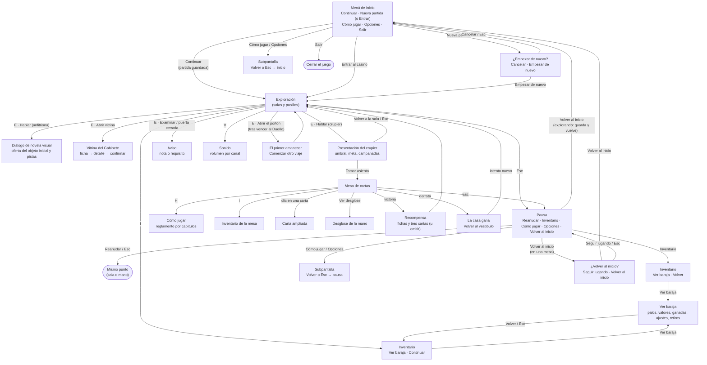
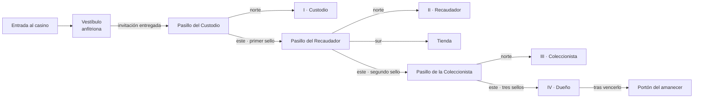
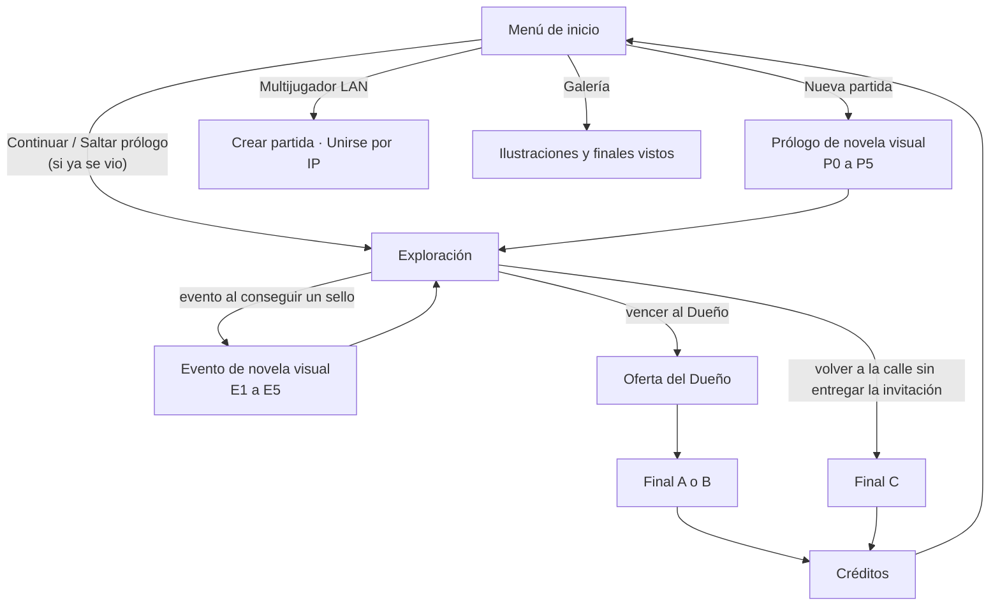

# La Última Mesa · Mapa de navegación

**Estado:** redactado por Kenned el 24 de noviembre de 2026 a partir del código de la rama `kenned/i5-arranque-campana` (I4 cerrada e I5 en curso). Cada pantalla indica si está **implementada** o **prevista**. Las previstas salen del [guion versión 4](GUION_PROLOGO_Y_DIALOGOS.md) y del [documento de diseño v2.4](../../../1P/Diseno_Videojuego/Documento_Diseno_La_Ultima_Mesa_v2_4.docx).

**Para qué sirve:** describir cómo se pasa de una pantalla a otra (inicio, exploración, diálogos, tienda, mesa, pausa, opciones y finales), qué teclas funcionan en cada una y cómo se vuelve al punto anterior.

## Índice

1. [Principios de navegación](#1-principios-de-navegación)
2. [Diagrama de pantallas implementadas](#2-diagrama-de-pantallas-implementadas)
3. [Pantallas](#3-pantallas)
4. [Mapa del casino](#4-mapa-del-casino)
5. [Controles](#5-controles)
6. [Cómo se cierra cada ventana](#6-cómo-se-cierra-cada-ventana)
7. [Pantallas previstas](#7-pantallas-previstas)

---

## 1. Principios de navegación

| Principio | Cómo se cumple |
| --- | --- |
| **Esc siempre retrocede un paso** | Esc cierra primero lo que esté abierto encima (carta ampliada, desglose, ayuda, elección de Llave, diálogo, vitrina, «Ver baraja») y solo cuando no queda nada abre la pausa. Desde la pausa reanuda; desde una subpantalla de la pausa vuelve a la pausa. Una pulsación hace una sola cosa. |
| **Se vuelve al mismo punto** | Al reanudar, el foco vuelve al botón que lo tenía. Al cerrar «Ver baraja», al botón desde el que se abrió. Al volver de una mesa, el visitante aparece frente a su puerta. |
| **Nada se pierde sin confirmar** | La partida se guarda sola entre encuentros. Volver al inicio a mitad de una mesa pide confirmación; explorando, guarda y vuelve. «Nueva partida» pide confirmación antes de borrar la guardada. Comprar en la vitrina pide confirmación y muestra el saldo resultante. |
| **Teclado y ratón por igual** | Todo botón se puede enfocar con Tab y flechas y activar con Enter o Espacio. En exploración se mueve con WASD o flechas e interactúa con **E**. |
| **Una sola pista a la vista** | Cerca de algo aparece una única acción («E · Hablar», «E · Abrir vitrina»); una puerta cerrada muestra su requisito («Falta el primer sello»). El objetivo actual se ve en la esquina superior izquierda. |
| **La partida se guarda sola** | Entre encuentros, en los puntos seguros (sala nueva, compra, recompensa, pausa, antes de sentarse). Nunca a mitad de una mesa. Perder borra la partida. |
| **La pausa congela el mundo** | Movimiento, entradas y animaciones de la sala y de la mesa se detienen; la mano en curso se conserva (mazo, campanadas y fase). |
| **Selección de nivel = mapa físico** | La campaña es lineal y no tiene pantalla de selección de nivel. La sustituye el propio casino: cada sello abre una puerta del pasillo siguiente y se puede volver a las salas ya visitadas caminando. Ver [Mapa del casino](#4-mapa-del-casino). |

---

## 2. Diagrama de pantallas implementadas

Las ventanas superpuestas (vitrina, diálogo, aviso, inventario, sonido) bloquean el movimiento del visitante mientras están abiertas y esconden el indicador de objetivo.

---

## 3. Pantallas

| Pantalla | Estado | Cómo se llega | Qué contiene | Cómo se sale |
| --- | --- | --- | --- | --- |
| **Menú de inicio** | Implementada | Al arrancar el juego o al volver desde la pausa | Título y lema. Sin partida guardada: **Entrar al casino**; con partida: **Continuar** (enfocado) y **Nueva partida**. Después, **Cómo jugar**, **Opciones** y **Salir**. Fondo del vestíbulo oscurecido | «Continuar», «Entrar al casino», «Nueva partida» (con confirmación) o «Salir». Esc no hace nada aquí |
| **Confirmar nueva partida** | Implementada | «Nueva partida» con una partida guardada | Aviso de que se borra la partida guardada | «Cancelar» o Esc (al inicio); «Empezar de nuevo» |
| **Cómo jugar** | Implementada | Inicio o pausa | Texto breve: moverse, interactuar, sellos, mesa y atajos | «Volver» o Esc, a la pantalla de origen |
| **Opciones** | Implementada | Inicio o pausa | Volumen de Música, Ambiente, Efectos e Interfaz; casilla de **movimiento reducido**. Se guardan en `user://ajustes.cfg` | «Volver» o Esc |
| **Exploración** | Implementada | «Entrar al casino», reanudar o volver de una mesa | Sala o pasillo con el visitante, puntos de interacción (◇, que se rellena al acercarse), objetivo arriba a la izquierda, sellos y fichas arriba a la derecha y una sola pista abajo | Interactuar con **E**, **I**, **V** o Esc |
| **Diálogo de novela visual** | Implementada | **E** con la anfitriona | Retrato enmarcado, cuadro con nombre, texto que se escribe a 55 caracteres por segundo y respuestas encima del cuadro. La oferta inicial muestra icono, nombre y efecto de cada objeto | Elegir una respuesta, avanzar hasta el final o Esc (no aplica nada) |
| **Aviso** | Implementada | Examinar una nota, intentar abrir una puerta cerrada | Título, texto y «Continuar» | «Continuar», Esc o **E** |
| **Vitrina del Gabinete** | Implementada | **E · Abrir vitrina** en la tienda (tras el primer sello) | Fichas ilustradas de los productos con precio; detalle con efecto, motivo si no se puede comprar y saldo tras la compra; selector de cartas para retirar o ajustar | Comprar, cancelar o Esc |
| **Presentación del crupier** | Implementada | **E · Hablar** en la sala de una mesa | Retrato, frase del crupier y tres cifras: umbral, meta y campanadas | «Tomar asiento» (a la mesa) o «Volver a la sala» |
| **Mesa de cartas** | Implementada | «Tomar asiento» | Mano, intervalo y umbral, franja de patrones, progreso hacia la meta, dial de campanadas, acciones **Iniciar/Pedir** y **Plantarse**, Lente si se lleva, botones de inventario y ayuda | Al terminar el encuentro, el botón principal levanta al jugador. Esc abre la pausa |
| **Cómo jugar (mesa)** | Implementada | **H** en la mesa | Reglamento por capítulos: mesa, palos, puntuación y Llaves, con ejemplos | «Cerrar» o Esc |
| **Inventario de la mesa** | Implementada | **I** en la mesa | Fichas, Lentes y amuletos que se llevan | «Cerrar» o Esc |
| **Carta ampliada** | Implementada | Clic o Enter sobre una carta | La carta grande y el efecto de su palo; una Máscara oculta muestra «1–10» | «Cerrar» o Esc |
| **Desglose** | Implementada | «Ver desglose» tras resolver una mano | Valores efectivos, patrones, Velas, amuletos y puntos | «Cerrar» o Esc |
| **Recompensa** | Implementada | Vencer una de las tres primeras mesas | Fichas ganadas y tres cartas para añadir a la baraja (una puede ser la Vela de Racha ×2) | Elegir una carta o «Continuar sin carta» |
| **La casa gana** | Implementada | Agotar las campanadas sin llegar a la meta | Texto de derrota | «Volver al vestíbulo»: empieza un intento nuevo |
| **Inventario (exploración)** | Implementada | **I** en exploración | Cartas, fichas, sellos, Lentes y amuletos | «Ver baraja», «Continuar», **I** o Esc |
| **Ver baraja** | Implementada | «Ver baraja» desde cualquiera de los dos inventarios | Total, recuento por palo y por valor, una fila por palo ordenada por valor; marca cartas ganadas, ajustadas y la Vela ×2; lista las retiradas. Durante una mano las Máscaras se ven boca abajo | «Volver», Esc o **B**, al inventario de origen |
| **Sonido** | Implementada | **V** en exploración o en la mesa | Los cuatro volúmenes | «Volver al casino» o Esc |
| **Pausa** | Implementada | Esc en exploración o en la mesa sin nada abierto | **Reanudar**, **Inventario**, **Cómo jugar**, **Opciones**, **Volver al inicio** | «Reanudar» o Esc, al mismo punto |
| **Confirmación de volver al inicio** | Implementada | «Volver al inicio» a mitad de una mesa | Aviso de que se pierde la mano en curso y de que, al continuar, se vuelve frente al crupier con lo que se tenía al sentarse | «Seguir jugando» o Esc (a la pausa); «Volver al inicio» |
| **El primer amanecer** | Implementada (provisional) | **E · Abrir el portón** en la sala del Dueño tras vencerlo | Texto de salida | «Comenzar otro viaje». Lo sustituyen los finales del guion |

---

## 4. Mapa del casino

El casino es la «selección de nivel» del juego: las salas se abren en orden con los sellos y se puede volver a cualquiera ya abierta.

| Señal en pantalla | Significado |
| --- | --- |
| Puerta con luz cálida y halo en el suelo | Es la que acerca al siguiente objetivo |
| Puerta oscurecida con candado | Cerrada; la placa dice el sello que falta |
| Placa con «Superada» | Mesa ya vencida; se puede entrar, pero no volver a jugar |
| Placa con «Siguiente», «Abierta» o «Cerrada» | Estado de cada puerta del pasillo |
| Objetivo arriba a la izquierda | «Habla con la anfitriona», «Encuentra la mesa del Custodio»… cambia solo con el progreso |

---

## 5. Controles

| Acción | Exploración | Mesa | Ventanas y menús |
| --- | --- | --- | --- |
| Moverse | WASD o flechas | — | — |
| Interactuar | **E** | — | **E**, Enter o Espacio activan la opción enfocada |
| Iniciar mano o pedir carta | — | **P** o botón | — |
| Plantarse | — | **S** o botón | — |
| Devolver una Llave | — | **L** o clic en la Llave | Esc cancela la elección |
| Ver reglas | — | **H** | — |
| Inventario | **I** | **I** | — |
| Sonido | **V** | **V** | — |
| Reiniciar la mesa | — | **R** (solo fuera de campaña) | Pide confirmación |
| Pausa y retroceder | **Esc** | **Esc** | **Esc** retrocede un paso |
| Navegar botones | — | Tab y flechas | Tab y flechas |

---

## 6. Cómo se cierra cada ventana

Orden en que Esc cierra cosas, de la más alta a la más baja. Cada pulsación cierra solo la primera que encuentre:

1. Ver baraja.
2. Confirmación o subpantalla de la pausa (vuelve a la pausa).
3. Pausa (reanuda).
4. En la mesa: ventana modal (carta ampliada, desglose, reglas, inventario), animación de revelado o elección de Llave.
5. Diálogo de novela visual o vitrina.
6. Aviso o inventario de exploración.
7. Si no hay nada abierto: abre la pausa.

---

## 7. Pantallas previstas

Salen del guion y del documento de diseño; todavía no están en el juego.

| Pantalla | Origen | Notas |
| --- | --- | --- |
| **Prólogo** | Guion, P0 a P5 | Modo NVL a pantalla completa y modo ADV con retrato. Controles de lectura: avanzar, saltar lo leído (Ctrl), automático, historial (rueda arriba) y ocultar el cuadro |
| **Saltar prólogo** | Guion | Solo si ya se vio en algún intento |
| **Eventos E1 a E5** | Guion | Se abren solos al volver con un sello o al acercarse a la última mesa; se cierran solos al terminar |
| **Oferta del Dueño y finales A, B y C** | Guion | Sustituyen a «El primer amanecer» provisional |
| **Multijugador LAN** | Documento de diseño | «Crear partida» muestra la IP local; «Unirse a partida» la pide. Sala de espera hasta que ambos estén listos |
| **Galería** | Guion | Ilustraciones y finales desbloqueados en cualquier intento |
| **Créditos** | — | Tras cualquier final |
