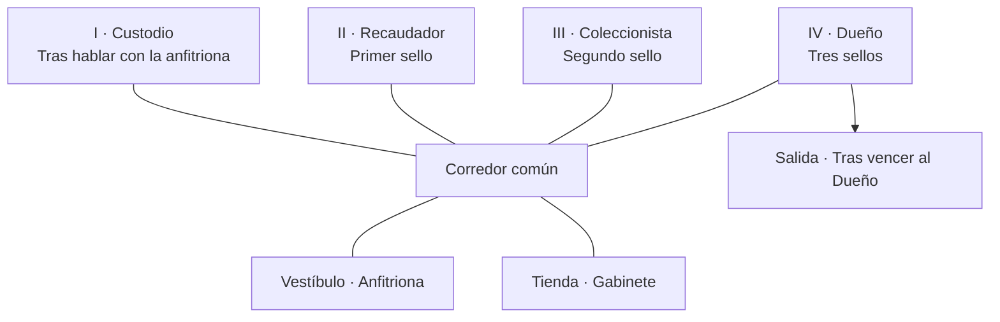

# Iteración 04 · Interfaz y recorrido del casino

**Estado general:** Las ocho tareas están implementadas en la rama `kenned/i4-interfaz-recorrido`. Las [dos correcciones de la revisión](#correcciones-de-la-revisión) están hechas; queda el piloto de I4-08. El rediseño del mapa pasa a la [iteración 05](ITERACION_05.md). **Base:** I3, commit `cd30925`.

**Objetivo:** que el jugador sepa adónde ir, qué puede comprar y qué acaba de pasar con una mirada. La vitrina, las puertas y las cartas llevan la información principal. Los detalles de efectos y reglas se consultan al seleccionar un elemento o abrir el libro.

## Plan de trabajo

| ID | Tarea | Estado | Primera entrega |
| --- | --- | --- | --- |
| I4-01 | Vitrina del Gabinete de la anfitriona | **Implementada** · `6ac000a` | Compra de la Lente de humo desde una ficha ilustrada, con confirmación, saldo actualizado y regreso al juego |
| I4-02 | Recorrido según el plano de la exposición | **Implementada sobre el arte del corredor** · el mapa se rehace en [I5](ITERACION_05.md) | Corredor transitable con puertas arriba y abajo, puntos de retorno y cerrojos en el orden indicado |
| I4-03 | Reducir el texto que aparece por defecto | **Implementada** · `2fc2ab3` y botones en `c6c6663` | Aplicar la jerarquía y los reemplazos de texto del apartado I4-03 en las pantallas jugables |
| I4-04 | Sellos y fichas ilustrados | **Implementada** · `7453b28` | Tres espacios para los sellos, saldo con icono y prueba al obtener el primer sello |
| I4-05 | Mesa visual y dial de campanadas | **Implementada** · `c6c6663` | Tapete más amplio, patrones en la franja inferior y acciones compactas a la derecha, con el dial animado en una mano real |
| I4-06 | Base reutilizable de diálogos tipo novela visual | **Implementada** | Una escena y un formato de conversación compartidos, probados con las líneas actuales de la anfitriona |
| I4-07 | Menú de inicio y pausa con Esc | **Implementada** | Entrada al casino, pausa, opciones y retorno a la misma mano o sala |
| I4-08 | Integración y prueba de usabilidad | **Regresión, capturas y correcciones hechas** · piloto pendiente | Recorrido completo, capturas a dos resoluciones y registro de dónde se detiene o duda el jugador |

**Orden propuesto.** Empezar por una compra completa y probar el corredor con formas simples antes de rehacer su fondo. Revisar qué textos necesita el jugador y aplicar esa jerarquía al HUD y a la mesa del Custodio. Probar la base de diálogos con la anfitriona, incorporar los menús y cerrar con el recorrido completo y el piloto.

## Avance de I4

Implementado por Kenned el 23 de noviembre de 2026. **217 pruebas y 2.067 aserciones** en Godot 4.7.2; capturas de la vitrina, el corredor, la mesa, el diálogo, el inicio, la pausa y las opciones a 1024 × 576 y 1280 × 720 con `tests/qa_interfaz_i4.gd`. Las tareas se integraron en el orden I4-04, I4-01, I4-02, I4-03, I4-05, I4-06 e I4-07, porque la vitrina reutiliza el recuadro de saldo y la pausa reutiliza el inventario y el sonido. Cada pantalla nueva es un componente propio: `casino.gd` y `mesa_ui.gd` solo los crean y conectan ([distribución](ARQUITECTURA_Y_PATRONES.md#distribución-en-i4)).

| Tarea | Qué quedó | Pendiente o límite |
| --- | --- | --- |
| I4-01 | `casino/interfaz/vitrina/`: fichas con imagen, nombre y precio; detalle con efecto, motivo («Faltan 5 fichas») y saldo tras la compra; selector de cartas con el cambio previsto («Pasará a 5») y el motivo de las no elegibles. Esc vuelve del detalle al catálogo y del catálogo al mostrador; el foco regresa al producto. Sustituye a `tienda_casino.gd`. El selector usa cuatro columnas de 84 × 58 para quedar dentro del marco | Los servicios de baraja usan el grabado de Llaves con un signo encima; falta arte propio para Retirar y Ajustar |
| I4-02 | `PlanoGaleria` sigue la diapositiva «Plano del casino» sobre el arte de `corredor.webp`: las cuatro mesas al norte, en orden, en las cuatro puertas de la derecha; el vestíbulo y la tienda al sur, bajo I y II. Las dos puertas de la izquierda del arte quedan apagadas y sin interacción. La próxima puerta se ilumina, las cerradas se oscurecen con candado y la placa muestra su estado (Superada, Siguiente, Abierta, Cerrada) o, al acercarse, el sello que falta. Volver de una sala deja al visitante frente a su puerta | El fondo no tiene puertas al sur: el vestíbulo y la tienda usan un vano provisional dibujado sobre la barandilla. No se pide un fondo nuevo: [I5](ITERACION_05.md) sustituye el corredor común por pasillos propios de cada jefe |
| I4-03 | Sin pista repetida ni tira fija de teclas: cerca de algo aparece una sola acción («E · Hablar», «E · Abrir vitrina») y una puerta cerrada muestra su requisito. El crupier muestra umbral, meta y campanadas como tres cifras junto a **Tomar asiento**. El resultado se lee como «+102 puntos» o «Quiebra · 19 supera 17» | El botón de sonido salió del encabezado del casino y de la mesa con I4-07; los atajos se conservan |
| I4-04 | `casino/interfaz/hud/`: tríptico de sellos (pendiente en relieve tenue, estado al enfocarlo, estampa única del sello nuevo) y ficha con saldo. El mismo recuadro aparece en exploración, mesa de campaña y vitrina. El inventario nombra cada sello | — |
| I4-05 | Tapete del Custodio, acciones apiladas de 230 × 64 bajo el boleto con coste solo si es real, patrones en una franja propia con símbolo y estado, intervalo y umbral juntos, boleto compacto que se ilumina al sumar y dial en dos capas cuyo aro gira 0,25 s al gastar una campanada. Las medidas viven en `mesa/interfaz/composicion_mesa.gd`. Se retiraron los óvalos antiguos del marco | El tapete solo existe para el Custodio; las otras mesas conservan el paño liso. Lo que daría plantarse ahora se lee junto a la suma, no dentro del botón |
| I4-06 | `casino/dialogos/`: `Conversacion` (recurso de datos) y `DialogoNovela` (escena). Retrato enmarcado sobre el fondo de la sala, cuadro inferior con nombre, texto que se escribe a 55 caracteres por segundo y respuestas encima del cuadro. Clic, Enter o E avanzan y la primera pulsación completa la línea; Esc cierra sin aplicar nada. Las entradas y opciones admiten condiciones («sin_invitacion», «sellos==2»); una opción emite una solicitud que `CampanaCasino.atender` comprueba y aplica. La anfitriona vive en `datos/dialogos/anfitriona.tres` y entrega la invitación una sola vez. `Conversacion.errores()` detecta destinos, personajes o retratos rotos | Solo la anfitriona usa la escena; los crupieres siguen en el libro porque muestran sus cifras y **Tomar asiento**. El guion completo llega con la trama |
| I4-07 | `casino/interfaz/menus/`: inicio (**Entrar al casino**, **Cómo jugar**, **Opciones**, **Salir**) al arrancar el juego; pausa con Esc (**Reanudar**, **Inventario**, **Cómo jugar**, **Opciones**, **Volver al inicio**) en la sala o a mitad de una mano; opciones con volumen por canal y movimiento reducido, guardados en `user://ajustes.cfg`. Esc cierra primero lo abierto (diálogo, vitrina, libro, carta o Llave) y solo después pausa; desde una subpantalla vuelve a la pausa. La pausa desactiva el proceso de la sala y de la mesa, de modo que se congelan movimiento, entradas y animaciones. Volver al inicio con un intento activo pide confirmación | El menú de inicio solo aparece cuando el casino es la escena principal; las pruebas lo abren con `abrir_inicio()` |
| I4-08 | Regresión de GUT con compra y cancelación, sellos, regreso a la tienda, salida tras el Dueño, giro del dial, invitación única y pausa sin cambios en la mano. Capturas de las pantallas nuevas a las dos resoluciones | Falta el piloto con tres personas descrito abajo |

## Correcciones de la revisión

**Responsable:** Kenned. **Rama:** `kenned/i4-interfaz-recorrido`. **Estado:** implementadas y verificadas el 23 de noviembre de 2026.

| Tarea | Corrección | Criterio de cierre | Resultado |
| --- | --- | --- | --- |
| I4-07 · Foco al reanudar | En [casino.gd](juego/casino/casino.gd), guardar el control enfocado antes de abrir la pausa y restaurarlo al reanudar si sigue disponible. Si ya no está disponible, enfocar una acción válida de la mesa. | Con **Plantarse** enfocado en una mano activa, pulsar **Esc** dos veces o elegir **Reanudar**. La mano se conserva, **Plantarse** recupera el foco y **Enter** ejecuta esa acción una sola vez. | `casino.gd` guarda el foco en `pausar()` y lo devuelve en `_reanudar()`; si el control desapareció, enfoca Iniciar o Pedir, Plantarse o Cómo jugar. Tres pruebas nuevas en `test_menus.gd`: Esc dos veces, botón **Reanudar** y control eliminado |
| I4-01 · Etiquetas de la vitrina | Crear cada etiqueta una sola vez en [ficha_producto.gd](juego/casino/interfaz/vitrina/ficha_producto.gd), [detalle_producto.gd](juego/casino/interfaz/vitrina/detalle_producto.gd) y [vitrina_gabinete.gd](juego/casino/interfaz/vitrina/vitrina_gabinete.gd). Las etiquetas creadas con `Label.new()` y reemplazadas por `Libro.rotulo()` explican los 26 nodos sin liberar al cerrar una sesión. | Abrir y cerrar el casino y repetir GUT. Confirmar que desaparecen las etiquetas huérfanas de la vitrina y que siguen pasando las pruebas de compra y navegación. | Los ocho campos se declaran como `Label` sin instancia y se crean solo con `Libro.rotulo()`. `test_vitrina.gd` cuenta los nodos huérfanos tras abrir y cerrar la vitrina: sin la corrección encuentra 26 y con ella ninguno. Cerrar el juego no informa fugas |

El enlace de la vitrina se corrigió en este plan. Regresión tras ambas correcciones: **221 pruebas y 2.076 aserciones**, todas pasan. GUT aún atribuye 28 huérfanos a `test_interfaz.gd`, que solo prueba la mesa; no vienen de la vitrina y quedan para revisar aparte. El piloto con tres personas sigue pendiente.

## I4-01 · Vitrina de la tienda

El Gabinete se abre con **E** junto al mostrador. La vitrina muestra el saldo y una cuadrícula de productos. Cada ficha tiene imagen, nombre y precio en fichas. Seleccionar una ficha muestra su efecto, el motivo si está bloqueada y el botón de compra. Las dos imágenes de referencia aportan la presentación por objetos y la lectura del precio al vistazo. La vitrina adopta el nogal, el vidrio, el latón y la luz cálida del Gabinete.

- **Objetos.** Reutilizar las ilustraciones de la Lente de humo, la Corona del riesgo, el Sello del prudente y la Moneda mellada.
- **Baraja.** Mostrar Retirar, Ajustar +1 y Ajustar −1 en una zona propia. Al seleccionar un servicio, abrir un selector visual de cartas con el cambio previsto. Mostrar las cartas no elegibles con su motivo al enfocarlas.
- **Confirmación.** Mostrar el coste y el saldo resultante antes de cobrar. Esc vuelve al catálogo desde el detalle o al mostrador desde la vitrina. Al volver, el foco regresa al producto seleccionado. El clic y el teclado recorren el mismo flujo.

El [catálogo](juego/datos/tienda/catalogo_tienda.tres) sigue siendo la fuente de precios y descripciones. La campaña valida y ejecuta cada compra. La [vitrina del Gabinete](juego/casino/interfaz/vitrina/vitrina_gabinete.gd) presenta el catálogo y solicita la compra.

**Aceptación.** Se puede comparar el precio de dos objetos sin abrirlos. Confirmar cobra y aplica una vez. Salir, cancelar o intentar una compra bloqueada conserva el saldo y la baraja. Con ratón o solo teclado se puede inspeccionar, confirmar y volver al mostrador.

## I4-02 · Distribución del mapa

La diapositiva **«Plano del casino»** define el mapa caminable. Las cuatro mesas quedan al norte del corredor común, en orden de izquierda a derecha. El vestíbulo y la tienda conectan desde el sur. La salida se alcanza desde la sala del Dueño, tras derrotarlo. El corredor permite regresar a la tienda entre encuentros.

- Ajustar en conjunto fondo, huellas, placas, puntos de **E** y posiciones de entrada. Volver de una sala deja al jugador frente a su puerta en el corredor, con espacio para seguir caminando.
- Señalar la próxima puerta con luz y una placa breve. Las puertas cerradas muestran un candado y su requisito al acercarse. El estado se distingue también por texto e icono.
- Comprobar el trayecto del vestíbulo a la anfitriona, la vuelta a la tienda, las puertas antes y después de conseguir sus sellos y el camino desde el Dueño hasta la salida.

**Aceptación.** Con WASD o flechas y **E** se puede completar la ruta de la diapositiva y volver a la tienda desde las salas accesibles. Las puertas respetan la progresión, los regresos conservan la orientación y las colisiones dejan paso hasta cada interacción.

## I4-03 · Texto en el momento de la decisión

| Pantalla | Qué se ve durante el juego | Qué se consulta al interactuar |
| --- | --- | --- |
| Vestíbulo y galería | Nombre de sala y un objetivo a la izquierda, como **Habla con la anfitriona**. Se elimina la pista inferior que repite el objetivo y la tira fija de teclas. Al acercarse aparece una sola acción, como **E · Hablar** | **Cómo jugar** reúne WASD, E y los atajos. Una puerta cerrada conserva su candado y muestra **Falta el primer sello** al acercarse |
| Encabezado de exploración y mesa | Los tres sellos ilustrados y la ficha con su saldo reemplazan **10 fichas · 0 / 3 sellos**. Ayuda, inventario y sonido pasan al menú | El inventario identifica cada sello y los objetos disponibles |
| Vitrina | Imagen, nombre y precio por producto. El detalle se abre al seleccionar. **Faltan 2 fichas** identifica un bloqueo en el producto elegido | Efecto, condición de compra y saldo resultante antes de confirmar |
| Presentación del crupier | Una intervención breve y **Tomar asiento**. Mostrar umbral, meta y campanadas en tres cifras junto a la elección, con sus etiquetas | La regla especial se consulta en el libro. Si cambia el coste de una acción, aparece junto a esa acción durante la mano |
| Mano activa | Cartas, suma o intervalo, umbral, campanadas y puntuación. Los botones muestran solo la acción y su atajo. Se retiran **Gratis**, **Revelar y puntuar** y **No lo excedas**. Si hay coste real, indicarlo con una ficha breve al lado de la acción, como **−1 campanada** o **−1 ficha** | El nombre, el bono y el progreso de cada patrón aparecen al enfocarlo o elegirlo. Los recuentos de mazo y descarte pasan a un detalle consultable |
| Resolución | Un resultado breve, como **+64 puntos** o **Quiebra · 19 supera 17**. Si hay Máscaras, la revelación precede al resultado | **Ver desglose** muestra la fórmula y los bonos |

**Aceptación.** Durante la exploración solo hay un objetivo y una pista de acción cuando el jugador está cerca de algo. Durante la mano, **Pedir** y **Plantarse** se reconocen a primera vista y conservan sus atajos; los costes reales aparecen en indicadores separados. El jugador puede averiguar por qué una puerta o compra está bloqueada, leer el intervalo de una Máscara y abrir el desglose con teclado. Revisar capturas comparables a 1024 × 576 y 1280 × 720, con movimiento reducido y audio silenciado.

## I4-04 · HUD de sellos y fichas

- **Sellos.** Tres recuadros contiguos forman una ilustración. Cada victoria del Custodio, el Recaudador y la Coleccionista completa su parte, en ese orden. Los espacios vacíos conservan un relieve tenue. Al volver a explorar, el sello recién ganado se estampa una vez y queda visible. El nombre y el estado de cada sello se pueden consultar al enfocar su recuadro o desde el inventario.
- **Fichas.** Un recuadro compacto combina el icono de una ficha del casino con el saldo en cifras alineadas. Usar el mismo recuadro en exploración, mesa y vitrina. En la confirmación se ve cuánto queda tras comprar. El saldo se actualiza al aplicar una compra, una comisión o una recompensa.
- **Arte disponible.** Reloj del Custodio, balanza del Recaudador y vitrina de la Coleccionista, recortados del mismo tríptico. El icono de ficha se entrega como capa independiente. [Archivos y procedencia](Diseno/ARTE_I4.md).

**Aceptación.** Se distinguen los estados de 0 a 3 sellos sin depender del color. Cada victoria habilita su recuadro y el HUD refleja las fichas reales. Con movimiento reducido el sello y el saldo aparecen de inmediato.

## I4-05 · Mesa visual y campanadas

La captura marca dos problemas: los botones ocupan todo el pie de la mano y los textos de patrones pasan por encima del borde del tapete. En la siguiente composición, el tapete y las cartas ganan espacio central. Las acciones bajan a la columna derecha y los patrones tienen una franja propia bajo la mano.

- **Acciones a la derecha.** Apilar **Pedir** y **Plantarse** debajo del boleto, con el mismo ancho y una sola línea por botón. Como punto de partida, probar **230 × 64** en el lienzo de 1440 × 810, frente a los 278 × 80 actuales. Así, la altura interactiva ronda 45 px a 1024 × 576. Mantener **P/S** y el foco visible. **Iniciar mano** y **Mostrar resultado** usan el mismo espacio cuando cambie la fase.
- **Mesa más amplia.** Extender el paño hacia el espacio que dejan los botones. Conservar el tapete generado, con su borde de latón como único contorno de la mesa. Retirar los óvalos decorativos anteriores de esa zona y evitar que el borde pase por debajo de textos o botones.
- **Patrones más abajo.** Colocar la lectura de la mano debajo del tapete y los cinco indicadores en una franja oscura al pie de la columna central. Mantener un símbolo y un estado breve dentro de cada indicador. Al enfocarlo o seleccionarlo, mostrar nombre, progreso y bono en un único espacio de detalle. Después de resolver, destacar los patrones aplicados.
- **Dial.** Al gastar una campanada, el aro ilustrado hace un giro corto mientras la cifra baja. El número permanece horizontal y se asienta en su valor real. El efecto se activa con el gasto confirmado, dura unos **0,25 s** como punto de partida y termina en el valor correcto aunque el jugador abra el menú. Una devolución de campanada actualiza la cifra con su propio aviso. Con movimiento reducido la cifra cambia de inmediato.
- **Resultado.** Al terminar la cuenta de puntos, iluminar brevemente el borde del boleto cuando se suma el aporte. Conservar la secuencia de revelación de Máscaras y evitar que el realce compita con ella.
- **Arte disponible.** Tapete del Custodio y dial en dos capas con el mismo centro de giro. Los grabados, el retrato y el boleto se reutilizan. [Archivos y montaje](Diseno/ARTE_I4.md).

**Ajustes propuestos.** Mostrar el intervalo y el umbral juntos en una sola línea. Dejar el retrato como ancla visual a la izquierda. Compactar el boleto alrededor de la cifra **acumulado / meta** y la barra. Llevar los accesos secundarios al menú de I4-07 para que la cabecera tenga espacio para los sellos y el saldo.

**Aceptación.** A 1024 × 576 y 1280 × 720, los botones quedan debajo del boleto, los patrones quedan fuera del tapete y una mano larga conserva el desplazamiento horizontal. Se puede jugar con P/S y consultar los patrones con Tab. Iniciar una mano consume una campanada y dispara un giro. Pedir, cancelar una acción, reiniciar o cambiar de pantalla dejan el aro quieto.

## I4-06 · Base reutilizable de diálogos tipo novela visual

La entrega es un sistema que se pueda usar desde cualquier sala con el guion que tengamos en cada momento. La trama y el guion completo se escribirán después. Mientras tanto, las líneas existentes de la anfitriona permiten probar la introducción, una elección y su efecto en el juego.

- **Presentación compartida.** Sobre el fondo de la sala, mostrar el retrato y un cuadro inferior con el nombre y una intervención. Tomar de las referencias la disposición de las respuestas encima del cuadro, con el estilo de La Última Mesa. Avanzar con clic, Enter o E. Si la línea se está escribiendo, la primera pulsación la completa.
- **Conversaciones como datos.** Cada intervención tiene un identificador, personaje, texto, retrato o expresión opcional y la siguiente intervención. Una elección contiene el texto de cada respuesta y su destino. El formato admite una condición de progreso para mostrar una frase u opción distinta más adelante. Al añadir un diálogo se prepara otro recurso que usa la misma escena.
- **Conexión con la campaña.** Una elección que afecta al juego emite una solicitud. La campaña comprueba si corresponde y aplica el cambio. La prueba usa **Entregar la invitación** y **Volver**. Abrir, avanzar o cerrar el diálogo conserva el progreso hasta que el jugador confirme la elección.

**Aceptación.** Cambiar una línea o conectar otra conversación a la misma escena requiere editar solo sus datos. La anfitriona responde antes y después de recibir la invitación, y esta se entrega una sola vez. El visitante queda quieto durante el diálogo y recupera el control al cerrar. Las opciones se pueden elegir con teclado y el texto se puede leer completo con movimiento reducido y sin audio.

## I4-07 · Inicio y pausa

| Pantalla | Opciones |
| --- | --- |
| Inicio | **Entrar al casino**, **Cómo jugar**, **Opciones** y **Salir** |
| Pausa con Esc | **Reanudar**, **Inventario**, **Cómo jugar**, **Opciones** y **Volver al inicio** |
| Opciones | Volumen por canal y movimiento reducido |

- Mover las opciones secundarias al menú y concentrar la pantalla de juego en las acciones de la sala o de la mano. Los atajos de inventario, ayuda y sonido se pueden conservar sin repetir sus botones en el encabezado.
- **Esc actúa sobre lo que está abierto.** Cancela una elección de Llave, cierra el detalle activo o termina una revelación según el contexto. Si hay una recompensa pendiente, la elección u omisión se resuelve en su propia pantalla. Desde el juego libre, Esc abre la pausa. Desde la pausa, Esc reanuda.
- Congelar movimiento y entradas de juego bajo el menú. Reanudar conserva la sala, la mano, los recursos y el foco. Pedir confirmación al volver al inicio con un intento activo.

**Aceptación.** El menú se navega con ratón o teclado. Una pulsación de Esc produce una sola acción. Abrir y cerrar la pausa a mitad de una mano conserva el estado y devuelve el control al jugador. Las opciones se conservan entre sesiones.

## I4-08 · Integración y prueba de usabilidad

- **Regresión.** Ejecutar GUT. Cubrir compra y cancelación, progreso de sellos, regreso a la tienda, salida posterior al Dueño, giro del dial, invitación única y pausa sin cambios en la mano. [Comandos de pruebas](juego/README.md#pruebas).
- **Revisión visual.** Ver la vitrina, el HUD, una puerta cerrada, la mesa, el diálogo y la pausa a **1024 × 576** y **1280 × 720**. Comprobar legibilidad, foco y acciones de Esc, con movimiento normal y reducido.
- **Piloto propuesto con tres personas.** Pedirles que entren al casino, hablen con la anfitriona, encuentren al Custodio, consulten opciones durante una mano y comparen dos productos. Registrar si reconocen el sello obtenido, entienden el gasto de campanadas y vuelven al juego sin ayuda.

El incremento se centra en presentación y recorrido de la campaña local. La implementación toma las reglas vigentes de [I3](ITERACION_03.md) y la [dirección artística](Diseno/DIRECCION_ARTISTICA.md).
