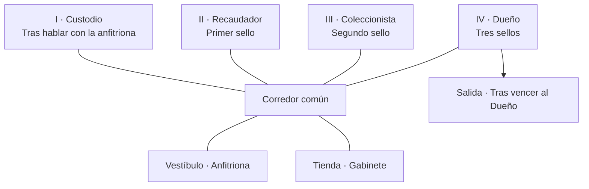

# Iteración 04 · Interfaz y recorrido del casino

**Estado general:** planificada. **Base:** I3, commit `cd30925`.

**Objetivo:** que el jugador sepa adónde ir, qué puede comprar y qué acaba de pasar con una mirada. La vitrina, las puertas y las cartas llevan la información principal. Los detalles de efectos y reglas se consultan al seleccionar un elemento o abrir el libro.

## Plan de trabajo

| ID | Tarea | Estado | Primera entrega |
| --- | --- | --- | --- |
| I4-01 | Vitrina del Gabinete de la anfitriona | Pendiente | Compra de la Lente de humo desde una ficha ilustrada, con confirmación, saldo actualizado y regreso al juego |
| I4-02 | Recorrido según el plano de la exposición | Pendiente | Corredor transitable con puertas arriba y abajo, puntos de retorno y cerrojos en el orden indicado |
| I4-03 | Reducir el texto que aparece por defecto | Pendiente | Revisar los mensajes del vestíbulo, las puertas, la mesa y el resultado con ejemplos antes y después |
| I4-05 | Sellos y fichas ilustrados | Pendiente | Tres espacios para los sellos, saldo con icono y prueba al obtener el primer sello |
| I4-06 | Mesa visual y dial de campanadas | Pendiente | Composición del Custodio con dial animado en una mano real |
| I4-07 | Base reutilizable de diálogos tipo novela visual | Pendiente | Una escena y un formato de conversación compartidos, probados con las líneas actuales de la anfitriona |
| I4-08 | Menú de inicio y pausa con Esc | Pendiente | Entrada al casino, pausa, opciones y retorno a la misma mano o sala |
| I4-04 | Integración y prueba de usabilidad | Pendiente | Recorrido completo, capturas a dos resoluciones y registro de dónde se detiene o duda el jugador |

**Orden propuesto.** Probar primero una compra completa y el HUD de progreso con la primera victoria. Probar el corredor con formas simples antes de rehacer su fondo. Después, preparar la mesa del Custodio y probar la base de diálogos con la anfitriona. Integrar los menús y validar los textos dentro de las pantallas jugables.

## I4-01 · Vitrina de la tienda

El Gabinete se abre con **E** junto al mostrador. La vitrina muestra el saldo y una cuadrícula de productos. Cada ficha tiene imagen, nombre y precio en fichas. Seleccionar una ficha muestra su efecto, el motivo si está bloqueada y el botón de compra. Las dos imágenes de referencia aportan la presentación por objetos y la lectura del precio al vistazo. La vitrina adopta el nogal, el vidrio, el latón y la luz cálida del Gabinete.

- **Objetos.** Reutilizar las ilustraciones de la Lente de humo, la Corona del riesgo, el Sello del prudente y la Moneda mellada.
- **Baraja.** Mostrar Retirar, Ajustar +1 y Ajustar −1 en una zona propia. Al seleccionar un servicio, abrir un selector visual de cartas con el cambio previsto. Mostrar las cartas no elegibles con su motivo al enfocarlas.
- **Confirmación.** Mostrar el coste y el saldo resultante antes de cobrar. Esc vuelve al catálogo desde el detalle o al mostrador desde la vitrina. Al volver, el foco regresa al producto seleccionado. El clic y el teclado recorren el mismo flujo.

El [catálogo](juego/datos/tienda/catalogo_tienda.tres) sigue siendo la fuente de precios y descripciones. La campaña valida y ejecuta cada compra. El primer prototipo parte de la [interfaz actual de tienda](juego/casino/interfaz/tienda_casino.gd).

**Aceptación.** Se puede comparar el precio de dos objetos sin abrirlos. Confirmar cobra y aplica una vez. Salir, cancelar o intentar una compra bloqueada conserva el saldo y la baraja. Con ratón o solo teclado se puede inspeccionar, confirmar y volver al mostrador.

## I4-02 · Distribución del mapa

La diapositiva **«Plano del casino»** define el mapa caminable. Las cuatro mesas quedan al norte del corredor común, en orden de izquierda a derecha. El vestíbulo y la tienda conectan desde el sur. La salida se alcanza desde la sala del Dueño, tras derrotarlo. El corredor permite regresar a la tienda entre encuentros.

- Ajustar en conjunto fondo, huellas, placas, puntos de **E** y posiciones de entrada. Volver de una sala deja al jugador frente a su puerta en el corredor, con espacio para seguir caminando.
- Señalar la próxima puerta con luz y una placa breve. Las puertas cerradas muestran un candado y su requisito al acercarse. El estado se distingue también por texto e icono.
- Comprobar el trayecto del vestíbulo a la anfitriona, la vuelta a la tienda, las puertas antes y después de conseguir sus sellos y el camino desde el Dueño hasta la salida.

**Aceptación.** Con WASD o flechas y **E** se puede completar la ruta de la diapositiva y volver a la tienda desde las salas accesibles. Las puertas respetan la progresión, los regresos conservan la orientación y las colisiones dejan paso hasta cada interacción.

## I4-03 · Texto en el momento de la decisión

| Situación | A primera vista | Detalle a petición |
| --- | --- | --- |
| Exploración | Un objetivo a la izquierda, sellos ilustrados y saldo con icono. Cerca de una interacción, una línea como **E · Abrir vitrina** | Placa o nota al examinarla. Los controles se consultan en el menú |
| Antes de sentarse | Nombre del crupier, umbral, meta, campanadas y **Tomar asiento** | Regla especial y diálogo en el libro o al hablar con el personaje |
| En la mesa | Suma o intervalo, umbral, coste de la acción y recursos disponibles. Los patrones se leen por su símbolo y estado | Nombre y efecto del patrón al enfocarlo. Ejemplos en el libro |
| Al resolver | Puntos obtenidos o motivo breve de la Quiebra | Fórmula y bonos en **Ver desglose** |

**Aceptación.** En cada pantalla se reconoce la acción principal sin leer un párrafo. La comisión, la Quiebra, el saldo insuficiente y los valores todavía ocultos siguen siendo comprensibles con audio silenciado y movimiento reducido. Los mensajes se leen completos y el detalle se puede abrir con teclado.

## I4-05 · HUD de sellos y fichas

- **Sellos.** Tres recuadros contiguos forman una ilustración. Cada victoria del Custodio, el Recaudador y la Coleccionista completa su parte, en ese orden. Los espacios vacíos conservan un relieve tenue. Al volver a explorar, el sello recién ganado se estampa una vez y queda visible. El nombre y el estado de cada sello se pueden consultar al enfocar su recuadro o desde el inventario.
- **Fichas.** Un recuadro compacto combina el icono de una ficha del casino con el saldo en cifras alineadas. Usar el mismo recuadro en exploración, mesa y vitrina. En la confirmación se ve cuánto queda tras comprar. El saldo se actualiza al aplicar una compra, una comisión o una recompensa.
- **Arte por generar.** Tres fragmentos de una misma composición y un icono original de ficha. Los motivos propuestos son el reloj del Custodio, la balanza del Recaudador y la vitrina de la Coleccionista. Preparar capas transparentes sin cifras ni letras incrustadas. Validar el conjunto antes de producir las variantes y registrar su procedencia.

**Aceptación.** Se distinguen los estados de 0 a 3 sellos sin depender del color. Cada victoria habilita su recuadro y el HUD refleja las fichas reales. Con movimiento reducido el sello y el saldo aparecen de inmediato.

## I4-06 · Mesa visual y campanadas

- **Composición.** Probar en el Custodio un tapete ilustrado que enmarque la mano, con el retrato, las cartas y el boleto de meta como focos. Usar motivos visuales de los patrones y reservar el nombre, el requisito y el bono para el detalle. Los números, costes, atajos y botones se dibujan en Godot con el estilo del casino.
- **Dial.** Al gastar una campanada, el aro ilustrado hace un giro corto mientras la cifra baja. El número permanece horizontal y se asienta en su valor real. El efecto se activa con el gasto confirmado, dura unos **0,25 s** como punto de partida y termina en el valor correcto aunque el jugador abra el menú. Una devolución de campanada actualiza la cifra con su propio aviso. Con movimiento reducido la cifra cambia de inmediato.
- **Resultado.** Al terminar la cuenta de puntos, iluminar brevemente el borde del boleto cuando se suma el aporte. Conservar la secuencia de revelación de Máscaras y evitar que el realce compita con ella.
- **Arte por generar.** Un tapete para el Custodio como prueba de estilo y un aro del dial separado de su base. Mantener libres las zonas de cartas, lectura, botones y cifras. Reutilizar los grabados, el retrato y el boleto existentes.

**Aceptación.** Iniciar una mano consume una campanada y dispara un giro. Pedir, cancelar una acción, reiniciar o cambiar de pantalla dejan el aro quieto. Se identifican la mano, el umbral y la acción disponible a ambas resoluciones, con animación normal o reducida.

## I4-07 · Base reutilizable de diálogos tipo novela visual

La entrega es un sistema que se pueda usar desde cualquier sala con el guion que tengamos en cada momento. La trama y el guion completo se escribirán después. Mientras tanto, las líneas existentes de la anfitriona permiten probar la introducción, una elección y su efecto en el juego.

- **Presentación compartida.** Sobre el fondo de la sala, mostrar el retrato y un cuadro inferior con el nombre y una intervención. Tomar de las referencias la disposición de las respuestas encima del cuadro, con el estilo de La Última Mesa. Avanzar con clic, Enter o E. Si la línea se está escribiendo, la primera pulsación la completa.
- **Conversaciones como datos.** Cada intervención tiene un identificador, personaje, texto, retrato o expresión opcional y la siguiente intervención. Una elección contiene el texto de cada respuesta y su destino. El formato admite una condición de progreso para mostrar una frase u opción distinta más adelante. Al añadir un diálogo se prepara otro recurso que usa la misma escena.
- **Conexión con la campaña.** Una elección que afecta al juego emite una solicitud. La campaña comprueba si corresponde y aplica el cambio. La prueba usa **Entregar la invitación** y **Volver**. Abrir, avanzar o cerrar el diálogo conserva el progreso hasta que el jugador confirme la elección.

**Aceptación.** Cambiar una línea o conectar otra conversación a la misma escena requiere editar solo sus datos. La anfitriona responde antes y después de recibir la invitación, y esta se entrega una sola vez. El visitante queda quieto durante el diálogo y recupera el control al cerrar. Las opciones se pueden elegir con teclado y el texto se puede leer completo con movimiento reducido y sin audio.

## I4-08 · Inicio y pausa

| Pantalla | Opciones |
| --- | --- |
| Inicio | **Entrar al casino**, **Cómo jugar**, **Opciones** y **Salir** |
| Pausa con Esc | **Reanudar**, **Inventario**, **Cómo jugar**, **Opciones** y **Volver al inicio** |
| Opciones | Volumen por canal y movimiento reducido |

- Mover las opciones secundarias al menú y concentrar la pantalla de juego en las acciones de la sala o de la mano. Los atajos de inventario, ayuda y sonido se pueden conservar sin repetir sus botones en el encabezado.
- **Esc actúa sobre lo que está abierto.** Cancela una elección de Llave, cierra el detalle activo o termina una revelación según el contexto. Si hay una recompensa pendiente, la elección u omisión se resuelve en su propia pantalla. Desde el juego libre, Esc abre la pausa. Desde la pausa, Esc reanuda.
- Congelar movimiento y entradas de juego bajo el menú. Reanudar conserva la sala, la mano, los recursos y el foco. Pedir confirmación al volver al inicio con un intento activo.

**Aceptación.** El menú se navega con ratón o teclado. Una pulsación de Esc produce una sola acción. Abrir y cerrar la pausa a mitad de una mano conserva el estado y devuelve el control al jugador. Las opciones se conservan entre sesiones.

## I4-04 · Cómo comprobar el incremento

- **Regresión.** Ejecutar GUT. Cubrir compra y cancelación, progreso de sellos, regreso a la tienda, salida posterior al Dueño, giro del dial, invitación única y pausa sin cambios en la mano. [Comandos de pruebas](juego/README.md#pruebas).
- **Revisión visual.** Ver la vitrina, el HUD, una puerta cerrada, la mesa, el diálogo y la pausa a **1024 × 576** y **1280 × 720**. Comprobar legibilidad, foco y acciones de Esc, con movimiento normal y reducido.
- **Piloto propuesto con tres personas.** Pedirles que entren al casino, hablen con la anfitriona, encuentren al Custodio, consulten opciones durante una mano y comparen dos productos. Registrar si reconocen el sello obtenido, entienden el gasto de campanadas y vuelven al juego sin ayuda.

El incremento se centra en presentación y recorrido de la campaña local. La implementación toma las reglas vigentes de [I3](ITERACION_03.md) y la [dirección artística](Diseno/DIRECCION_ARTISTICA.md).
