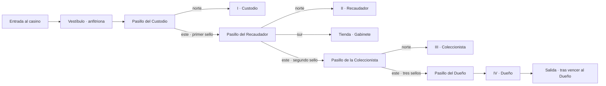

# Iteración 05 · Pasillos de los jefes

**Estado general:** en curso. De las nueve tareas, **seis están completas, una está a medias y dos están pendientes** ([avance](#avance)). El primer tramo, la oferta inicial, «Ver baraja», la variante de la Vela y el guardado se integraron en `main` el 24 de noviembre de 2026 junto con I4 (PR #4, commit `07d4fe6`). Las correcciones del 25 de noviembre (I5-06) y este documento se integraron en `main` el 25 de noviembre de 2026, para que Julio continúe desde ahí. **Base:** I4 con sus correcciones, commit `d9c82b7`.

**Objetivo:** que el avance por la campaña se recorra. Cada sello abre una puerta física hacia el pasillo del jefe siguiente, y cada pasillo anuncia con su arte y su sonido a quién se va a enfrentar el jugador.

**Identificadores.** Kenned redactó el plan el 23 de noviembre de 2026 a partir de lo que acordó con Julio. Los identificadores I5-01 a I5-09 ordenan el trabajo hecho para seguir el avance; Julio puede reasignarlos o cambiar el reparto.

## Plan de trabajo

| ID | Tarea | Estado | Evidencia o pendiente |
| --- | --- | --- | --- |
| I5-01 | Oferta inicial de la anfitriona | **Completado** · `23ced9f` | Baraja, diez fichas y un objeto a elegir en una sola operación |
| I5-02 | Entrada y pasillos por jefe | **Parcial** · `23ced9f` | Entrada, vestíbulo y tres pasillos jugables. Falta el pasillo propio del Dueño |
| I5-03 | Recompensa verificada y «Ver baraja» | **Completado** · `23ced9f` | Desde el inventario en exploración y desde la pausa, también a mitad de una mano |
| I5-04 | Variante · Vela de Racha ×2 | **Completado** · `86aed51` | Activada por defecto; el balance queda para Julio |
| I5-05 | Guardado automático de la partida | **Completado** · `8a4368b` | 16 pruebas en `test_guardado.gd`; «Continuar» y «Nueva partida» en el inicio |
| I5-06 | Correcciones de la revisión del 25 de noviembre | **Completado** · `83f12aa` | Cierre sin fugas, franja de patrones, menú de inicio, colisiones y respuestas duplicadas del diálogo. Integrado en `main` |
| I5-07 | Arte de la entrada y de los pasillos | **Pendiente** | Hoy es provisional: la entrada se dibuja en código y los pasillos tiñen `corredor.webp` |
| I5-08 | Sonido por jefe | **Pendiente** | Los buses y los controles de volumen de I4-07 ya existen |
| I5-09 | Guion narrativo y documentos de la rúbrica | **Completado** · `ac08646` | [Guion v4](Diseno/GUION_PROLOGO_Y_DIALOGOS.md), [ilustraciones pendientes](Diseno/ILUSTRACIONES_PENDIENTES.md), navegación, catálogo y presentación |

## Avance

| Iteración | Tema | Tareas cerradas | Pruebas automáticas |
| --- | --- | --- | ---: |
| [I1](ITERACION_01.md) | Mesa del Custodio | Prototipo jugable, versión 0.1.0 | — |
| [I2](ITERACION_02.md) | La casa de los tres sellos | Campaña completa, versión 0.2.0 | 134 |
| [I3](ITERACION_03.md) | Pulido, balance y deuda técnica | 8 de 8 | 167 |
| [I4](ITERACION_04.md) | Interfaz y recorrido del casino | 8 de 8 implementadas; falta el piloto de I4-08 | 221 |
| **I5** | **Pasillos de los jefes** | **6 de 9, una parcial** | **259** |

Con I5, la campaña se juega de principio a fin: entrada, vestíbulo, pasillos, cuatro mesas, tienda, objeto inicial y salida. La partida también sobrevive a un cierre del juego. Lo que falta es sobre todo arte y sonido (I5-07 e I5-08) y una pantalla, el pasillo del Dueño (I5-02).

## Mapa

El corredor común de I4 se sustituye por una entrada y cuatro pasillos, uno por cada jefe. Cada pasillo es una pantalla propia. Las puertas entre pasillos se cierran hasta conseguir el sello que corresponde.



**Decisiones.**

- **La tienda no es accesible antes del Custodio.** Queda en el pasillo del Recaudador, detrás del primer sello.
- **Elección inicial de objeto.** La anfitriona entrega la baraja, diez fichas y un objeto a elegir al aceptar la invitación. Ver [I5-01](#i5-01--oferta-inicial-de-la-anfitriona).
- **El Dueño tiene su propio pasillo**, igual que los otros tres jefes.
- **Sin atajos a la tienda.** El jugador camina de vuelta por los pasillos. Al volver de una mesa aparece frente a su puerta, como en I4-02.
- Cada puerta cerrada indica el sello que falta. Se conservan la luz de la puerta siguiente, el candado y las placas de I4-02.

## I5-01 · Oferta inicial de la anfitriona

**Estado:** completado el 23 de noviembre de 2026. La anfitriona muestra las tres opciones en una intervención de la escena de diálogos de I4-06. Cada opción enseña el icono, el nombre y el efecto en una línea. Se reutilizan los objetos del [catálogo](juego/datos/tienda/catalogo_tienda.tres).

| Opción | Efecto para mostrar al jugador | Decisión que ofrece |
| --- | --- | --- |
| **Lente de humo** | Revela todas las Máscaras ocultas de tu mano. Un uso. | Saber si conviene pedir otra carta. |
| **Sello del prudente** | Recupera 1 campanada si quedas 3 o más por debajo del umbral. Una vez por mesa. | Plantarte temprano para ganar otra oportunidad. |
| **Moneda mellada** | Gana 2 fichas al lograr Punto exacto. Hasta tres veces por mesa. | Buscar el umbral exacto y ahorrar para la tienda. |

**Resultado.** «Entregar la invitación» abre la oferta. Al elegir, `CampanaCasino.atender("objeto_inicial:<id>")` entrega la baraja, diez fichas y el objeto en una sola operación. «Pensarlo un momento» o Esc cierran sin entregar nada, y la oferta se puede retomar. Se rechazan una segunda confirmación y cualquier opción fuera de la lista. Sin elegir, el pasillo del Custodio sigue cerrado.

**Límite.** Los textos de la oferta usan la descripción del catálogo, no la versión breve de la tabla. Si Julio prefiere esas frases, basta con cambiar `catalogo_tienda.tres`.

**Aceptación.** Al confirmar, el inventario muestra solo el objeto elegido y el saldo inicial queda en diez fichas. Volver a hablar después de confirmar, o enviar dos veces la misma elección, conserva el inventario y el saldo. Las tres opciones se pueden elegir con ratón o teclado.

## I5-02 · Entrada y pasillos por jefe

**Estado:** parcial. Funciona el recorrido entrada → vestíbulo → pasillo del Custodio → mesa. El primer sello abre la puerta del este hacia el pasillo del Recaudador, que tiene su mesa al norte y la tienda al sur. El segundo sello abre el pasillo de la Coleccionista. Con tres sellos se abre la puerta del Dueño. Al volver de una sala o de otro pasillo, el visitante aparece frente a la puerta por la que llegó. Cada pasillo ilumina la puerta que acerca al siguiente objetivo.

| Espacio | Puertas | Estado |
| --- | --- | --- |
| Entrada al casino | Fachada y puerta hacia el vestíbulo. Es breve: presenta el lugar y enseña a moverse y a usar **E**. | **Jugable** con arte provisional dibujado en código. El intento empieza aquí |
| Vestíbulo | La anfitriona y el paso al pasillo del Custodio. | **Jugable.** La puerta al pasillo pide la invitación |
| Pasillo del Custodio | Al norte, la mesa del Custodio. Al este, la puerta al pasillo siguiente, cerrada hasta el primer sello. | **Jugable** sobre `corredor.webp` |
| Pasillo del Recaudador | Al norte, la mesa del Recaudador; al sur, la tienda. Al este, la puerta al pasillo siguiente, cerrada hasta el segundo sello. | **Jugable** sobre `corredor.webp` |
| Pasillo de la Coleccionista | Al frente, la mesa de la Coleccionista. Al este, la puerta al pasillo del Dueño, cerrada hasta reunir los tres sellos. | **Provisional:** la puerta del este lleva directamente a la sala del Dueño |
| Pasillo del Dueño | La mesa del Dueño. La salida se abre desde su sala tras vencerlo. | **Pendiente** |

**Implementación.** `PlanoGaleria` pasó de una lista de puertas a una lista de pasillos (`PASILLOS`, `PADRE`, `ORDEN`). Cada puerta tiene su lado y, si está al norte o al sur, su posición sobre el arte. Los sellos que exige cada pasillo y la tienda están en `CampanaCasino.ACCESO`, y `puerta_abierta` los consulta. La entrada es una sala más en `PlanoSalas` y `SalaExplorable`, con la fachada como obstáculo. Se reutilizan la luz, los candados, las placas y los puntos de regreso de I4-02.

**Pendiente.** El pasillo del Dueño como pantalla propia, con la puerta desde el pasillo de la Coleccionista.

## I5-03 · Recompensa verificada y «Ver baraja»

**Estado:** completado el 23 de noviembre de 2026.

- **Recompensa.** Al vencer al Custodio, la oferta de tres cartas de I2 añade la carta elegida a la baraja, y esa carta entra en el mazo de la mesa siguiente. Omitir la oferta conserva la baraja tal cual.
- **«Ver baraja».** Se abre desde el inventario (**I**) en exploración y desde **Inventario** en la pausa, también a mitad de una mano. Muestra el total, el recuento por palo y por valor, y una fila por palo ordenada por valor. Marca las cartas ganadas, las ajustadas (+1 o −1) y la Vela de Racha ×2, y lista las retiradas en la tienda. Al cerrarla, el jugador vuelve al inventario y el foco al botón desde el que la abrió.

**Límite.** La vista nunca refleja el orden del mazo. Durante una mano, las Máscaras aparecen boca abajo, sin valor ni ajuste, para que no delaten las de la mano. `CampanaCasino` registra `ganadas`, `ajustadas` (con el signo del ajuste) y `retiradas` para esta vista.

## I5-04 · Variante · Vela de Racha ×2

**Estado:** completado el 23 de noviembre de 2026. La tercera carta de cada recompensa es una Vela que cuenta como dos cartas para Racha cuando forma parte de las últimas cartas del mismo palo. Para el umbral vale lo impreso y sigue sumando +1 al multiplicador como cualquier Vela. Su efecto aparece en la carta de la oferta («RACHA ×2»), en su descripción, en la carta ampliada en la mesa, en el indicador de Racha y en «Ver baraja».

**Implementación.** `CartaDef.rasgo` admite rasgos especiales. `EvaluadorMano.racha` y los indicadores públicos pesan la Vela de Racha ×2. La variante está activada por defecto en `CampanaCasino.variante_vela` y se desactiva poniendo esa variable en `false`.

### Simulación de la campaña

`tests/sim_campana.gd` ya no compra una Lente antes del Custodio: el objeto inicial llega por `atender` y las compras empiezan tras el primer sello. Se usaron 300 semillas con margen 6 y las mesas de `mesas_campana.tres`. Cada celda indica qué parte de los intentos que llegan a esa mesa la superan.

| Estrategia | Custodio | Recaudador | Coleccionista | Dueño | Campañas ganadas |
| --- | ---: | ---: | ---: | ---: | ---: |
| Sin objeto ni compras | 89 % | 87 % | 92 % | 35 % | 25 % |
| Objeto inicial: Lente de humo | 90 % | 87 % | 92 % | 35 % | 26 % |
| Objeto inicial: Sello del prudente | 95 % | 93 % | 98 % | 43 % | 38 % |
| Objeto inicial: Moneda mellada | 89 % | 87 % | 92 % | 35 % | 25 % |
| Lente inicial; Corona y Sello en cuanto abre la tienda | 90 % | 99 % | 100 % | 99 % | 88 % |

Lecturas para Julio:

- **El Sello del prudente domina la oferta inicial.** Es la única opción que mejora sola el resultado: +13 puntos de campañas ganadas.
- **La Moneda mellada no cambia nada en la simulación**, porque la estrategia nunca gasta las fichas. Su valor real depende de la tienda.
- **La Lente apenas se nota**, porque es de un solo uso.
- **Comprar Corona y Sello sigue rompiendo al Dueño**, como ya se vio en I2, aunque ahora las compras empiecen en el Recaudador.
- **Efecto de la variante de la Vela.** Con `--recompensas`, la simulación toma la carta de menor valor efectivo. Con la variante activa, las campañas ganadas sin objeto pasan del 35 % al 40 %, y con el Sello del 49 % al 55 %. La estrategia no busca Racha a propósito: parte de la diferencia viene de que cambia la tercera carta de la oferta.

## I5-05 · Guardado automático de la partida

**Estado:** completado por Kenned el 24 de noviembre de 2026, a pedido de Julio. Antes, cerrar el juego reiniciaba el intento y solo se conservaban los ajustes.

| Aspecto | Comportamiento |
| --- | --- |
| **Ranura** | Una sola partida, en `user://partida.json` (JSON con número de versión). Se escribe en un temporal y se renombra, así un cierre a mitad de la escritura no estropea la partida anterior |
| **Cuándo se guarda** | Automáticamente en los puntos seguros: al recibir la invitación, al entrar en una sala o pasillo, al comprar, al resolver una recompensa, al pausar, justo antes de sentarse en una mesa y al cerrar la ventana |
| **Qué se guarda** | Invitación, fichas, sellos, Lentes, amuletos, la baraja con la identidad de cada carta, los ajustes, las cartas ganadas y retiradas, una recompensa pendiente, la sala y la posición del visitante |
| **Mesa en curso** | **No se guarda.** Si el juego se cierra a mitad de una mesa, al continuar el jugador está frente al crupier con lo que tenía al sentarse (sin las 15 fichas del Recaudador, por ejemplo). Alternativa descartada: contar la mesa abandonada como derrota, que castiga un cierre accidental |
| **Derrota** | Borra la partida: el intento terminó |
| **Recompensa pendiente** | Si se cierra el juego antes de elegir la carta, al continuar la oferta vuelve a abrirse |
| **Menú de inicio** | Sin partida: «Entrar al casino». Con partida: **«Continuar»** (enfocado) y **«Nueva partida»**, que pide confirmación antes de borrar |
| **Volver al inicio desde la pausa** | Explorando, guarda y vuelve sin pedir confirmación: no se pierde nada. En una mesa, avisa de que se pierde la mano en curso |
| **Archivo dañado** | Un archivo ilegible o de otra versión se ignora (el inicio ofrece «Entrar al casino»). Los datos inválidos (palos, valores u objetos desconocidos) se descartan sin romper el juego |

**Implementación.** `ajustes/partida_guardada.gd` (`PartidaGuardada`) lee, escribe y borra el archivo. `CampanaCasino.a_datos()` y `CampanaCasino.desde_datos()` convierten el intento en datos simples. El casino decide cuándo guardar (`guardar()`) y cómo continuar (`continuar()`). El guardado solo se activa cuando el casino es la escena principal, de modo que las pruebas y las escenas sueltas nunca tocan la partida de quien juega; las pruebas usan su propio archivo.

**Pruebas.** `tests/test_guardado.gd` tiene 16 pruebas:

- los datos pasan por JSON sin cambios y los inválidos se descartan;
- un archivo dañado o de otra versión no se carga;
- moverse y comprar guardan la partida;
- continuar restaura la sala y la posición;
- cerrar en la mesa vuelve a como se estaba al sentarse;
- perder borra la partida;
- la recompensa pendiente se vuelve a ofrecer;
- el menú ofrece «Continuar» y confirma «Nueva partida».

## I5-06 · Correcciones de la revisión del 25 de noviembre

**Responsable:** Kenned. **Rama:** `kenned/i5-arranque-campana`, commits `83f12aa` y `13658cf`. **Estado:** implementadas, verificadas e integradas en `main` el 25 de noviembre de 2026.

| Problema | Corrección | Comprobación |
| --- | --- | --- |
| Al cerrar el juego justo después de vencer a un jefe, el depurador informaba 8 instancias de ObjectDB perdidas y 2 recursos de audio en uso (`campana.wav`, `sello.wav`) | `AudioCasino.detener_todo()` detiene y suelta todos los emisores al pedir el cierre de la ventana o al salir del árbol | `tests/qa_cierre.gd` y `tests/qa_cierre_mesa.gd` cierran la ventana en tres momentos (tras el Custodio, a mitad de una mano y con la recompensa abierta). Seis ejecuciones con `--verbose`, sin fugas |
| La franja de patrones mostraba símbolos («3×», «=17») y el texto de Racha se desbordaba | La franja vuelve a mostrar el nombre y el bono de cada patrón con su estado debajo. Los cinco botones miden 131 × 43 y caben en los 680 px de la franja | `test_la_franja_muestra_nombre_y_bono_de_cada_patron` en `test_costes_y_revelacion.gd` |
| Al volver al inicio con una partida guardada, el menú se desbordaba: «Continuar» y «Nueva partida» añaden un quinto botón | El marco de cualquier pantalla del menú crece hacia arriba si el contenido no cabe, sin salir de la pantalla | `test_ninguna_pantalla_del_menu_desborda_su_marco` en `test_menus.gd`. Sin la corrección falla en el inicio |
| En las salas, el visitante subía hasta el zócalo del fondo (y = 188) y se metía en las columnas laterales | Tramos de pared en `PlanoSalas` para el vestíbulo (fondo y peana del reloj), el Custodio (fondo y columnas), el Recaudador (fondo y balanza), la Coleccionista (fondo y columnas) y el Dueño (pilares y muro, con el portón libre). En el vestíbulo, el visitante llega ahora hasta y ≈ 215 | `test_colisiones_salas.gd` comprueba cada tramo nuevo y que todas las interacciones siguen accesibles. Sigue habiendo paso por detrás de la silla del Custodio (`test_sprites.gd`) |
| En el diálogo de la anfitriona, con «movimiento reducido» activado en las opciones, las respuestas aparecían duplicadas (8 botones en vez de 4) | `DialogoNovela.completar()` quita las respuestas anteriores antes de crearlas: completar una línea ya completa no las repite | `test_con_movimiento_reducido_el_texto_aparece_completo` en `test_dialogos.gd` completa dos veces y cuenta 2 respuestas |

`tests/qa_limites.gd` empuja al visitante contra los cuatro lados de una sala y anota hasta dónde llega. Sirve para revisar las huellas al sustituir un fondo.

## I5-07 · Arte de la entrada y de los pasillos

**Estado:** pendiente. Hasta tener las ilustraciones, el juego usa el arte provisional y el sprite antiguo del visitante. La herramienta de generación de Julio vuelve a estar disponible el jueves al mediodía.

| Pieza | Descripción |
| --- | --- |
| Entrada al casino | Fachada exterior de noche con la puerta del casino. Hoy se dibuja en `casino/exploracion/entrada_casino.gd`. |
| Cuatro pasillos | Uno por jefe, con la paleta común y un motivo propio: relojes y péndulos para el Custodio, libros mayores y balanzas para el Recaudador, vitrinas y piezas expuestas para la Coleccionista, y el amanecer tras la verja para el Dueño. Cada pasillo muestra solo sus puertas. Hoy los tres primeros usan `corredor.webp` con un tinte y apagan las puertas sobrantes. |
| Puertas laterales y del sur | Puertas reales en el arte de cada pasillo para sustituir los vanos de latón provisionales. |
| Diseño nuevo del protagonista | Según las hojas de expresiones de [ILUSTRACIONES_PENDIENTES.md](Diseno/ILUSTRACIONES_PENDIENTES.md). |

## I5-08 · Sonido por jefe

**Estado:** pendiente. Un ambiente propio para cada pasillo y para cada mesa. Los buses y el control de volumen de I4-07 ya existen, así que basta con añadir los recursos y elegirlos al entrar en cada espacio.

## I5-09 · Guion narrativo y documentos de la rúbrica

**Estado:** completado el 24 de noviembre de 2026 (`ac08646`). Es trabajo de diseño: todavía no hay nada de esto dentro del juego.

| Documento | Contenido |
| --- | --- |
| [GUION_PROLOGO_Y_DIALOGOS.md](Diseno/GUION_PROLOGO_Y_DIALOGOS.md) | Guion final, versión 4: prólogo de novela visual, diálogos de reacción, eventos por sello, decisiones morales y finales |
| [ILUSTRACIONES_PENDIENTES.md](Diseno/ILUSTRACIONES_PENDIENTES.md) | Fondos, hojas de expresiones del protagonista y de los personajes, e indicaciones para generar las imágenes |
| [NAVEGACION_PANTALLAS.md](Diseno/NAVEGACION_PANTALLAS.md) | Mapa de las 21 pantallas y sus transiciones |
| [CATALOGO_JUEGO.md](Diseno/CATALOGO_JUEGO.md) | Cartas, patrones, objetos, crupieres y personajes |
| [PRESENTACION_Y_JUSTIFICACION.md](Diseno/PRESENTACION_Y_JUSTIFICACION.md) | Exposición en tres bloques iguales de 5 minutos |

## Para después

- **LAN.** Queda para una iteración futura, por decisión de Julio. No se ha empezado.
- **Prólogo de novela visual en el juego**, a partir del guion de I5-09 y la base de diálogos de I4-06.
- **Nodos huérfanos de `test_interfaz.gd`.** GUT sigue atribuyéndole 28. Es un pendiente aparte de I4; no viene de los cambios de I5.
- **Piloto de I4-08 con tres personas.** Conviene hacerlo antes de cerrar el diseño de los pasillos, para saber si el jugador encuentra las puertas y entiende las placas.

## Verificación

```powershell
& $GodotExe --headless --path '2P/Desarrollo/juego' -s addons/gut/gut_cmdln.gd -gdir=res://tests -gexit
& $GodotExe --headless --path '2P/Desarrollo/juego' --script res://tests/sim_campana.gd -- --semillas=300 --margen=6
& $GodotExe --path '2P/Desarrollo/juego' --verbose --script res://tests/qa_cierre.gd
& $GodotExe --headless --path '2P/Desarrollo/juego' --script res://tests/qa_limites.gd -- --sala=vestibulo
```

I5 pasa **259 pruebas y 2.468 aserciones** en Godot 4.7.2. La integración en `main` del 24 de noviembre se comprobó además con la simulación de campaña y una exportación para Windows.
