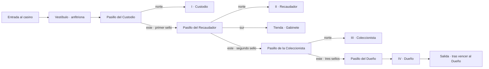

# Iteración 05 · Pasillos de los jefes

**Estado general:** borrador. Kenned lo redactó el 23 de noviembre de 2026 a partir de lo que acordó con Julio. Julio define los identificadores, el orden y el reparto de las tareas. **Base:** I4, rama `kenned/i4-interfaz-recorrido`.

**Objetivo:** que el avance por la campaña se recorra. Cada sello abre una puerta física hacia el pasillo del jefe siguiente, y cada pasillo anuncia con su arte y su sonido a quién se va a enfrentar el jugador.

## Mapa

El corredor común de I4 se sustituye por una entrada y cuatro pasillos, uno por cada jefe. Cada pasillo es una pantalla propia. Las puertas entre pasillos se cierran hasta conseguir el sello que corresponde.

| Espacio | Puertas |
| --- | --- |
| Entrada al casino | Fachada y puerta hacia el vestíbulo. Es breve: presenta el lugar y enseña a moverse y a usar **E**. |
| Vestíbulo | La anfitriona y el paso al pasillo del Custodio. |
| Pasillo del Custodio | Al norte, la mesa del Custodio. Al este, la puerta al pasillo siguiente, cerrada hasta el primer sello. |
| Pasillo del Recaudador | Al norte, la mesa del Recaudador; al sur, la tienda. Al este, la puerta al pasillo siguiente, cerrada hasta el segundo sello. |
| Pasillo de la Coleccionista | Al frente, la mesa de la Coleccionista. Al este, la puerta al pasillo del Dueño, cerrada hasta reunir los tres sellos. |
| Pasillo del Dueño | La mesa del Dueño. La salida se abre desde su sala tras vencerlo. |

## Decisiones

- **La tienda no es accesible antes del Custodio.** Queda en el pasillo del Recaudador, detrás del primer sello.
- **Elección inicial de objeto.** Al recibir la invitación, la anfitriona entrega las fichas de inicio y ofrece elegir uno de tres objetos. Se construye sobre la escena de diálogos de I4-06 cuando esté afinada: una intervención con tres opciones, cada una con su solicitud a la campaña. Así la primera mesa no se juega sin objetos.
- **El Dueño tiene su propio pasillo**, igual que los otros tres jefes.
- **Sin atajos a la tienda.** El jugador camina de vuelta por los pasillos. Al volver de una mesa aparece frente a su puerta, como en I4-02.
- Cada puerta cerrada indica el sello que falta. Se conservan la luz de la puerta siguiente, el candado y las placas de I4-02.

## Arte y sonido

| Pieza | Descripción |
| --- | --- |
| Entrada al casino | Fachada exterior de noche con la puerta del casino. |
| Cuatro pasillos | Uno por jefe, con la paleta común y un motivo propio: relojes y péndulos para el Custodio, libros mayores y balanzas para el Recaudador, vitrinas y piezas expuestas para la Coleccionista y el amanecer tras la verja para el Dueño. Cada pasillo muestra solo sus puertas, sin puertas sobrantes. |
| Sonido por jefe | Un ambiente propio para cada pasillo y para cada mesa. Los buses y el control de volumen de I4-07 ya existen. |

## Impacto técnico

- `PlanoGaleria` pasa de una lista de puertas a una lista de pasillos. Cada pasillo tendrá su fondo, sus puertas, su lado y el sello que exige. La luz, los candados, las placas y los puntos de regreso de I4-02 se reutilizan.
- La entrada se monta como una sala más en `PlanoSalas` y `SalaExplorable`.
- La elección inicial añade una solicitud a `CampanaCasino.atender` y opciones en `datos/dialogos/anfitriona.tres`.
- Hay que revisar el balance del Custodio con el objeto inicial y sin acceso a la tienda. La simulación de `tests/sim_campana.gd` compraba una Lente antes de la primera mesa.

## Pendiente de I4

El piloto de I4-08 con tres personas. Conviene hacerlo antes de cerrar el diseño de los pasillos, para saber si el jugador encuentra las puertas y entiende las placas.
