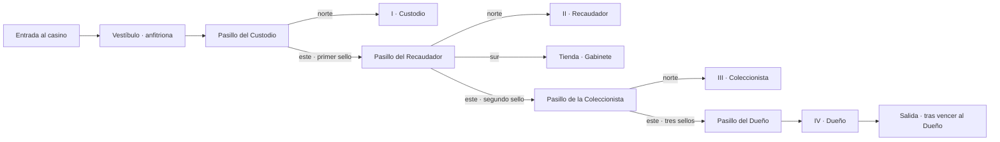

# Iteración 05 · Pasillos de los jefes

**Estado general:** en curso. Kenned redactó el borrador el 23 de noviembre de 2026 a partir de lo que acordó con Julio, y ese mismo día implementó el primer tramo en la rama `kenned/i5-arranque-campana`, que parte de I4 con sus correcciones. Julio define los identificadores, el orden y el reparto de las tareas. **Integrada en `main` el 24 de noviembre de 2026** junto con I4 (PR #4), con 257 pruebas en verde sobre el resultado, la simulación de campaña y una exportación para Windows comprobada.

**Objetivo:** que el avance por la campaña se recorra. Cada sello abre una puerta física hacia el pasillo del jefe siguiente, y cada pasillo anuncia con su arte y su sonido a quién se va a enfrentar el jugador.

## Mapa

El corredor común de I4 se sustituye por una entrada y cuatro pasillos, uno por cada jefe. Cada pasillo es una pantalla propia. Las puertas entre pasillos se cierran hasta conseguir el sello que corresponde.

| Espacio | Puertas | Estado |
| --- | --- | --- |
| Entrada al casino | Fachada y puerta hacia el vestíbulo. Es breve: presenta el lugar y enseña a moverse y a usar **E**. | **Jugable** con arte provisional dibujado en código. El intento empieza aquí |
| Vestíbulo | La anfitriona y el paso al pasillo del Custodio. | **Jugable.** La puerta al pasillo pide la invitación |
| Pasillo del Custodio | Al norte, la mesa del Custodio. Al este, la puerta al pasillo siguiente, cerrada hasta el primer sello. | **Jugable** sobre `corredor.webp` |
| Pasillo del Recaudador | Al norte, la mesa del Recaudador; al sur, la tienda. Al este, la puerta al pasillo siguiente, cerrada hasta el segundo sello. | **Jugable** sobre `corredor.webp` |
| Pasillo de la Coleccionista | Al frente, la mesa de la Coleccionista. Al este, la puerta al pasillo del Dueño, cerrada hasta reunir los tres sellos. | **Provisional:** la puerta del este lleva directamente a la sala del Dueño |
| Pasillo del Dueño | La mesa del Dueño. La salida se abre desde su sala tras vencerlo. | Pendiente |

## Decisiones

- **La tienda no es accesible antes del Custodio.** Queda en el pasillo del Recaudador, detrás del primer sello.
- **Elección inicial de objeto.** La anfitriona entrega la baraja, diez fichas y un objeto a elegir al aceptar la invitación. El objeto es gratis y queda disponible antes de la mesa del Custodio. Ver [oferta inicial](#oferta-inicial-de-la-anfitriona).
- **El Dueño tiene su propio pasillo**, igual que los otros tres jefes.
- **Sin atajos a la tienda.** El jugador camina de vuelta por los pasillos. Al volver de una mesa aparece frente a su puerta, como en I4-02.
- Cada puerta cerrada indica el sello que falta. Se conservan la luz de la puerta siguiente, el candado y las placas de I4-02.

## Oferta inicial de la anfitriona

**Estado:** implementada el 23 de noviembre de 2026. La anfitriona muestra las tres opciones en una intervención de la escena de diálogos de I4-06. Cada opción enseña el icono, el nombre y el efecto en una línea. Se reutilizan los objetos del [catálogo](juego/datos/tienda/catalogo_tienda.tres).

| Opción | Efecto para mostrar al jugador | Decisión que ofrece |
| --- | --- | --- |
| **Lente de humo** | Revela todas las Máscaras ocultas de tu mano. Un uso. | Saber si conviene pedir otra carta. |
| **Sello del prudente** | Recupera 1 campanada si quedas 3 o más por debajo del umbral. Una vez por mesa. | Plantarte temprano para ganar otra oportunidad. |
| **Moneda mellada** | Gana 2 fichas al lograr Punto exacto. Hasta tres veces por mesa. | Buscar el umbral exacto y ahorrar para la tienda. |

**Aceptación.** Al confirmar una opción, el inventario muestra solo el objeto elegido y el saldo inicial queda en diez fichas. Si el jugador cierra el diálogo antes de elegir, puede volver a abrir la oferta. Volver a hablar después de confirmar o enviar dos veces la misma elección conserva el inventario y el saldo. Las tres opciones se pueden elegir con ratón o teclado.

## Avance del primer tramo

Implementado por Kenned el 23 de noviembre de 2026 en `kenned/i5-arranque-campana`. **241 pruebas y 2.352 aserciones** en Godot 4.7.2. Capturas de la entrada, los pasillos, la oferta, la recompensa y «Ver baraja» con `tests/qa_interfaz_i4.gd`. Las cuatro tareas son propuestas de Kenned; Julio les asigna identificador y orden.

| Tarea propuesta | Resultado | Límites |
| --- | --- | --- |
| **Elección inicial de la anfitriona** | «Entregar la invitación» abre la oferta; cada opción muestra el icono y la descripción del catálogo de la tienda. Al elegir, `CampanaCasino.atender("objeto_inicial:<id>")` entrega la baraja, diez fichas y el objeto en una sola operación. «Pensarlo un momento» o Esc cierran sin entregar nada y la oferta se puede retomar. Una segunda confirmación, o una opción fuera de la lista, se rechaza. Sin elegir, el pasillo del Custodio sigue cerrado | Los textos de la oferta usan la descripción del catálogo, no la versión breve de la tabla de arriba. Si Julio prefiere esas frases, basta con cambiar `catalogo_tienda.tres` |
| **Primer tramo del mapa** | Entrada → vestíbulo → pasillo del Custodio → mesa. El primer sello abre la puerta del este hacia el pasillo del Recaudador, con su mesa al norte y la tienda al sur; el segundo abre el pasillo de la Coleccionista; con tres sellos se abre la puerta del Dueño. Al volver de una sala o de otro pasillo, el visitante aparece frente a la puerta por la que llegó. Cada pasillo ilumina la puerta que acerca al siguiente objetivo | Arte provisional: todos los pasillos usan `corredor.webp` con un tinte propio y apagan las puertas que no usan; las puertas del sur y de los lados son vanos de latón dibujados. La entrada está dibujada en código. Falta el pasillo propio del Dueño |
| **Recompensa y «Ver baraja»** | Verificado: al vencer al Custodio, la oferta de tres cartas de I2 añade la elegida a la baraja y esa carta entra en el mazo de la mesa siguiente; omitir la conserva tal cual. «Ver baraja» se abre desde el inventario (**I**) en exploración y desde **Inventario** en la pausa, también a mitad de una mano. Muestra el total, el recuento por palo y por valor, y una fila por palo ordenada por valor. Marca las cartas ganadas, las ajustadas (+1 o −1) y la Vela de Racha ×2, y lista las retiradas en la tienda. Al cerrarla, el jugador vuelve al inventario y el foco al botón desde el que la abrió | La vista sigue la organización de la captura de referencia (resumen a la izquierda, valores, filas por palo), con el estilo de La Última Mesa. Nunca refleja el orden del mazo; durante una mano las Máscaras aparecen boca abajo, sin valor ni ajuste, para que no delaten las de la mano |
| **Variante · Vela de Racha ×2** | La tercera carta de cada recompensa es una Vela que cuenta como dos cartas para Racha cuando forma parte de las últimas cartas del mismo palo. Para el umbral vale lo impreso y sigue sumando +1 al multiplicador como cualquier Vela. Su efecto aparece en la carta de la oferta («RACHA ×2»), en su descripción, en la carta ampliada en la mesa, en el indicador de Racha y en «Ver baraja» | Activada por defecto con `CampanaCasino.variante_vela`; se desactiva poniéndola en `false`. Basta para probar la idea; el balance queda para Julio |

### Simulación de la campaña

`tests/sim_campana.gd` ya no compra una Lente antes del Custodio: el objeto inicial llega por `atender` y las compras empiezan tras el primer sello. 300 semillas con margen 6 y las mesas de `mesas_campana.tres`. Cada celda indica cuántos intentos superan la mesa de los que llegan a ella.

| Estrategia | Custodio | Recaudador | Coleccionista | Dueño | Campañas ganadas |
| --- | ---: | ---: | ---: | ---: | ---: |
| Sin objeto ni compras | 89 % | 87 % | 92 % | 35 % | 25 % |
| Objeto inicial: Lente de humo | 90 % | 87 % | 92 % | 35 % | 26 % |
| Objeto inicial: Sello del prudente | 95 % | 93 % | 98 % | 43 % | 38 % |
| Objeto inicial: Moneda mellada | 89 % | 87 % | 92 % | 35 % | 25 % |
| Lente inicial; Corona y Sello en cuanto abre la tienda | 90 % | 99 % | 100 % | 99 % | 88 % |

Lecturas para Julio:

- **El Sello del prudente domina la oferta inicial.** Es la única opción que mejora sola el resultado: +13 puntos de campañas ganadas.
- **La Moneda mellada no cambia nada en la simulación** porque la estrategia nunca gasta las fichas. Su valor real depende de la tienda.
- **La Lente apenas se nota** porque es un solo uso.
- **Comprar Corona y Sello sigue rompiendo al Dueño**, como ya se vio en I2, aunque ahora empiece a comprar en el Recaudador.
- **Efecto de la variante de la Vela.** Con `--recompensas`, la simulación toma la carta de menor valor efectivo. Con la variante activa, las campañas ganadas sin objeto pasan del 35 % al 40 %, y con el Sello del 49 % al 55 %. La estrategia no busca Racha a propósito: parte de la diferencia viene de que la tercera carta de la oferta cambia.

## Guardado de la partida

**Estado:** implementado por Kenned el 24 de noviembre de 2026 a pedido de Julio. Hasta ahora, cerrar el juego reiniciaba el intento; solo se conservaban los ajustes.

| Aspecto | Comportamiento |
| --- | --- |
| **Ranura** | Una sola partida, en `user://partida.json` (JSON con número de versión). Se escribe en un temporal y se renombra, así un cierre a mitad de la escritura no estropea la partida anterior |
| **Cuándo se guarda** | Automáticamente en los puntos seguros: al recibir la invitación, al entrar en una sala o pasillo, al comprar, al resolver una recompensa, al pausar, justo antes de sentarse en una mesa y al cerrar la ventana |
| **Qué se guarda** | Invitación, fichas, sellos, Lentes, amuletos, la baraja con la identidad de cada carta, los ajustes, las cartas ganadas y retiradas, una recompensa pendiente, la sala y la posición del visitante |
| **Mesa en curso** | **No se guarda.** Si el juego se cierra a mitad de una mesa, al continuar el jugador está frente al crupier con lo que tenía al sentarse (sin las 15 fichas del Recaudador, por ejemplo). Alternativa descartada: contar la mesa abandonada como derrota, que castiga un cierre accidental |
| **Derrota** | Borra la partida: el intento terminó |
| **Recompensa pendiente** | Si se cierra el juego antes de elegir la carta, al continuar la oferta vuelve a abrirse |
| **Menú de inicio** | Sin partida: «Entrar al casino». Con partida: **«Continuar»** (enfocado) y **«Nueva partida»**, que pide confirmación antes de borrar |
| **Volver al inicio desde la pausa** | Explorando, guarda y vuelve sin pedir confirmación: no se pierde nada. En una mesa, avisa de que se pierde la mano en curso |
| **Archivo dañado** | Un archivo ilegible o de otra versión se ignora (el inicio ofrece «Entrar al casino»). Los datos inválidos (palos, valores u objetos desconocidos) se descartan sin romper el juego |

**Implementación.** `ajustes/partida_guardada.gd` (`PartidaGuardada`) lee, escribe y borra el archivo; `CampanaCasino.a_datos()` y `CampanaCasino.desde_datos()` convierten el intento en datos simples; el casino decide cuándo guardar (`guardar()`) y cómo continuar (`continuar()`). El guardado solo se activa cuando el casino es la escena principal, de modo que las pruebas y las escenas sueltas nunca tocan la partida de quien juega; las pruebas usan su propio archivo.

**Pruebas.** `tests/test_guardado.gd`, 16 pruebas: los datos pasan por JSON sin cambios, se descartan los inválidos, el archivo dañado o de otra versión no se carga, moverse y comprar guardan, continuar restaura la sala y la posición, cerrar en la mesa vuelve a como se estaba al sentarse, perder borra, la recompensa pendiente se vuelve a ofrecer, y el menú ofrece «Continuar» y confirma «Nueva partida». Regresión completa: **257 pruebas y 2.421 aserciones**.

## Arte y sonido

| Pieza | Descripción |
| --- | --- |
| Entrada al casino | Fachada exterior de noche con la puerta del casino. Hoy se dibuja en `casino/exploracion/entrada_casino.gd` a la espera del arte. |
| Cuatro pasillos | Uno por jefe, con la paleta común y un motivo propio: relojes y péndulos para el Custodio, libros mayores y balanzas para el Recaudador, vitrinas y piezas expuestas para la Coleccionista y el amanecer tras la verja para el Dueño. Cada pasillo muestra solo sus puertas, sin puertas sobrantes. Hoy los tres primeros usan `corredor.webp` con un tinte y apagan las puertas sobrantes. |
| Puertas laterales y del sur | Puertas reales en el arte de cada pasillo para sustituir los vanos de latón provisionales. |
| Sonido por jefe | Un ambiente propio para cada pasillo y para cada mesa. Los buses y el control de volumen de I4-07 ya existen. |

## Impacto técnico

- **Hecho.** `PlanoGaleria` pasó de una lista de puertas a una lista de pasillos (`PASILLOS`, `PADRE`, `ORDEN`). Cada puerta tiene su lado y, si está al norte o al sur, su posición sobre el arte. Los sellos que exige cada pasillo y la tienda están en `CampanaCasino.ACCESO`, y `puerta_abierta` los consulta. La luz, los candados, las placas y los puntos de regreso de I4-02 se reutilizan.
- **Hecho.** La entrada es una sala más en `PlanoSalas` y `SalaExplorable`, con la fachada como obstáculo.
- **Hecho.** La oferta inicial vive en `datos/dialogos/anfitriona.tres`. `DialogoNovela.abrir` acepta un `describir` opcional que añade icono y detalle a una opción sin que la escena conozca el juego. `CampanaCasino.atender` valida la opción.
- **Hecho.** `CampanaCasino` registra `ganadas`, `ajustadas` (con el signo del ajuste) y `retiradas` para «Ver baraja».
- **Hecho.** `CartaDef.rasgo` admite rasgos especiales; `EvaluadorMano.racha` y los indicadores públicos pesan la Vela de Racha ×2.
- **Pendiente.** El pasillo del Dueño como pantalla propia, el arte definitivo y los sonidos por pasillo.

## Para después

- **Pasillo del Dueño** con su propia pantalla y la puerta desde el pasillo de la Coleccionista.
- **LAN.** Queda para una iteración futura, por decisión de Julio. No se ha empezado.
- **Diseño nuevo del protagonista.** Hasta tener las ilustraciones (la herramienta de generación de Julio vuelve a estar disponible el jueves al mediodía), el juego usa el sprite antiguo del visitante.
- **Integración a `main`.** Hecha el 24 de noviembre de 2026 (commit de integración `07d4fe6`); el PR #4 de I4 quedó fusionado con ella. El trabajo siguiente de I5 parte de `main`.
- **Nodos huérfanos de `test_interfaz.gd`.** GUT sigue atribuyéndole 28; es un pendiente aparte de I4, no viene de los cambios de I5.

## Pendiente de I4

El piloto de I4-08 con tres personas. Conviene hacerlo antes de cerrar el diseño de los pasillos, para saber si el jugador encuentra las puertas y entiende las placas.
