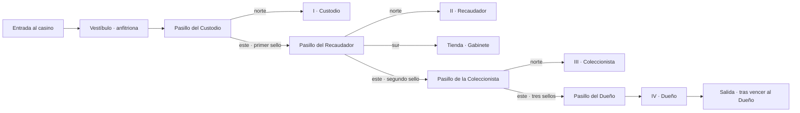

# Iteración 05 · Pasillos de los jefes

**Estado general.** Las once tareas están implementadas. Los recuerdos de los jefes, la validación de balance y la entrega de audio están en la copia de trabajo. La campaña sigue pendiente de observación con tres jugadores en el piloto de I6. [Documento de diseño 2.5](Diseno/Version_2_5/Documento_Diseno_La_Ultima_Mesa_v2_5.docx).

**Objetivo:** que el avance por la campaña se recorra. Cada sello abre una puerta física hacia el pasillo del jefe siguiente, y cada pasillo anuncia con su arte y su sonido a quién se va a enfrentar el jugador.

**Identificadores.** Kenned redactó el plan el 23 de noviembre de 2026 a partir de lo que acordó con Julio. Los identificadores I5-01 a I5-11 mantienen el orden del trabajo y las tareas pendientes.

## Plan de trabajo

| ID | Tarea | Estado | Evidencia o pendiente |
| --- | --- | --- | --- |
| I5-01 | Oferta inicial de la anfitriona | **Completado** · `23ced9f` | Baraja, diez fichas y un objeto a elegir en una sola operación |
| I5-02 | Entrada y pasillos por jefe | **Implementado en local** | Entrada, vestíbulo y cuatro pasillos jugables. El del Dueño requiere tres sellos |
| I5-03 | Recompensa verificada y «Ver baraja» | **Completado** · `23ced9f` | Desde el inventario en exploración y desde la pausa, también a mitad de una mano |
| I5-04 | Variante · Vela de Racha ×2 | **Implementada y comparada en simulación** | Se mantiene activa. Resultados con las mismas 1.000 semillas en [validación de balance](#validación-de-balance). |
| I5-05 | Guardado automático de la partida | **Completado** · `8a4368b` | 16 pruebas en `test_guardado.gd`; «Continuar» y «Nueva partida» en el inicio |
| I5-06 | Correcciones de la revisión del 25 de noviembre | **Completado** · `83f12aa` | Cierre sin fugas, franja de patrones, menú de inicio, colisiones y respuestas duplicadas del diálogo. Integrado en `main` |
| I5-07 | Arte de la entrada y de los pasillos | **Implementado en local** | Fachada ilustrada y cuatro fondos propios con los accesos del plano |
| I5-08 | Sonido por jefe | **Implementado** | Cuatro ambientes de pasillo y cuatro temas de mesa, con fundido al cambiar de pista. |
| I5-09 | Guion narrativo y documentos de la rúbrica | **Completado** · `ac08646` | [Guion v4](Diseno/GUION_PROLOGO_Y_DIALOGOS.md), [ilustraciones pendientes](Diseno/ILUSTRACIONES_PENDIENTES.md), navegación, catálogo y presentación |
| I5-10 | Novela visual en el juego: cinemáticas, conversaciones, accesibilidad y créditos | **Completado** · `b420ab3`, en `main` | Prólogo y llegada como cinemáticas; anfitriona y crupieres con el guion v4; Historial, Auto y Saltar; opciones de lectura; créditos; efectos, personajes en escena, «examinar» ilustrado y un recorrido hacia delante desde el vestíbulo. 285 pruebas |
| I5-11 | Menús posvictoria de los jefes | **Implementado** | Tres preguntas por jefe y cuatro recuerdos ilustrados del [guion v5](Diseno/GUION_PROLOGO_Y_DIALOGOS.md#8-los-jefes), accesibles en la revisita. Las preguntas ligadas a futuros eventos siguen en el guion. |

## Avance

| Iteración | Tema | Tareas cerradas | Pruebas automáticas |
| --- | --- | --- | ---: |
| [I1](ITERACION_01.md) | Mesa del Custodio | Prototipo jugable, versión 0.1.0 | — |
| [I2](ITERACION_02.md) | La casa de los tres sellos | Campaña completa, versión 0.2.0 | 134 |
| [I3](ITERACION_03.md) | Pulido, balance y deuda técnica | 8 de 8 | 167 |
| [I4](ITERACION_04.md) | Interfaz y recorrido del casino | 8 de 8 implementadas; falta el piloto de I4-08 | 221 |
| **I5** | **Pasillos de los jefes** | **7 de 10, una parcial** | **285** |

Con I5, la campaña se juega de principio a fin. La partida se guarda entre encuentros y la historia empieza con un prólogo de novela visual. Al sentarse cambia el tema de la mesa. Al volver después de ganar se puede conocer la historia del jefe y abrir su recuerdo. Los eventos y finales se desarrollarán en iteraciones posteriores. [Inventario de ilustraciones](Diseno/ILUSTRACIONES_PENDIENTES.md).

## Mapa

El corredor común de I4 se sustituye por una entrada y cuatro pasillos, uno por cada jefe. Cada pasillo es una pantalla propia. Las puertas entre pasillos se cierran hasta conseguir el sello que corresponde.



**Decisiones.**

- **La tienda no es accesible antes del Custodio.** Queda en el pasillo del Recaudador, detrás del primer sello.
- **Elección inicial de objeto.** La anfitriona entrega la baraja, diez fichas y un objeto a elegir al aceptar la invitación. Ver [I5-01](#i5-01--oferta-inicial-de-la-anfitriona).
- **El Dueño tiene su propio pasillo**, igual que los otros tres jefes.
- **Sin atajos a la tienda.** El jugador camina de vuelta por los pasillos. Al volver de una mesa aparece frente a su puerta, como en I4-02.
- Ante una puerta cerrada, **E** abre un diálogo de novela visual. La primera puerta que exige un sello dice que falta el sello necesario. Las siguientes indican que faltan los sellos necesarios. El vestíbulo pide hablar con la anfitriona.

## I5-01 · Oferta inicial de la anfitriona

**Estado:** completado el 23 de noviembre de 2026. La anfitriona muestra las tres opciones en una intervención de la escena de diálogos de I4-06. Cada opción enseña el icono, el nombre y el efecto en una línea. Se reutilizan los objetos del [catálogo](juego/datos/tienda/catalogo_tienda.tres).

| Opción | Efecto para mostrar al jugador | Decisión que ofrece |
| --- | --- | --- |
| **Lente de humo** | Revela todas las Máscaras ocultas de tu mano. Un uso. | Saber si conviene pedir otra carta. |
| **Sello del prudente** | Recupera 1 campanada si quedas 3 o más por debajo del umbral. Una vez por mesa. | Plantarte temprano para ganar otra oportunidad. |
| **Moneda mellada** | Gana 2 fichas al lograr Punto exacto. Hasta tres veces por mesa. | Buscar el umbral exacto y ahorrar para la tienda. |

**Resultado.** «Entregar la invitación» abre la oferta. Al elegir, `CampanaCasino.atender("objeto_inicial:<id>")` entrega la baraja, diez fichas y el objeto en una sola operación. «Pensarlo un momento» o Esc cierran sin entregar nada, y la oferta se puede retomar. Se rechazan una segunda confirmación y cualquier opción fuera de la lista. Sin elegir, el pasillo del Custodio sigue cerrado.

**Límite.** Los textos de la oferta usan la descripción del catálogo, no la versión breve de la tabla. Si Julio prefiere esas frases, basta con cambiar `catalogo_tienda.tres`.

**Aceptación.** Al confirmar, el inventario muestra solo el objeto elegido y el saldo inicial queda en diez fichas. Volver a hablar después de confirmar, o enviar dos veces la misma elección, conserva el inventario y el saldo. Las tres opciones se pueden elegir con ratón o teclado.

## I5-02 · Entrada y pasillos por jefe

**Estado:** implementado en local. El primer sello abre el pasillo del Recaudador, el segundo el de la Coleccionista y el tercero el del Dueño. Al volver de una sala o de otro pasillo, el visitante aparece frente a la puerta de regreso. Cada pasillo ilumina el acceso que acerca al siguiente objetivo.

| Espacio | Puertas | Estado |
| --- | --- | --- |
| Entrada al casino | Fachada con puerta hacia el vestíbulo y farola examinable | **Jugable**, con el fondo que se usa al llegar en el prólogo |
| Vestíbulo | Se llega por la puerta de la calle, al sur. La anfitriona, y al este la puerta al pasillo del Custodio, para seguir hacia delante (I5-10). La puerta de la calle se cierra al entregar la invitación. | **Jugable.** La puerta del este pide la invitación; es un vano provisional en el nicho del arte |
| Pasillo del Custodio | Oeste al vestíbulo, norte a la mesa y este al Recaudador con el primer sello | **Jugable**, 3 accesos |
| Pasillo del Recaudador | Oeste al Custodio, norte a la mesa, sur al Gabinete y este a la Coleccionista con el segundo sello | **Jugable**, 4 accesos |
| Pasillo de la Coleccionista | Oeste al Recaudador, norte a la mesa y este al Dueño con tres sellos | **Jugable**, 3 accesos |
| Pasillo del Dueño | Oeste a la Coleccionista y norte a la mesa. La salida se abre desde su sala tras vencerlo | **Jugable**, 2 accesos |

**Implementación.** `PlanoGaleria` define los accesos de los pasillos y los puntos de regreso. `CampanaCasino.ACCESO` valida los sellos necesarios. Las puertas se dibujan en el fondo y el minimapa transparente de la esquina superior derecha muestra los accesos y la posición real del visitante. **M** abre el plano completo y destaca la sala actual. **M** o **Esc** devuelven el control.

## I5-03 · Recompensa verificada y «Ver baraja»

**Estado:** completado el 23 de noviembre de 2026.

- **Recompensa.** Al vencer al Custodio, la oferta de tres cartas de I2 añade la carta elegida a la baraja, y esa carta entra en el mazo de la mesa siguiente. Omitir la oferta conserva la baraja tal cual.
- **«Ver baraja».** Se abre desde el inventario (**I**) en exploración y desde **Inventario** en la pausa, también a mitad de una mano. Muestra el total, el recuento por palo y por valor, y una fila por palo ordenada por valor. Marca las cartas ganadas, las ajustadas (+1 o −1) y la Vela de Racha ×2, y lista las retiradas en la tienda. Al cerrarla, el jugador vuelve al inventario y el foco al botón desde el que la abrió.

**Límite.** La vista nunca refleja el orden del mazo. Durante una mano, las Máscaras aparecen boca abajo, sin valor ni ajuste, para que no delaten las de la mano. `CampanaCasino` registra `ganadas`, `ajustadas` (con el signo del ajuste) y `retiradas` para esta vista.

## I5-04 · Variante · Vela de Racha ×2

**Estado:** completado el 23 de noviembre de 2026. La tercera carta de cada recompensa es una Vela que cuenta como dos cartas para Racha cuando forma parte de las últimas cartas del mismo palo. Para el umbral vale lo impreso y sigue sumando +1 al multiplicador como cualquier Vela. Su efecto aparece en la carta de la oferta («RACHA ×2»), en su descripción, en la carta ampliada en la mesa, en el indicador de Racha y en «Ver baraja».

**Implementación.** `CartaDef.rasgo` admite rasgos especiales. `EvaluadorMano.racha` y los indicadores públicos pesan la Vela de Racha ×2. La variante está activada por defecto en `CampanaCasino.variante_vela` y se desactiva poniendo esa variable en `false`.

### Simulación de la campaña

`tests/sim_campana.gd` ya no compra una Lente antes del Custodio: el objeto inicial llega por `atender` y las compras empiezan tras el primer sello. Se usaron 300 semillas con margen 6 y las mesas de `mesas_campana.tres`. Cada celda indica qué parte de los intentos que llegan a esa mesa la superan.

| Estrategia | Custodio | Recaudador | Coleccionista | Dueño | Campañas ganadas |
| --- | ---: | ---: | ---: | ---: | ---: |
| Sin objeto ni compras | 89 % | 87 % | 92 % | 35 % | 25 % |
| Objeto inicial: Lente de humo | 90 % | 87 % | 92 % | 35 % | 26 % |
| Objeto inicial: Sello del prudente | 95 % | 93 % | 98 % | 43 % | 38 % |
| Objeto inicial: Moneda mellada | 89 % | 87 % | 92 % | 35 % | 25 % |
| Lente inicial; Corona y Sello en cuanto abre la tienda | 90 % | 99 % | 100 % | 99 % | 88 % |

Lecturas para Julio:

- **El Sello del prudente domina la oferta inicial.** Es la única opción que mejora sola el resultado: +13 puntos de campañas ganadas.
- **La Moneda mellada no cambia nada en la simulación**, porque la estrategia nunca gasta las fichas. Su valor real depende de la tienda.
- **La Lente apenas se nota**, porque es de un solo uso.
- **Comprar Corona y Sello sigue rompiendo al Dueño**, como ya se vio en I2, aunque ahora las compras empiecen en el Recaudador.
- **Efecto de la variante de la Vela.** Con `--recompensas`, la simulación toma la carta de menor valor efectivo. Con la variante activa, las campañas ganadas sin objeto pasan del 35 % al 40 %, y con el Sello del 49 % al 55 %. La estrategia no busca Racha a propósito: parte de la diferencia viene de que cambia la tercera carta de la oferta.

### Validación de balance

Se compararon 1.000 semillas por escenario con margen 6. Cuando se aceptaron recompensas, la estrategia eligió la carta de menor valor efectivo.

| Estrategia | Omitir recompensa | Aceptar, Vela desactivada | Aceptar, Vela activa |
| --- | ---: | ---: | ---: |
| Sin objeto ni compras | 25,3 % | 31,6 % | 36,6 % |
| Sello del prudente inicial | 37,9 % | 45,3 % | 52,3 % |
| Lente inicial, luego Corona y Sello | 87,1 % | 89,0 % | 88,1 % |

**Decisión.** Mantener la Vela ×2 y las reglas actuales de los amuletos para el piloto. El Sello inicial mejora la tasa bajo esta política de juego. La combinación de Corona y Sello sigue siendo fuerte. La política no busca Racha deliberadamente ni modela la comprensión, las preferencias o las compras alternativas del jugador. Que el piloto observe si esas opciones eclipsan a las demás antes de cambiar precios, efectos o metas.

## I5-05 · Guardado automático de la partida

**Estado:** completado por Kenned el 24 de noviembre de 2026, a pedido de Julio. Antes, cerrar el juego reiniciaba el intento y solo se conservaban los ajustes.

| Aspecto | Comportamiento |
| --- | --- |
| **Ranura** | Una sola partida, en `user://partida.json` (JSON con número de versión). Se escribe en un temporal y se renombra, así un cierre a mitad de la escritura no estropea la partida anterior |
| **Cuándo se guarda** | Automáticamente en los puntos seguros: al recibir la invitación, al entrar en una sala o pasillo, al comprar, al resolver una recompensa, al pausar, justo antes de sentarse en una mesa y al cerrar la ventana |
| **Qué se guarda** | Invitación, fichas, sellos, Lentes, amuletos, la baraja con la identidad de cada carta, los ajustes, las cartas ganadas y retiradas, una recompensa pendiente, la sala y la posición del visitante |
| **Mesa en curso** | **No se guarda.** Si el juego se cierra a mitad de una mesa, al continuar el jugador está frente al crupier con lo que tenía al sentarse (sin las 15 fichas del Recaudador, por ejemplo). Alternativa descartada: contar la mesa abandonada como derrota, que castiga un cierre accidental |
| **Derrota** | Borra la partida: el intento terminó |
| **Recompensa pendiente** | Si se cierra el juego antes de elegir la carta, al continuar la oferta vuelve a abrirse |
| **Menú de inicio** | Sin partida: «Entrar al casino». Con partida: **«Continuar»** (enfocado) y **«Nueva partida»**, que pide confirmación antes de borrar |
| **Volver al inicio desde la pausa** | Explorando, guarda y vuelve sin pedir confirmación: no se pierde nada. En una mesa, avisa de que se pierde la mano en curso |
| **Archivo dañado** | Un archivo ilegible o de otra versión se ignora (el inicio ofrece «Entrar al casino»). Los datos inválidos (palos, valores u objetos desconocidos) se descartan sin romper el juego |

**Implementación.** `ajustes/partida_guardada.gd` (`PartidaGuardada`) lee, escribe y borra el archivo. `CampanaCasino.a_datos()` y `CampanaCasino.desde_datos()` convierten el intento en datos simples. El casino decide cuándo guardar (`guardar()`) y cómo continuar (`continuar()`). El guardado solo se activa cuando el casino es la escena principal, de modo que las pruebas y las escenas sueltas nunca tocan la partida de quien juega; las pruebas usan su propio archivo.

**Pruebas.** `tests/test_guardado.gd` tiene 16 pruebas:

- los datos pasan por JSON sin cambios y los inválidos se descartan;
- un archivo dañado o de otra versión no se carga;
- moverse y comprar guardan la partida;
- continuar restaura la sala y la posición;
- cerrar en la mesa vuelve a como se estaba al sentarse;
- perder borra la partida;
- la recompensa pendiente se vuelve a ofrecer;
- el menú ofrece «Continuar» y confirma «Nueva partida».

## I5-06 · Correcciones de la revisión del 25 de noviembre

**Responsable:** Kenned. **Rama:** `kenned/i5-arranque-campana`, commits `83f12aa` y `13658cf`. **Estado:** implementadas, verificadas e integradas en `main` el 25 de noviembre de 2026.

| Problema | Corrección | Comprobación |
| --- | --- | --- |
| Al cerrar el juego justo después de vencer a un jefe, el depurador informaba 8 instancias de ObjectDB perdidas y 2 recursos de audio en uso (`campana.wav`, `sello.wav`) | `AudioCasino.detener_todo()` detiene y suelta todos los emisores al pedir el cierre de la ventana o al salir del árbol | `tests/qa_cierre.gd` y `tests/qa_cierre_mesa.gd` cierran la ventana en tres momentos (tras el Custodio, a mitad de una mano y con la recompensa abierta). Seis ejecuciones con `--verbose`, sin fugas |
| La franja de patrones mostraba símbolos («3×», «=17») y el texto de Racha se desbordaba | La franja vuelve a mostrar el nombre y el bono de cada patrón con su estado debajo. Los cinco botones miden 131 × 43 y caben en los 680 px de la franja | `test_la_franja_muestra_nombre_y_bono_de_cada_patron` en `test_costes_y_revelacion.gd` |
| Al volver al inicio con una partida guardada, el menú se desbordaba: «Continuar» y «Nueva partida» añaden un quinto botón | El marco de cualquier pantalla del menú crece hacia arriba si el contenido no cabe, sin salir de la pantalla | `test_ninguna_pantalla_del_menu_desborda_su_marco` en `test_menus.gd`. Sin la corrección falla en el inicio |
| En las salas, el visitante subía hasta el zócalo del fondo (y = 188) y se metía en las columnas laterales | Tramos de pared en `PlanoSalas` para el vestíbulo (fondo y peana del reloj), el Custodio (fondo y columnas), el Recaudador (fondo y balanza), la Coleccionista (fondo y columnas) y el Dueño (pilares y muro, con el portón libre). En el vestíbulo, el visitante llega ahora hasta y ≈ 215 | `test_colisiones_salas.gd` comprueba cada tramo nuevo y que todas las interacciones siguen accesibles. Sigue habiendo paso por detrás de la silla del Custodio (`test_sprites.gd`) |
| En el diálogo de la anfitriona, con «movimiento reducido» activado en las opciones, las respuestas aparecían duplicadas (8 botones en vez de 4) | `DialogoNovela.completar()` quita las respuestas anteriores antes de crearlas: completar una línea ya completa no las repite | `test_con_movimiento_reducido_el_texto_aparece_completo` en `test_dialogos.gd` completa dos veces y cuenta 2 respuestas |

`tests/qa_limites.gd` empuja al visitante contra los cuatro lados de una sala y anota hasta dónde llega. Sirve para revisar las huellas al sustituir un fondo.

## I5-07 · Arte de la entrada y de los pasillos

**Estado:** implementado en local. Los fondos de exploración tienen cámara elevada y accesos pintados en la posición de sus puntos de interacción.

| Pieza | Descripción |
| --- | --- |
| Entrada al casino | `historia/ilustraciones/fachada_casa.webp`, con el umbral y la farola accesibles desde la acera. |
| Cuatro pasillos | Fondos `casino/arte/pasillo_*.webp`: relojes y péndulos, libros y balanza, vitrinas y máscaras, y mármol negro con un sol de latón. Los pasos laterales y la escalera del Gabinete forman parte del dibujo. |
| Protagonista | `casino/arte/klein_movimiento.webp`, en ocho direcciones. Retratos y arte narrativo en el [encargo de ilustraciones](Diseno/ILUSTRACIONES_PENDIENTES.md). |

## I5-08 · Sonido por jefe

**Estado.** Implementado. Cada pasillo usa un ambiente de 24 s y cada mesa tiene un tema instrumental de 96 s. Los ajustes independientes de Música y Ambiente siguen activos. El fundido de 0,7 s acompaña los cambios de sector y el paso de exploración a mesa. [Recursos y uso](juego/audio/README.md).

## I5-09 · Guion narrativo y documentos de la rúbrica

**Estado:** completado el 24 de noviembre de 2026 (`ac08646`). Es trabajo de diseño: todavía no hay nada de esto dentro del juego.

| Documento | Contenido |
| --- | --- |
| [GUION_PROLOGO_Y_DIALOGOS.md](Diseno/GUION_PROLOGO_Y_DIALOGOS.md) | Guion final, versión 4: prólogo de novela visual, diálogos de reacción, eventos por sello, decisiones morales y finales |
| [ILUSTRACIONES_PENDIENTES.md](Diseno/ILUSTRACIONES_PENDIENTES.md) | Fondos, hojas de expresiones del protagonista y de los personajes, e indicaciones para generar las imágenes |
| [NAVEGACION_PANTALLAS.md](Diseno/NAVEGACION_PANTALLAS.md) | Mapa de las 21 pantallas y sus transiciones |
| [CATALOGO_JUEGO.md](Diseno/CATALOGO_JUEGO.md) | Cartas, patrones, objetos, crupieres y personajes |
| [PRESENTACION_Y_JUSTIFICACION.md](Diseno/PRESENTACION_Y_JUSTIFICACION.md) | Exposición en tres bloques iguales de 5 minutos |

## I5-10 · Novela visual en el juego

**Estado:** completado por Kenned el 25 de noviembre de 2026, a partir del guion v4 (I5-09) y la base de diálogos de I4-06. Integrado en `main` el 25 de noviembre de 2026 (`b420ab3`).

**Dos tipos de escena**, según lo acordado con Kenned:

| Tipo | Cuándo | Cómo se ve |
| --- | --- | --- |
| **Conversación** | La anfitriona, la tienda y los crupieres | El sistema de I4-06 sobre la sala: retrato, cuadro con nombre y respuestas. El juego sigue detrás |
| **Cinemática** | El prólogo (P0–P5) antes de entrar al casino y la llegada al vestíbulo (P6) | Una escena propia, opaca y a pantalla completa (`casino/dialogos/cinematica.gd`), al estilo de Fate. Entra con un fundido breve y al terminar se desvanece para devolver la exploración. La ilustración ocupa la pantalla con viñeta en los bordes; la narración avanza un párrafo por clic en la franja inferior; los diálogos usan el cuadro con los personajes en escena. Con movimiento reducido no hay fundidos ni efectos |

| Pieza | Resultado |
| --- | --- |
| **Prólogo** | «Entrar al casino» y «Nueva partida» abren la cinemática P0–P5: la mano de Ignacio, el taller, la invitación, la calle de la niebla y la fachada. Narración a pantalla completa (NVL), diálogos con retrato (ADV), la tarjeta del capítulo y las elecciones del guion (motivo, invitación, farolero). «Saltar ▸» la deja en cualquier momento; Esc no la cierra por accidente. Al terminar, el jugador aparece frente a la fachada |
| **Llegada al vestíbulo** | La primera vez que se pisa el vestíbulo, la cinemática P6 da paso sola a la conversación con la anfitriona |
| **Anfitriona** | Guion 7.1–7.3: primera respuesta que fija el tono, la invitación (con la variante de si se intentó quemar), la conversación sobre Ferrer, la oferta de I5-01, una línea por objeto, la puerta que se cierra, la línea según el motivo, las pistas con el saludo del tono y el menú «Preguntar…» (nueve preguntas, tres se desbloquean con sellos) |
| **Crupieres** | Guion 8: presentación con las tres cifras de la mesa encima del cuadro, «Tomar asiento», «Preguntar…» o «Volver a la sala»; revisita y preguntas tras vencerlo; su línea de victoria en la recompensa y la de derrota en «La casa gana». El Recaudador muestra la página de Ignacio y la Coleccionista, su vitrina |
| **Efectos** | Fundido cruzado al cambiar de ilustración, acercamiento o desplazamiento lento sobre fondos y CG, temblor (normal y fuerte) y destello por línea. En el prólogo: la campana de la apuesta, la Quiebra de Ignacio, los golpes en la puerta y la llama verde |
| **Personajes en escena** | Cada línea puede hacer entrar o salir personajes en tres posiciones (izquierda, centro, derecha), con un deslizamiento suave. El que habla queda iluminado, los demás atenuados, y su cara aparece en el cuadro. El guion lo marca con `[ENTRA]` y `[SALE]` (versión 4.1); el prólogo ya lo usa con el Dueño, Ignacio, la anfitriona y el farolero |
| **Ilustraciones pendientes** | Toda ilustración que falta se muestra como «Ilustración pendiente» con su id y su descripción, sin imágenes provisionales. Se sustituye guardando el archivo con su id en `juego/historia/ilustraciones/` |
| **Barra de lectura** | Historial (o rueda hacia arriba; Esc lo cierra primero), Auto y Saltar, que adelanta hasta la próxima elección (o manteniendo Ctrl) |
| **Opciones** | Dos columnas: Sonido, y Lectura y accesibilidad: velocidad del texto (hasta instantáneo), espera del modo Auto, tamaño del texto, opacidad del cuadro y movimiento reducido. Se guardan en `user://ajustes.cfg` |
| **Créditos** | Nueva entrada del menú de inicio con Julio, Ariel y Kenned y la parte de cada uno |
| **Examinar** | Las diez variantes jugables ya muestran la ilustración y el texto de la sección 11 del guion. La farola cambia según lo que se habló con el farolero y el reloj del vestíbulo según los sellos |
| **Una ilustración por momento** | Cada momento clave del guion tiene su CG conectada: los relojes parados, la ventana, el reloj helado, la invitación que no arde, el reverso de la tarjeta, el farolero, el camino de farolas, la ficha que late, la calle que desaparece, los jugadores de porcelana, el reloj de las tres ranuras, la puerta grabada y la cadena del Custodio. Están descritas en [ILUSTRACIONES_PENDIENTES.md](Diseno/ILUSTRACIONES_PENDIENTES.md), que también pide **todos los personajes recortados sobre fondo transparente** |
| **Recorrido** | Desde el vestíbulo ya no hay que volver atrás: se entra por la puerta de la calle y se sale al pasillo por la puerta del este, y el pasillo del Custodio recibe por el oeste. El recorrido avanza de oeste a este |
| **Historia en la partida** | `CampanaCasino.historia` guarda las elecciones y descubrimientos (motivo, tono, farolero, página de la garantía, vitrina vista…) y viaja con la partida guardada. Los diálogos los consultan con `historia:clave=valor` y `no:` |

**Implementación.**

- Las conversaciones son datos en `datos/dialogos/`: `prologo.tres`, `llegada_vestibulo.tres`, `anfitriona.tres` y una por crupier.
- `Conversacion` admite fondos por id, una «siguiente» que depende de condiciones y expresiones de retrato que, si aún no existen, usan el retrato general.
- `DialogoNovela` añade los modos NVL y tarjeta, sonidos y solicitudes por línea, un anexo para las cifras, la barra y el historial.
- Las ilustraciones que faltan se muestran como «Ilustración pendiente» con su id y su descripción. Basta con guardar el archivo en `juego/historia/` ([instrucciones](juego/historia/README.md)).
- `{nombre}` y `{apellido}` usan Klein Moretti hasta que el jugador pueda elegirlos.
- Las CG de la cadena del Custodio, el libro mayor y la vitrina de Ignacio se cargan desde las conversaciones existentes. El recorrido muestra a Amparo, Tobías, Benavides y los jugadores en las ubicaciones descritas en [I06](ITERACION_06.md). La placa ADV usa una campana y un borde de latón envejecido.

**Límites.**

- Todavía no se implementan los eventos E1–E5, las decisiones morales M1–M4 ni los finales del guion.
- El arte de los eventos y finales, tres notas adicionales, la figura del farolero para el mapa y la miniatura de la galería están preparados para integrarse en sus escenas.
- Las preguntas ya respondidas siguen en el menú.
- No hay guardado ni carga a mitad de una cinemática.

**Pruebas.** `test_novela_i5_10.gd` (22 pruebas):

- los siete diálogos no tienen referencias rotas;
- el prólogo se recorre entero y guarda las elecciones;
- saltarlo no lo marca como visto, y Esc no lo cierra;
- la ilustración pendiente muestra su id;
- la narración avanza un párrafo por clic en la franja inferior;
- los efectos no se aplican con movimiento reducido;
- los personajes entran y salen, y se resalta al que habla;
- examinar muestra el grabado y el texto del guion, las diez variantes jugables tienen una textura importada y la historia determina cuál aparece;
- las cifras y las marcas se sustituyen, y se puede preguntar al crupier y volver a la mesa;
- después de la victoria aparecen la revisita y la línea de victoria;
- la historia se guarda con la partida y el saludo depende del tono;
- la cinemática ocupa su propia escena y la llegada da paso a la anfitriona;
- el historial funciona, y Saltar y Auto avanzan solos.

`test_menus.gd` añade los créditos y las opciones de lectura.

**Correcciones durante I5-10.**

- El marco del menú de inicio también se vuelve a medir cuando cambia su contenido. La captura del desborde venía de una ventana del juego abierta antes de la corrección de I5-06.
- Se corrigieron los ocho avisos de GDScript que mostraba el depurador: operadores ternarios incompatibles en `vista_mano.gd` y `casino.gd`, variables sin usar en `respuesta_resultado.gd`, y en `mesa_ui.gd` una variable sombreada y una propiedad sin usar.
- La balanza del Recaudador tenía una huella que hacía fallar a veces la prueba de colisiones.

## I5-11 · Menús posvictoria de los jefes

Kenned escribió la versión 5. Las doce preguntas del recorrido actual están conectadas en los cuatro recursos de `juego/datos/dialogos/`. El juego registra las respuestas vistas en la partida y, al terminar o saltar un recuerdo, regresa al jefe y a las preguntas pendientes. [Sección 8 del guion](Diseno/GUION_PROLOGO_Y_DIALOGOS.md#8-los-jefes).

- Reutilizar la condición `mesa_superada`. Antes del encuentro se conserva el menú de presentación. Al volver después de la victoria, `revisita → preguntas_revisita` abre preguntas y respuestas propias. Cada respuesta regresa a ese menú o permite volver a la sala.
- Escribir al menos tres preguntas nuevas por jefe. En conjunto deben ampliar su historia personal, el origen o las reglas de la Casa, la relación con el Dueño y algún detalle del mundo exterior. Las revelaciones deben respetar los hechos, el momento narrativo y las condiciones del guion vigente.
- Algunas preguntas pueden ofrecer un **flashback opcional**. Reutilizar la cinemática de I5-10. Terminarlo o saltarlo devuelve al menú posvictoria. Por cada imagen que pida el guion, anotar su identificador, escena, descripción y prioridad en [Ilustraciones pendientes](Diseno/ILUSTRACIONES_PENDIENTES.md#ilustraciones-de-novela-visual-cg).

**Cómo probar.** Después de ganar una mesa, resuelve su recompensa si la hay y vuelve a hablar con el jefe. Elige la pregunta que abre el recuerdo, recórrelo y comprueba que puedes seguir conversando. En el Dueño se puede hacer antes de cruzar la salida. Las preguntas adicionales de la Coleccionista y el Dueño dependen de decisiones futuras del guion.

## Para después

- **LAN.** Queda para una iteración futura, por decisión de Julio. No se ha empezado.
- **Eventos, decisiones morales y finales** del guion (E1–E5, M1–M4, finales A–C) sobre las cinemáticas de I5-10.
- **Piloto de I4-08 con tres personas.** Comprobar si se orientan con el minimapa y si entienden los requisitos al intentar pasar por una puerta.

## Verificación

```powershell
& $GodotExe --headless --path '2P/Desarrollo/juego' -s addons/gut/gut_cmdln.gd -gdir=res://tests -gexit
& $GodotExe --headless --path '2P/Desarrollo/juego' --script res://tests/sim_campana.gd -- --semillas=300 --margen=6
& $GodotExe --path '2P/Desarrollo/juego' --verbose --script res://tests/qa_cierre.gd
& $GodotExe --headless --path '2P/Desarrollo/juego' --script res://tests/qa_limites.gd -- --sala=vestibulo
```

I5 pasa **285 pruebas y 2.640 aserciones** en Godot 4.7.2, sin avisos de nodos huérfanos en GUT. El caso del diálogo de la mesa quedó registrado en las [correcciones de I4](ITERACION_04.md#correcciones-de-la-revisión). Las capturas de I5-10 se generan con `tests/qa_novela.gd` y `tests/qa_recorrido.gd`. `test_recorrido.gd` comprueba la salida del vestíbulo hacia delante y la puerta de la calle que se cierra. La integración en `main` del 24 de noviembre se comprobó además con la simulación de campaña y una exportación para Windows.
